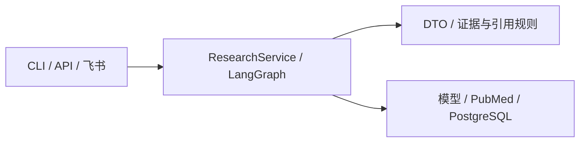

# Clinical Literature Research Agent

> 2026-10-30：科研回答已加入独立文献覆盖、证据分组、技术方向写作和架构段落召回。[第四阶段实测与当前故障](docs/openalex-stage4/acceptance.md)。API健康；机器人因启动/容器DNS问题仍待恢复，完整验收未通过。

> OpenAlex第三阶段新增合法全文获取、章节/页码定位、E5/pgvector缓存与段落召回。[技术验收](docs/openalex-stage3/acceptance.md)、[业务部署与真实API/飞书补验](docs/openalex-stage3/deployment/acceptance.md)、[运行前提](docs/openalex-stage3/usage.md)。业务库已迁移、新镜像已部署；科研质量和医学签署仍有缺口，飞书实收已确认但发送ack为unknown。

> 2026-10-29 科研检索改造：生产在线发现已切换为 OpenAlex；历史 PubMed 离线能力与验收记录保留。[新配置与用法](docs/openalex-stage2/usage.md)、[本轮验收与未验证项](docs/openalex-stage2/acceptance.md)。


面向医学科研选题，复用本地文献库与 PubMed，生成带来源、证据定位、支持度和待验证事项的调研分析及报告。

已实现离线 PDF/XML 入库、本地向量/关键词/RRF 检索、在线 PubMed、PICO、证据分析、六角色 LangGraph 有界反馈、引用核验、版本发布与知识维护。CLI、FastAPI 和飞书复用研究服务。Phase 9 已交付离线评价核心，真实模型、医学审查与服务负载验收仍有缺口；实现不等于医学质量通过。见 [当前状态](docs/development-plan.md)。

技术栈：Python 3.12、Pydantic、LangGraph/LangChain、PostgreSQL/pgvector、SQLAlchemy/Alembic、E5、FastAPI、Redis、飞书官方 SDK；版本以 pyproject.toml / uv.lock 为准。



## 安装与配置

PowerShell，在项目根目录，先准备 Python 3.12 与 uv：

```powershell
uv sync --frozen --all-extras
Copy-Item .env.example .env
.venv/Scripts/python.exe -m clinical_agent --help
.venv/Scripts/python.exe -m clinical_agent doctor
```

已有 `.env` 时保留并对照示例补充；配置数据库、受控文献/快照目录、已有固定模型目录和通用 `LLM_API_KEY`、`LLM_BASE_URL`、`LLM_MODEL`。doctor 仅检查基础工程环境。数据库迁移须由操作者显式执行。完整说明见 [运行与部署](docs/guides/README.md)。

## 最小业务入口

```powershell
.venv/Scripts/clinical-agent.exe ask --report --question "科研想法" --model-dir "<已有模型目录>"
.venv/Scripts/python.exe -m uvicorn clinical_agent.api:create_app --factory --host 127.0.0.1 --port 8000
.venv/Scripts/clinical-feishu.exe --help
```

业务命令需要相应模型、数据库和凭据。飞书启动及订阅配置见 [飞书指南](docs/feishu-runtime.md)；API 的 `/v1/reports`、`/v1/analyses` 等契约见 [API 指南](docs/api.md)，导入和检索参数见 [CLI 指南](docs/cli.md)。

## 目录与测试

- `src/clinical_agent/domain`：DTO、证据、引用、排序与版本规则。
- `src/clinical_agent/application`：用例、工作流状态与六角色协作。
- `src/clinical_agent/adapters`：外部系统实现；`src/feishu`：独立消息入口。
- `tests/unit`、`tests/integration`：离线、集成与显式外部验收。
- `alembic`：迁移历史；`scripts`：显式维护与评价；`evaluation`：冻结数据和原始结果。

```powershell
.venv/Scripts/python.exe -I -m pytest -q
.venv/Scripts/python.exe -m ruff check src tests scripts
```

默认 pytest 排除 external/database/redis/performance；排除不等于通过。真实依赖命令及历史结果见 [测试策略](docs/testing-strategy.md)。

## 阅读入口与限制

[文档总导航](docs/README.md) · [当前架构与工作流](docs/current/architecture.md) · [状态与验收](docs/development-plan.md) · [学习主题](docs/learning/README.md) · [治理报告](docs/governance/README.md)。

来源核验不证明医学结论正确；无检索结果不表示创新。最小真实基线 fresh 报告仍为 0/2，医学指标未评价；历史测试不能套用到今天版本。原安装实验、构建命令和逐任务记录见 [整理前 README 快照](docs/archive/readme-before-governance.md)。

用户入口（CLI/API/飞书）默认来源为 `hybrid`，会检索本地及在线 PubMed；CLI/API 仅本地时显式设置 `scope=local`。本地 `mode` 默认仍为 vector，在线预算、限流和部署单实例约束不变。
