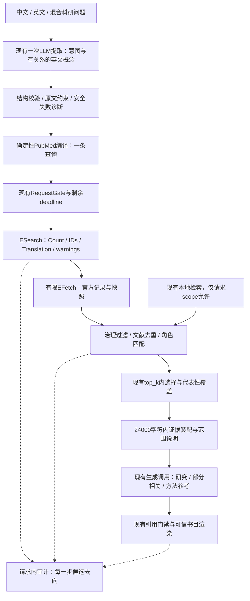

# Clinical Literature Research Agent 通用科研检索设计

> 2026-10-29 实施补记：方案A本轮最小实现见`../plan-a/acceptance.md`。新增安全阶段诊断、可选概念完全相同强制组校验、官方warning细节及自然ESearch状态判别；没有实施完整字段编译/概念关系扩展。历史英文raw响应无法恢复；尚无新增真实召回改善证据。不得将规划缺陷的合成复现当成历史英文具体根因。

日期：2026-10-29。性质：源码调查与设计，未实施。唯一推荐：**方案A，先修复可观察的规划与查询语义问题，在现有候选和调用预算内验证**。B/C为后续独立批准选项。本文不授权增加候选、请求、模型或存储预算。

## 1. 依据与当前真实架构

依据文件：`docs/research-quality-investigation.md`、`docs/specs/research-quality-phase2.md`、`docs/quality-runs/acceptance.md`、`docs/final-acceptance/acceptance.md`及`docs/final-acceptance/docker-e2e/{actual-zh.json,actual-en.json,retry-acceptance.md}`。1097项unit通过是工程基线；真实中文发现失败、英文提取失败是质量基线。旧“所有概念用OR”描述不适用于当前源码。

实际链路：`ResearchService.answer` → LangGraph plan → `IdeaPlannerAgent/PicoPlanner.plan` → `LangChainAnswerGenerator.extract` → `ExtractionDraft/QueryPlan` → `LiteratureScoutAgent` → 本地检索和/或`PubMedRetrievalService.retrieve` → `PubMedSearchRequest.query_text` → `PubMedClient.search` → ESearch/EFetch → XML解析/来源治理 → `select_candidates` → `merge_sources` → `_prepare/_generate` → `parse_draft/build_answer`。

answer仅检查引用身份和来源关联；report另有语义审核、元数据核验与反馈重入，不能混称为医学事实已验证。当前online请求不经过本地检索，本次真实结果不能验证混合来源排序。

### 1.1 本次为什么只有3篇

|环节|实际值|结论|
|---|---|---|
|ESearch Count|3|本次查询在该时点匹配3条，不是领域全部相关研究数量|
|requested_limit|10|项目最大允许20；本次没有用满10|
|返回顺序|35576953、26819533、42321976|实际有限返回集合|
|分页|retstart=0、retmax=10|Count已耗尽，无需第二页|
|EFetch成功/缺失|3 / 0|不是获取丢失|
|治理排除、top_k损失|0、0|3条全部保留|
|最终引用|3|全部引用来解释其无关性|

真实查询：

```text
("liver tumor" OR "liver neoplasm" OR "hepatic tumor" OR "hepatic neoplasm" OR "liver cancer") AND ("subregion segmentation" OR "subregion partitioning" OR "subregion division" OR "intratumoral subregion" OR "tumor subregion")
```

QueryTranslation中部分短语成为All Fields精确词串，另外一些拆成subregion词族与partition/division词族；记录有`official_search_warning`，但客户端丢弃了warninglist具体内容。返回摘要的subregion均为地理区域。可确认：查询没有稳定表达“肿瘤内部”的关系约束，生成术语与研究领域实际表述覆盖不足；泛化词扩展又放进地理噪声。更大retmax对Count=3没有收益。

已独立核验的三篇HCC研究使用habitat相关表述，分别涉及Otsu、GMM、K-means。它们与主题相关但不在本次返回集合；不能断言是哪一个查询子句单独排除了每篇，也不能把HCC或habitat写成业务特例。这说明需要区别“直译同义词”和“领域研究表达”，不证明某个词应永久加入所有查询。

NLM说明引号短语会影响ATM；主题词搜索和文本搜索覆盖不同，不能假设所有引号表达都会按期望精确匹配。应以每次QueryTranslation与warning为准，保留自由文本通道以覆盖尚未MeSH索引的记录。[PubMed官方帮助](https://pubmed.ncbi.nlm.nih.gov/help/)、[NLM短语与邻近搜索教程](https://www.nlm.nih.gov/oet/ed/pubmed/phrase/03-300.html)。本文不以这些机制解释代替具体查询的实测。

### 1.2 英文extraction_failed：确认到哪一步

真实记录显示Provider返回一次响应及usage，随后提取失败；没有合格QueryPlan，没有检索。`PicoPlanner.plan`依次执行：响应大小/时间检查 → 严格JSON（拒绝重复键、非JSON常量）→ `ExtractionDraft.model_validate` → 歧义/状态推导 → `StructuredQuestion`校验 → `QueryPlan`原文span、映射引用和分类一致性校验。任何非超时异常最终统一为`extraction_failed`且`from None`隐藏原因。

生成适配器还会拒绝finish_reason异常、工具调用和非字符串输出；仅凭usage不能证明它已经返回了合格JSON。验收包装仅保存成功计划，未保存失败文本。因此**不能确认英文错误是span偏移、字段类型、映射还是适配器拒绝**，不得据此直接放宽校验。

设计：保留外部错误码兼容，增加内部阶段码（provider_envelope/json/schema/span/mapping/status）、安全字段路径、错误类型、schema版本、输入长度和响应hash。默认不存敏感原文；受控诊断可保存有期限、访问隔离、大小受限的原始响应到现有审计文件。不得记录Authorization或环境变量。已有失败无法追溯恢复，下一次授权真实验证应一次采集齐全。

若确认是span错误，可做确定性修复：原文引句唯一出现时由程序计算索引；多次出现、缺失或否定范围不清时继续拒绝，不能模糊匹配或更改原文。此修复须先有真实脱敏失败fixture，当前只列条件性任务。

### 1.3 候选与上下文的现有局限

`select_candidates`按各concept_group在标题+摘要中的正则词面命中数选文献，再恢复原始顺序。它不判断同义关系、语义角色或直接证据；同一“地理亚区”仍可能命中。文献多样性优先后会用同文片段补位，但没有验证片段互补性。

`merge_sources`先以本地半额顺序构建pool，再选候选，末尾仍按来源/原分数排序；`RetrievalResult.validate_hits`要求这一顺序。因此不能简单改列表顺序冒充精排完成，也不能把新相关性数值写进旧pubmed_rank/cosine字段。本地与在线分数不能直接比较。

上下文超过24000字符直接context_limit，不会按相关性截断。真实中文为14136字符，3篇全部可见；不证明20篇时也安全。QueryPlan、schema、instructions及JSON转义均占预算。字符限制不等于token限制。

## 2. 推荐整体数据流（方案A）



不增加Agent或LangGraph节点；A默认一次规划、一次生成，零自动持久化。方案B的语义排序/缓存是以后插在R前的可选端口，不应先建设空基础设施。

## 3. 统一科研理解与查询规划规则

### 3.1 计划契约（扩展现有DTO，保留旧格式读取）

在`ConceptMapping`增加概念id、明确role（对象/主题/方法/结局/设计/时间）、原文anchor、required、关系类型。英文术语区分canonical、strict_synonym、abbreviation、broader、narrower、related_method、exploratory；扩展项指向父概念及理由，模型置信度只能作审计，不当医学证据。采用固定最大组数/词数和已有输出字节限制。

原始问题及引用片段始终保留。`research_intent`控制证据价值，不再把临床`question_type=other`当作科研意图。现有两字段兼容保留；发现/方法综述/比较/设计建议可有主要意图和次要需求，不强制完整PICO。

同一次LLM提取完成语言规范化、专业表达候选及关系标注；英文输入同样规范化。纯方法问题允许无疾病组。缩写有多个合理含义时以原文上下文消歧；上下文不够时保留原缩写并标unknown，必要约束不明才澄清。

### 3.2 编译规则

1. 显式用户query最高优先，原样发送；计划只辅助解释，不能改写它。
2. 同概念严格同义项OR，必要概念组AND。上位词、下位词不得伪装为严格同义；广义疾病不能仅替换为常见亚型。亚型只能作为有关系的补充覆盖，保留原广义对象，且不默认全部枚举。
3. 相关方法词不设为必需AND；探索表达不得无约束OR到全查询顶层。只有表达同一个必要研究主题、并保留对象及“内部”等关系锚点时，才可进入该主题的受控替代支路；否则仅记录为B的后续查询候选。
4. 不再一律给词加引号。编译器只允许结构化白名单field/mode：ATM自由词、tiab文本、已验证MeSH项、邻近短语。模型不能任意生成字段语法或Boolean控制符。已验证主题词可与文本支路OR；未验证MeSH不直接当有效索引词。A不增加主题词远程查表调用。
5. 歧义词优先与必要修饰关系在同一文本/邻近表达内绑定，不能只靠“对象AND泛词”保证关系。字段或邻近距离选择必须离线fixture与小样本真实QueryTranslation验证；不用固定地理黑名单制造本例命中。
6. 否定不能粗暴转NOT：一篇同时讨论排除对象和目标对象仍可能相关。明确排他限制记录为硬约束，候选阶段检查；能安全表达时才编译排除条件。时间映射至现有PubMedOptions日期对；人群/设计只有用户明确要求才硬过滤，避免新文献索引延迟导致遗漏。无法安全表达时显式说明，不悄悄丢弃。
7. 旧terms无关系时继续显式降级，保留未用词及原因；不恢复全局OR，也不宣称降级已具备中文召回能力。

QueryTranslation是查询如何执行的证据；检测到短语未找到、意外词拆分或非预期字段时记planning_warning。A不自动重试，必须在答案中限定检索有效范围。warning具体结构有限保存并脱敏，不能只剩official_search_warning。

## 4. 不同意图的检索与停止规则

|问题类型|必要概念|可选拓展及代表性|停止/不足|
|---|---|---|---|
|疾病原始研究发现|对象+主题，方法仅显式要求时必要|原始研究、不同方法与验证队列；综述作线索|已有代表性直接证据可回答，不以数量凑满|
|探索研究|清楚的研究主题，未必疾病|允许跨方向，标注关系与假设|仅有词面噪声时承认未发现，不无限翻页|
|纯方法综述|方法/任务/适用条件|跨器官方法是主要证据，不降为次等|覆盖主要方法差异而非固定疾病|
|两方法/治疗比较|共同对象/任务+比较双方|区分头对头和独立研究，不能强制每篇含双方|缺少可比性明确声明；B才考虑分支查询|
|罕见病/稀少证据|病种身份及关键主题|B可放松可选方法/结局或借鉴上位研究，保留间接标签|Count小且无直接证据时扩分页无用|
|跨疾病借鉴|任务/方法及明确目标用途|来源疾病单独报告，迁移有效性未证实|不把算法相似说成目标疾病验证|

A仅一条查询。B可最多一次预先规划的修复/拓展，触发条件为低相关性、覆盖缺口或明确query warning，且存在不同的有效查询意图；单纯Count大不触发。任何拓展不得删除硬约束，除非原问题本来允许方法借鉴。停止条件：deadline不足、共享尝试预算不足、去重后新相关文献增益低、关键维度已覆盖、检索错误或来源政策不允许。阈值在开发集确定、独立集冻结评估；此处不捏造已验证阈值。

## 5. 候选架构比较：如何处理20、50、100条

以下“候选A–E”与三种产品方案A/B/C不同。

|候选架构|适用情况|收益和局限|
|---|---|---|
|候选A：PubMed排序+有限摘要|聚焦且领域术语稳定的发现问题|成本最低，排名依赖和尾部漏检仍在|
|候选B：批量获取+词面排序|必要概念/同义组明确|解释性强，不能分辨同词异义，无法补回未召回研究|
|候选C：请求内Embedding|表达差异大但池内已有相关文献|无需入库；语义近不等于对象/方法直接匹配|
|候选D：词面+Embedding+可选精排|噪声多、需要对象和主题同时匹配|先保留不同通道候选再联合判定；独立LLM精排需增加调用预算|
|候选E：持久向量索引|反复跨问题复用、已获治理准入的文献|摊薄成本，但版本/撤稿/隔离和存储成本最高，不能解决首次查询术语缺口|

20篇通常适合明确问题的首屏发现，不是检全保证。Count远大于20且首屏已有一定直接证据、但代表性维度缺失时，50/100可能有意义；应看新增页面的相关收益，而不是Count阈值自动扩容。没有相关概念、Count=3、首屏全部同词异义时，应修正语义计划，扩大池通常无效。长尾高相关研究只能通过更合适查询、后续分页或不同检索支路进入候选；池内重排不能发现未获取文献。

避免只保留一个通道topN：B可保留PubMed前列、词面前列、语义前列的去重并集，在相同候选总预算内选取；审计每通道排名。语义值与本地vector、PubMed位置不相加。可用固定排序融合或按角色匹配分层；RRF只解决排名组合，不证明医学相关性。

当前PubMedClient每10条一页ESearch/一批EFetch，成功调用估算`2*ceil(N/10)`：10→2，20→4，50→10，100→20，后两者已超过单search最多8次尝试，重试还会占名额。不能仅改max_results。候选扩大须同时审视DTO上限、结果字节限额、分页一致性及共享deadline，或另行批准批量策略调整。[NCBI E-utilities官方入口](https://www.ncbi.nlm.nih.gov/books/NBK25501/)；NBK25499页面本轮遇到访问验证，本文数值以当前源码为依据，不以远程接口最大值当项目许可。

## 6. A/B/C三种方案与唯一推荐

|维度|方案A：最小改进（推荐）|方案B：平衡|方案C：增强|
|---|---|---|---|
|计划/检索|有关系概念、确定性字段编译、一次查询|A+至多一次有条件拓展；候选扩容另批|多支路候选管理和更新任务|
|重排|角色词面匹配、文献多样性；未知保留|请求内E5语义+词面融合|B+可选模型精排/代表研究覆盖|
|缓存|不新增服务，使用已有审计快照回放|有界文献/embedding缓存；查询缓存可选|治理后热点文献进入现有向量索引|
|预期收益|减少翻译错位和查询语义漂移|提高池内语义召回、重复请求效率|重复主题持续覆盖与复杂问题精度|
|漏检风险|单查询/20上限，专业表达仍可能漏|拓展方向错误或池外长尾仍漏|本地库偏差、陈旧记录仍漏|
|LLM成本|仍一次提取+一次生成，prompt/schema须瘦身|默认同A；独立精排不默认启用|若启用精排会增加token/调用，须批准|
|Embedding|不新增在线向量计算|一查询向量+候选片段批量CPU|缓存未命中计算+索引维护|
|HTTP|默认10、允许最多20；2–4次成功调用示例|共享请求账本；50/100须增预算或改批量策略|拓展、更新、元数据核验累计计费|
|延迟|预计接近现有，需实测|加CPU编码及可能第二查询|最高且波动更大|
|存储|现有来源审计|有界缓存，非知识库|现有Postgres版本/向量数据增长|
|复杂度/测试性|低至中；编译和校验可确定性测试|中；需要性能、失效和融合标注|高；需要长期治理与跨租户验证|
|兼容性|复用所有现有核心组件|需额外接口与预算账本，但不用新引擎|需扩展现有更新流程，不必新库|

所有质量收益都是待验证预期；当前只有小型合成排序提升及真实失败记录，没有证据支持B/C投入收益。推荐A的依据是已确认失败发生在规划/查询和提取校验，扩大池或建库都不能补救Count=3。先证明A的跨疾病收益，再决定是否有必要升级B。C当前缺少热点复用数据和治理成本证据，不应先做。

## 7. 候选筛选、引用及回答的具体契约

对每篇保存对象/主题/方法匹配依据及unknown，不将标题命中等同于直接证据。高可信对象不匹配可标方法参考；无法确定时保留部分相关/unknown，禁止用“必须三组全命中”的词面硬过滤。方法综述的主价值是方法匹配，不能要求疾病一致。

A可以更清晰地区分词面角色并调整代表性选择，但不能声称确定性规则完成医学语义分类。最终现有生成调用基于正文作研究关系解释；这些解释标为模型判断并带原文引用。将不相关文献保留为审计，不强制正文逐篇介绍噪声。单纯“无直接证据”的回答状态与非空hits应区分，不能因有三条噪声就当科研问题已充分回答。

每个PMID保留事件序列：ESearch返回 → fetched/missing → governance/source排除 → eligible → selected/not_selected → cited/not_cited；多次查询需query_id区分。未返回的指定PMID只能说not_in_returned_set；未查完整池或索引解释不足时匹配状态unknown。候选审计同时覆盖本地document/chunk与online PMID，避免当前在线单字典漏本地状态。

PMID优先去重，DOI规范化用于辅助关联；同PMID不同hash是版本冲突，不能静默覆盖；题名相似不能强合并。挑选代表研究时考虑任务、方法、研究对象、队列独立性及研究设计，研究质量与主题相关性分开。文章若有多个互补片段，先给其他高价值文献名额，再补有用片段，避免同文占满。

可信来源保持原XML/hash/PMID/正文位置。Embedding文本可以拼接标题与截取正文用于排序，**不能替换证据原文或产生伪造offset**。选中记录回到原始EvidenceHit供生成与引用。

24000字符内先扣除系统指令/schema/精简计划/范围/书目预算，再按代表性装入完整摘要或有精确offset的完整来源段；不截断数字或统计句。必须保留至少可回答部分的正文，记录未装入原因。无法安全容纳时继续返回context_limit/不足，不扩大上限。默认正文用编号与可信书目，UUID/hash保留结构化审计；不让生成模型自行填PMID。

## 8. 缓存与是否入库

**A不要求在线论文自动入库。** 本地已有768维multilingual-e5-base、PostgreSQL/pgvector、FTS/RRF和版本/治理流程，足够承接后续实验，不需要Qdrant或新数据库。用户旧.env的PubMedBERT设置不是当前实际embedding契约。

|层|键与用途|失效/建议起点（待批准测试）|
|---|---|---|
|查询缓存|编译query+日期字段/范围+sort+分页+计划版本+访问scope；存Count/ID/translation|一般1小时，零命中5分钟；要求最新时绕过。保留检索时间，不冒充本次实时查询|
|文献缓存|PMID+来源hash/版本，标题/摘要/出版信息|内容可复用，元数据/撤稿状态单独检查；一般24小时复核，治理失效立即阻断|
|Embedding缓存|内容hash+模型revision+维度+tokenizer+前缀+切片版本|由内容/模型变化驱动失效，不仅靠TTL；模型更换不得混用旧向量|
|持久向量索引|经批准摄取的文献版本和证据块|走现有导入、发布、撤稿、更正与重建流程，非自动缓存升级|

TTL只是保守试验参数，没有实测最优证据。B首选有界单进程LRU（已有Python能力），明确进程重启清空、跨worker不共享；不为了缓存先建表或引入服务。若需要磁盘缓存，使用现有受控快照目录和manifest方案，先批准容量/隔离/删除策略，不能把治理表塞成通用缓存。多实例共享缓存是独立设计，不暗中借用飞书Redis。

是否持久化应结合独立用户/问题复用、摘要引用频率、获取成本、治理许可及内容价值；单一用户重复刷新不能把全部结果升级入库。不同问题可复用同一PMID内容和向量，但相似度及directness必须重新按问题评估。冷门一次查询适合临时排序，热点重复文献才可能摊薄存储成本。

PMID缓存不保存API Key。敏感研究问题的缓存键也可能泄露主题，须用命名空间/租户隔离和访问控制，不能只认为hash匿名。摘要与全文版权权限分开，不能因为PubMed可访问就默认可长期公开全文；来源许可未知时不扩展持久化。已有`OnlineUpdateService.run`要求窗口完整，发现truncated会返回window_incomplete且不前移cursor，不能把不完整科研搜索结果直接送入此入口并伪称完整更新。

## 9. 预算与内存估算

现有ResearchLimits总90秒、generation60秒、context24000字符；PicoPlanner最多20秒，PubMed search最多30秒且受剩余deadline限制，单次最多8次HTTP尝试。它们不是可相加的各自独立时间额度。B/C需请求级账本累计search重试、反馈Scout、report元数据核验；外层截止时刻不变。

现有embedding每批8、最大128块、512 tokens/块、768维；接口是embed_query和embed_chunks(ChunkingResult)，不是任意长摘要列表。B应复用现有分块/前缀/锁，或增加窄的临时打分端口，不能绕过长度校验。100篇长摘要可能超过128块。句段级编码后文献聚合应限制单篇块数，避免长摘要因max分数占优；聚合方法需实测。

float32向量裸大小N×768×4：20篇单向量约60KiB、100篇约300KiB；Python list/对象、tokenizer与模型常驻内存远大于此。不能据此声称总内存很小；真实Docker加载现有模型已是主要资源成本。CPU延迟、缓存命中率和实际费用未知，必须测。LLM只接收最终top_k及预算内段落，不接收全部50/100篇。真实基线3次调用9912 tokens仅代表本次两题（英文失败），不能当每问题平均费用。

## 10. 必须触及的现有接口与文件（实施清单，不是本轮修改）

|位置|A需要的改变|兼容/测试要点|
|---|---|---|
|domain/pico.py：ConceptMapping/ExtractionDraft/QueryPlan/PICO_INSTRUCTIONS|关系类型、约束与编译模式；版本迁移|旧字段默认兼容；有组/无组降级可追踪|
|application/pico.py：PicoPlanner.plan|阶段诊断；验证关系与硬约束|不增加LLM重试，外部错误码兼容；span修复仅真实复现后|
|adapters/langchain_generation.py：extract/_invoke|有界诊断响应与精简schema；保留usage|敏感内容隔离；Provider envelope失败与schema失败分开|
|domain/pubmed.py：PubMedSearchRequest.query_text/planning_warnings|结构化字段编译和语法白名单|显式query不改；不要全局替换OR或去掉所有引号|
|adapters/pubmed_online.py：search|保留有界官方warning细节及querytranslation|不添搜索轮次、不增加返回上限；解析失败仍受原门禁|
|application/pubmed.py：select_candidates/retrieve/merge_sources|角色依据、代表文献及本地去向|不跨分数比较，不丢原始正文；先测是否有收益|
|domain/retrieval.py：EvidenceHit/RetrievalResult|选择依据/呈现顺序单独字段|保留原rank/score语义，不能粗暴移除稳定排序校验|
|application/research.py：_prepare|按真实序列化长度装配证据|完整段落、offset、selected与included区别|
|domain/research.py及domain/citations.py|不足状态/证据关系与可信引用表达|非空候选不等于问题已回答；门禁不放宽|
|domain/report.py：render_report|结构化科研正文和可选审计|避免靠字符串前缀过滤误删科研内容；回归标题/引用|
|tests/unit、tests/integration、evaluation|真实失败快照、独立标注与指标|不凭提示词字符串断言医学准确性|

B另需embedder临时打分端口、Scout/WorkflowState请求级账本、SearchProvenance多查询事件、缓存端口及运行时注入；C复用application/online_updates.py、adapters/postgres/online_publication.py及既有版本/治理，不直接在answer写库。A不应预建B/C接口全集。

## 11. 可执行评测集与指标

冻结24个语义案例：8疾病+方法发现、4领域探索、4纯方法综述、3比较、3稀少证据、2跨疾病借鉴；每例中文/英文配对，另选8例混合语言/缩写变体，总56输入。疾病至少覆盖肿瘤、心血管、神经、免疫和罕见病。示例：哮喘呼出气、帕金森步态、心衰预测、多发性硬化影像、罕见代谢病诊断；方法包括批次校正、空间去卷积、生存分析、因果推断。每类均含非完整PICO。

开发16个语义案例、独立8个；按疾病与方法族拆分，不能把同题中英文分到两侧泄漏。至少4个案例包含同词异义、非必要影像词、明确排除或日期限制。肝肿瘤本例进入开发回归，三个已知PMID不能再算完全未见独立集。

每例标注必要概念、可选概念、扩展关系、意图、相关文献集合与正文依据；真实文献必须保留官方快照/检索日期，合成fixture单独目录明确标synthetic。参考集合来自独立人工检索及文献核对，不依赖被测算法生成；双人医学/检索复核与分歧记录可提高可靠性，未完成不得标医学gold。

|指标|定义与边界|
|---|---|
|概念准确性|必要概念保留、错误收窄/放宽、optional误加、跨语言等价；映射正确不能只看英文字符|
|ESearch覆盖|参考相关PMID进入返回ID的比例；匹配Count、返回上限另报；参考集不完整，不称全库recall|
|获取完整度|成功EFetch/返回ID，区分缺摘要和治理排除|
|池内recall@k/precision@k|去重文献为单位；分母仅已获取合格池的相关文献；相关分母0报NA|
|发现能力|有至少一个直接研究的问题比例、代表方法覆盖；纯方法问题用方法相关标签|
|回答|原文支持claim比例、无依据数字/方法、跨疾病误归属、代表研究覆盖、有限检索绝对否定|
|成本|workflow内HTTP尝试、LLM次数/usage、embedding块数、冷/热延迟P50/P95、context大小、缓存各层命中|

离线三层：编译/校验单测 → 固定ESearch/EFetch/生成响应集成 → 真实来源快照与人工标签回放。真实验收单独授权小批（先6个语义案例中英配对），每输入一次，不反复调prompt；报告版本、时点、候选重合及差异。价格用Provider实际用量和当期账单，本文不估算货币数。

预注册验收：所有既有门禁/预算测试通过；独立集不得新增关键约束丢失、医学结果编造或跨疾病误归属；发现覆盖与precision分别报告配对差异，不能用平均值掩盖某类退化。给出样本分子分母及置信区间；小样本只认方向证据。医学错误零容忍作为发布门槛，不意味着观察到零例即可证明总体错误率零。

## 12. 分阶段实施与交给Sol的任务

**任务0 / SPEC与基线**：读取本文和真实JSON；对拟修改文件保存副本+SHA256，保存工作区差异而非HEAD。冻结fixture、开发/独立集合、指标和预算账本。禁止读取/输出密钥，禁止重新执行已有付费问题来碰运气。

**任务1 / 提取可观测性**：RED构造schema/span/原文映射/Provider envelope等不同失败，断言安全诊断分流且外部码保持兼容。GREEN只增加诊断与严格验证；不得默认接受非法span。回归pico、research、API/CLI错误契约；获得授权后一次捕获真实英文失败，才决定确定性修复。提交失败raw fixture须脱敏且不冒充历史原响应。

**任务2 / 概念关系与编译**：先以固定计划写RED覆盖中英、缩写、上下位、否定、时间、纯方法及显式query。实现关系DTO和确定性编译，记录版本/降级；不写疾病词典或PMID特例。冻结查询后做低成本真实QueryTranslation检查，不能以Mock翻译宣称PubMed行为一致。

**任务3 / 候选与上下文**：先写固定真实摘要回放RED，复现地理噪声、跨疾病参考、同文多块和超限。只实施有测量收益的选择依据与装配；不预先宣称自动direct分类。保持top_k、原排序契约和引用原文位置。回归全部来源/治理/引用及相关报告测试，再执行完整unit一次。

**任务4 / 真实质量验收**：在已有固定Compose项目中复用容器，记录镜像/源码hash、模型版本、两次问题间容器身份、全部请求/usage；只跑预先批准的评测批次。人工核对摘要支持，报告查询召回与池内选择损失，失败不放宽断言、不强插PMID。数据与结论写evaluation，默认正文仅精简结果。

**任务5 / B/C决策**：只有A过关且真实错误分析表明瓶颈转移到尾部候选/语义排序/重复成本，再做有界Embedding或缓存消融。先证明增量收益，后批准扩候选和持久化；没有收益保留A。

## 13. 授权边界与待决项

本轮批准范围仅本文调查和设计，所有生产实现、付费评测均未执行。A未来需明确开发授权，但设计遵守既有架构与预算；即便更长schema也须量测不挤占输出/上下文。诊断原响应保存需隐私策略和有限留存。

B的额外搜索轮次、50/100候选、更大HTTP总预算、跨进程缓存、语义重排CPU占用，C的持久索引增长/自动更新及独立LLM精排均需分别批准。已有模块可用不等于已经授权自动入库。无需新Agent、新数据库或新模型；若现有E5性能不足，应先报告证据，不能自行替换。

仍未知：真实英文失败具体字段、推荐编译的真实跨疾病收益、临时Embedding相对词面的增益、缓存命中率、持续维护成本。本文提供可执行验证路径，不以架构复杂度代替质量证据。
