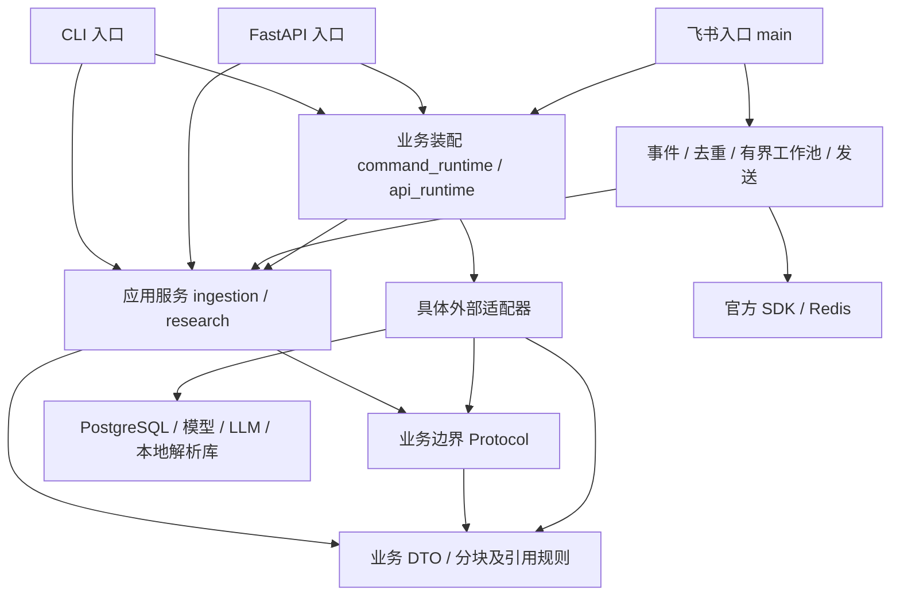
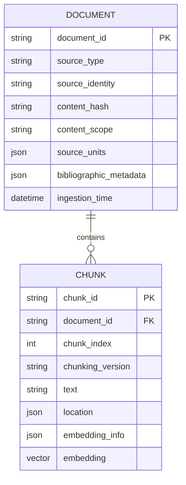
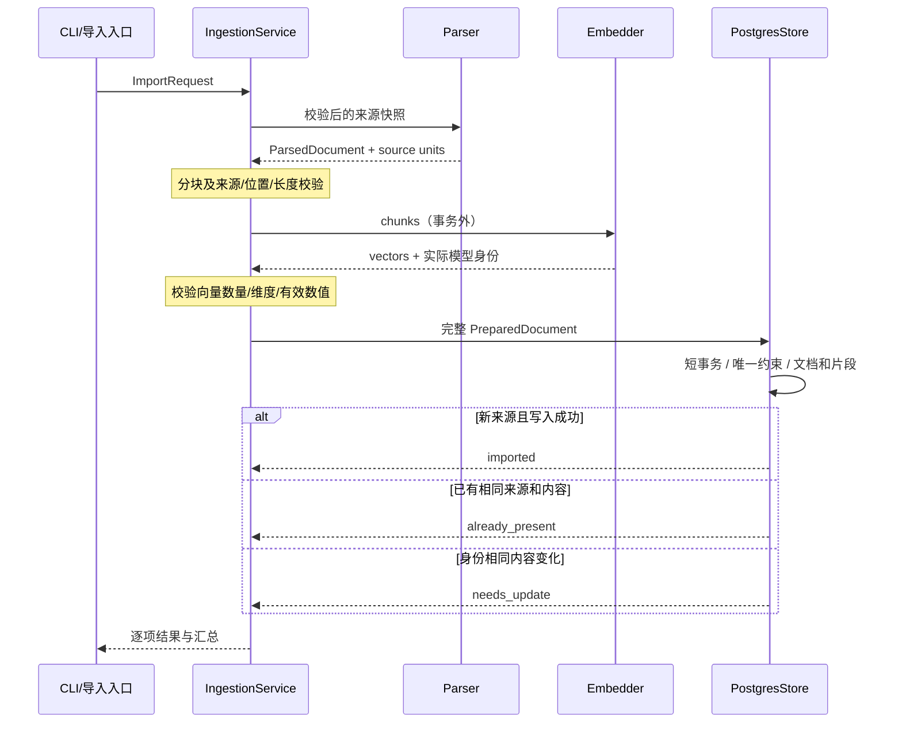
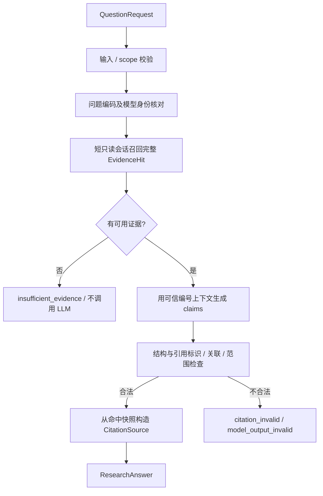
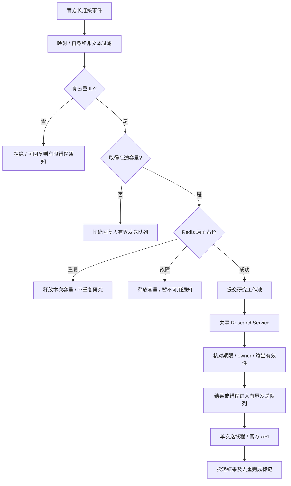

> 历史快照：2026-10-28 整理前内容，原结论仅代表记录时点。当前事实见 [文档导航](../README.md)。仅重定位链接，未改写验收结论。

# Clinical Literature Research Agent 架构设计

## Phase 5 已实施边界（2026-10-28）

复用既有PostgresRetriever/来源hydration和RetrievalService，domain/hybrid.py定义固定RRF排名规则。p501_0003为chunks增加simple生成列/GIN；没有第二套搜索引擎、重复文献表或新依赖。两路有限候选和最终来源验证位于同一只读可重复读事务，总期限和语句预算保留。

mode默认vector，可显式选择keyword/hybrid；scope仍表示local/online/hybrid来源。ASCII关键词和完整出版日过滤语义明确，通道失败不降级。在线不参加本地RRF；本地不同chunk在后续来源合并时保留，跨来源PMID去重继续成立。完成边界见[Phase5记录](../phase5-acceptance.md)，不提前实现Phase6质量分析。

## Phase 4 已实施边界（2026-10-28）

`adapters/pubmed_online.py` 使用HTTPX访问官方E-utilities，`adapters/pubmed_xml.py`复用已有安全映射，`domain/pubmed.py`管理记录/来源快照/检索追溯；`application/pubmed.py`转换真实摘要为未编码EvidenceChunk，并负责来源名额合并。现有ResearchService按scope调度，生成/领域引用门禁/CLI/API/飞书仍共用。

SourceMetadata 的 source_uri 增加真实HTTPS PubMed来源，离线文件规则保留；pubmed_rank命中不要求或伪造embedding。local仍严格验证固定E5身份/分数/过滤。hybrid只合并来源，不比较不同通道分数；日期只过滤PubMed分支。在线记录本次持有规范化XML快照，不自动写库或引入新表。全进程请求门不代表跨进程/IP全局协调，部署限一个启用在线检索实例。

实际范围与跨阶段待验收项见 [Phase 4 记录](../phase4-acceptance.md)。下文旧设计/历史验收按当时范围阅读。

## 后续扩展顺序（2026-10-28）

本轮仅调整规划，不改变现有模块与运行流程。后续按 **Phase 3 → 4 → 5 → 6 → 7** 扩展现有 ResearchService/LangGraph、LangChain 通用模型调用、文献与证据 DTO、PostgreSQL/pgvector、XML 解析与领域引用门禁。Phase 3–7 不依赖 Phase 2 TaskRecord/receipt；继续复用现有 CLI/API/飞书及有界工作池，避免新增并行架构。

Phase 2、8、9 及非核心性能/健壮性/复杂异常处理留 Phase 7 后收尾；必要超时、配额限制、错误分类、事务一致性和引用追溯始终保留。每阶段先明确 SPEC 与验收测试，阶段末集中测试/回归/验收，学习文档仍须交付；未运行不标通过。历史验收不改写，详见[当前开发计划](../development-plan.md)。第 11 节按编号罗列职责，不代表执行顺序。

## 当前模型接入方式（2026-10-27 修订）

LangGraph 负责 Agent 状态、节点与分支编排；LangChain 负责标准消息和模型调用。`adapters/llm.py` 中的 `LLMSettings` / `open_llm` 通过通用 `ChatOpenAI` 装配模型，`LangChainAnswerGenerator` 使用 `BaseChatModel.invoke`，领域层独立核验引用。DeepSeek 仅是配置示例中的 API 服务商，不存在供应商专属模块、类型、依赖或业务分支。

显式设置 `LLM_BASE_URL`、`LLM_API_KEY`、`LLM_MODEL`，三项均必填；可选 `LLM_MAX_TOKENS` 默认 1500。旧供应商变量不再读取。URL 可含 `/v1` 或网关路径前缀；远端使用 HTTPS，本地回环可使用 HTTP；禁止 URL 内嵌凭据、查询参数或 fragment。应用不自动读取 `.env`。部署时 API 和飞书共享 Compose 的三项通用模型配置。

调用关系：入口 → `ResearchService` / LangGraph → `AnswerGenerator` → `LangChainAnswerGenerator` → LangChain `ChatOpenAI` → 配置的模型 API URL。服务需兼容 OpenAI Chat Completions 的标准消息、JSON mode、`max_tokens` 与非流式响应；不使用供应商推理扩展字段。HTTPX 仅负责受限传输，保留超时、响应上限、无重试及资源关闭。

直接依赖固定为 `langchain-core==1.7.0` 与 `langchain-openai==1.7.3`。[调整 SPEC](../specs/tasks/langchain-model-boundary.md)。以下按任务日期保留的直连协议与真实调用结果属于迁移前历史证据，不代表新实现已执行在线验收。


版本：0.2；更新：2026-10-27（Asia/Shanghai）；原设计任务：P0-05。

状态：Phase0与P1-01–15已按各任务范围验收；P1-16已实现第五模块main.py、官方SDK长连接适配、鉴权/共享资源生命周期与API/feishu_bot/Redis的Compose入口。离线与真实SDK收发通过，共享镜像/隔离Compose启动关闭已验收，边界按开发计划单列，Phase1未整体验收。当前任务与剩余规划见[开发计划](../development-plan.md#phase-1-任务进度)。

下列P1更新段落是各任务交付时的历史快照，“尚未/待实现”只针对该时点。正文的Phase 0目录图与未来阶段/飞书流程图仍是相应范围的设计，不代表所有图中模块均已落地。实际业务装配位于command_runtime.py、api_runtime.py和feishu/main.py；bootstrap.py只提供本地配置、日志及关联上下文。

P1-01 更新：已新增 domain/__init__.py 与 domain/models.py，仅实现六个文献/证据相关 DTO；应用服务、解析器、数据库、问答及飞书仍是后续设计目标。DTO 详细契约见 [P1-01 SPEC](../specs/tasks/p1-01-literature-contracts.md)。

P1-02 更新：已增加 PdfSourceUnit/ParsedPdf 与 adapters/pdf.py，执行受控本地文件的 pypdf 文本层提取和页内切片核验。应用服务、XML、分块、数据库、问答和飞书仍未实现。当前 PDF 返回 ParsedPdf，没有提前泛化解析器 Protocol；文件快照/来源单元的持久化仍待入库任务。[详细边界](../specs/tasks/p1-02-pdf-parsing.md)。

P1-03 更新：adapters/pubmed_xml.py 安全读取本地 PubmedArticleSet，domain 增加四个摘要/条目/批次 DTO。逐条映射元数据与摘要节，拒绝状态不等于入库失败/成功；未泛化解析器框架。分块/存储/工作流和在线查询仍未实现。[详细边界](../specs/tasks/p1-03-pubmed-xml.md)。

P1-04 更新：domain/chunking.py 接收 ParsedPdf/ParsedPubmedArticle、显式 tokenizer callable/身份/预算和 ID 工厂，返回含定位证据、计数及配置的 ChunkingResult。逐码点候选探测，首次超预算收块；不假设计数单调，不跨页/摘要节，保留来源切片并调用解析 DTO 回建核验。计数包含 prefix 和特殊 token 的责任在 tokenizer 适配边界；真实模型加载、编码一致性与维度验收尚未实现。[详细边界](../specs/tasks/p1-04-source-chunking.md)。

P1-05 更新：domain/embedding.py 提供与框架无关的向量 DTO；adapters/embedding.py 显式校验本地快照并延迟加载 sentence-transformers，向 chunk_source 提供实际 tokenizer 和固定身份。文档与查询前缀、512 token 门禁、重算计数、批量结果形状/有限性/范数检查均位于适配器；不增加应用服务/数据库抽象。实例复用、单实例锁串行、有界批次和协作预算；没有后台线程池或硬资源隔离。真实 E5 CPU 冒烟已通过，存储及入口装配仍待实现。[SPEC](../specs/tasks/p1-05-local-embedding.md)、[本地操作](../local-embedding.md)。

P1-06 更新：adapters/postgres/{models,connection}.py及包初始化已实现；Alembic初始迁移独立于当前ORM，显式创建/复用vector扩展，downgrade保留扩展。documents保存书目/原文/canonical来源单元，chunks保存定位、固定E5身份和vector(768)，通过组合来源外键和唯一约束保护结构。generated来源身份为PDF hash / PubMed PMID；删除文献级联删除片段。实际迁移/约束/事务验收通过；store.py、DTO映射和应用用例未实现。[SPEC](../specs/tasks/p1-06-postgres-schema.md)、[数据库操作](../postgres.md)。

P1-07更新：application/ingestion.py通过实际消费者协议接收reader/embedder/store，不依赖外部SDK；domain/ingestion.py定义来源/已准备文献/结果契约及稳定身份。adapters/offline.py负责受控快照和既有解析器复用；postgres/store.py负责脱离会话的映射与单文档事务。p107_0002保存解析/profile/policy元数据，legacy NULL明确拒绝伪造。来源唯一冲突采用定向DO NOTHING，借用连接显式READ COMMITTED，回读合法winner后分类；不泛化任意IntegrityError。真实链路已验收，业务入口与检索仍待实现。[SPEC](../specs/tasks/p1-07-offline-ingestion.md)、[入库说明](../offline-ingestion.md)。

P1-08更新：domain/retrieval.py定义请求/过滤、DocumentSummary、EvidenceHit和结果契约；application/retrieval.py通过两个Protocol复用既有query编码并控制预算，不依赖SQLAlchemy/模型框架。postgres/retrieval.py使用pgvector精确余弦距离，先过滤/阈值后稳定排序与limit；显式REPEATABLE READ + READ ONLY，同一快照内最多三条数据SELECT并复用P1-07 mapper核验完整来源。编码在事务外，空结果与错误分离，不新增迁移或ANN索引。真实E5查询→PG→命中回建已通过；RAG和业务入口仍未实现。[SPEC](../specs/tasks/p1-08-vector-retrieval.md)、[检索操作](../vector-retrieval.md)。

P1-09更新：domain/research.py分离模型草稿、可信引用和共享答案DTO，domain/citations.py独立检查严格JSON/引用白名单并构造实际使用来源；application/research.py构造时编译一次LangGraph，按请求建立独立状态，复用检索服务及可替换生成端口。adapters/deepseek.py使用HTTPX实现明确的单一供应商协议与客户端生命周期，不增加SDK/通用供应商框架。生成上下文无书目/本机路径字段，引用从命中深副本构造，显式关闭LangSmith追踪。没有工具/持久checkpoint/循环/自动重试；RAG单次生成和结构门禁不承担医学语义核验。[SPEC](../specs/tasks/p1-09-basic-rag.md)、[操作说明](../basic-rag.md)。

P1-10更新：cli.py保留doctor，新增ingest/ask解析、请求/结果校验和JSON输出，command_runtime.py集中延迟装配并复用已有应用服务。help不创建资源，配置先于模型；问答HTTP先于engine关闭，退出资源成功后再输出结果。无新SDK/依赖、迁移或核心业务规则。CLI与现有服务的实际E5/PG集成通过，LLM明确为HTTP替身，不声明真实付费整链路已验证。[SPEC](../specs/tasks/p1-10-cli-entrypoints.md)、[CLI用法](../cli.md)。

P1-11更新：api.py提供延迟工厂、受控ASGI请求边界和明确HTTP DTO/错误映射；api_runtime.py负责配置、共享业务装配及标准ThreadPoolExecutor的有界接纳。lifespan一次加载E5/engine/HTTP与编译图，工作线程执行同步服务，容量按实际Future完成释放，关闭等待工作后退出资源。服务器固定import_root/snapshot/model目录，HTTP只接受受控相对文件路径；保留现有核心业务与CLI。实际Uvicorn TCP/E5/PG集成已通过，LLM仍为协议替身，未恢复四节点修订。[SPEC](../specs/tasks/p1-11-fastapi.md)、[HTTP用法](../api.md)。

## 1. 任务范围与设计依据

依据 [总体 SPEC](../specs/00-project-overview.md)、[MVP SPEC](../specs/01-mvp.md)、其余 [阶段规划](../development-plan.md)、[技术选型](../tech-stack.md) 和项目“适度工程化”规则。参考仓库事实见 [源码分析](../research/reference-repository-analysis.md)，不复制其实现。

本任务输入是已有 SPEC、调研和目录现状；输出新增本文并更新开发计划，同时补齐总体 SPEC 已漏列的 needs_update 结果，与既有 MVP 规则一致，不新增业务范围。目标是确定目录、模块职责、数据边界、三条主流程和资源归属，为 P0-06 的详细任务与测试策略提供依据。文档静态检查及阅读核查是本次验收，不执行产品 TDD；后续实现仍必须保留真实 RED → GREEN → 重构/回归记录。

本次不创建目录骨架、不编写业务代码、不调整依赖、不连接外部服务，也不细化所有未来阶段参数。接口名称是设计约定，签名、限额、实际 CLI/API 路由和配置键须在所属任务 SPEC 中冻结再编码。

## 2. 总体结构与依赖方向

采用一个 Python 代码库和发行包，CLI、API、飞书是不同入口；应用服务复用，不通过内部 HTTP 相互调用。PostgreSQL 是文献和后续任务事实存储；Redis 仅承担短期去重等有限状态。API 与机器人可用两个进程部署，仍是模块化单体，不引入业务微服务。



图中箭头表示代码依赖或调用目标，不是网络拓扑。入口业务runtime负责选择和注入具体实现；应用服务不读取全局客户端。domain 不依赖 application、适配器、入口或 SDK；application 不依赖 SQLAlchemy、lark_oapi 或 HTTP 客户端实现。LangGraph 是 application/research.py 内必要工作流依赖，纯引用和文本规则不依赖它。

不建立接口基类 → 抽象仓储 → 具体仓储 → Service → Factory 多层链路。边界使用少量 typing.Protocol 或简单 callable，具体适配器可结构化满足接口，不必继承；普通业务函数直接调用。

## 3. 推荐目录：区分 Phase 0 与 MVP

### 3.1 当前目录事实

当前源码包含clinical_agent的领域DTO/应用服务/适配器、CLI与API及各自业务runtime，并包含feishu/__init__.py与events.py。实际文件以src/、tests/及[任务表](../development-plan.md#phase-1-任务进度)为准。原先“十一个源文件、十个测试文件”是P1-03时点，不能作为当前目录统计。AGENTS.md.txt、PROJECT.md.txt保留原文件名；正式锁与docs/research/dependencies/的历史研究解析结果分开。

### 3.2 Phase 0 最小工程目标

以下由 P0-07 逐任务创建，**本次只画目录**；不在 Phase 0 创建 domain、application、adapters、api 或 feishu 空壳。

```text
clinical_agent/
├── AGENTS.md.txt / PROJECT.md.txt       # 已有项目规则
├── .gitignore                         # 后续补充密钥、环境、模型、数据排除
├── .python-version                    # 经核实的项目解释器
├── .env.example                       # 无密钥的最小配置示例
├── pyproject.toml                      # 正式依赖、脚本和质量工具设置
├── uv.lock                            # 正式锁文件，与研究清单区分
├── README.md                          # 基于实际验证的安装与最小 Demo
├── docs/
│   ├── specs/00–09                    # 已有阶段 SPEC
│   ├── architecture.md                # 本文
│   ├── tech-stack.md                  # 已有技术选型
│   ├── development-plan.md            # 进度与执行证据
│   ├── testing-strategy.md            # P0-06 再创建
│   └── learning/phase-00/             # P0-08 基于真实代码创建
├── src/
│   └── clinical_agent/
│       ├── __init__.py                # 轻量包标识，无启动行为
│       ├── __main__.py                # 仅委托 CLI main
│       ├── cli.py                     # 参数、输出与退出码
│       ├── config.py                  # 显式 Settings，不在模块顶层实例化
│       ├── logging_config.py          # 最小日志装配
│       └── bootstrap.py               # 配置与资源装配入口
└── tests/
    ├── conftest.py                    # 需要时才加共享 fixture
    ├── unit/                         # 配置、日志、入口无副作用
    └── integration/                  # CLI 与装配的离线集成
```

`src` 是源码根，不是 import 名称；核心导入为 `clinical_agent.*`。当前发行名为`clinical-literature-agent`，已注册CLI脚本`clinical-agent = clinical_agent.cli:main`，模块入口为`python -m clinical_agent`；已通过实际安装入口测试。Phase 0 的 --help 与本地自检不需要数据库 URL、LLM 或飞书密钥。

bootstrap 在 Phase 0 只装配实际存在的配置/日志与本地运行上下文；不创建假的 ResearchService 或模拟“医学答案”。测试文件的具体命名和参数由 P0-06 决定，目录存在本身不算工程验收。

### 3.3 Phase 1 按需求新增的目录

以下保留P0-05的MVP目录设计，包含前述Phase 0文件；其中ports.py未独立创建，Protocol已放在实际消费者处，CLI/API实际装配模块见第4.1节，飞书仅events.py已落地。所有实际包目录具有必要__init__.py。不预建 Phase 2–9 的模块。

```text
src/
├── clinical_agent/
│   ├── api.py                         # FastAPI 工厂、生命周期与薄路由
│   ├── domain/
│   │   ├── models.py                  # 文献、片段、检索、答案 DTO
│   │   ├── chunking.py                # 按 source unit 的业务分块规则
│   │   ├── citations.py               # 标识/关联校验与可信来源构造
│   │   └── errors.py                  # 少量扁平错误码/异常，无复杂继承树
│   ├── application/
│   │   ├── ports.py                   # 真正需要替换的外部能力契约
│   │   ├── ingestion.py               # 导入用例，不直接操作 ORM
│   │   └── research.py                # 问答服务与必要 LangGraph 编排
│   └── adapters/
│       ├── pdf.py                     # pypdf 按页解析
│       ├── pubmed_xml.py              # 本地 PubMed XML 解析及字段映射
│       ├── embedding.py               # sentence-transformers / tokenizer
│       ├── llm.py                     # 届时选定的成熟模型 SDK 适配
│       └── postgres/
│           ├── models.py              # SQLAlchemy ORM，不能作为对外 DTO
│           ├── connection.py          # engine/sessionmaker 的显式构造
│           └── store.py               # 写入事务与向量检索具体实现
└── feishu/                            # 用户要求的 src/feishu/ 包
    ├── __init__.py                    # 不计入五个职责模块；保持轻量
    ├── main.py                        # SDK 长连接与全局生命周期
    ├── events.py                      # 消息映射、文本/自身/会话过滤
    ├── dedup.py                       # redis-py 原子占位与 owner 校验
    ├── worker.py                      # 有界接纳、工作池、容量释放
    └── sender.py                      # 渲染、官方消息 API、有界发送

alembic/                               # Phase 1 迁移，不在应用启动 create_all
docker-compose.yml                     # Phase 1 postgres / redis / api / feishu_bot
Dockerfile                             # Phase 1 同一代码镜像，不同入口
tests/
├── unit/                              # 纯规则及注入 Fake 的用例
├── integration/                       # 独立 PostgreSQL / Redis / 入口装配
├── external/                          # 明确前提的模型、LLM、飞书真实冒烟
└── fixtures/                          # 合成或可合法使用的 PDF/XML/证据样例
```

将 feishu 作为第二个顶层 Python 包是为了满足指定物理路径；正式打包必须显式收集 `clinical_agent` 和 `feishu`，不能只打包核心后让机器人依赖工作目录才能导入。官方 SDK 的包名仍为 lark_oapi；不用 sys.path 注入或 `from src...`。

本地文献快照、模型权重、运行报告放配置的数据目录（开发时可为 data/），忽略进 Git；测试 fixtures 单独小规模管理，不用全局 `*.json`/`*.pdf` 排除而误伤合法测试资料。最小目录不增加 utils、manager、base_repository 等无明确职责集合。

## 4. 模块契约与替换边界

### 4.1 核心职责

| 模块 | 输入 → 输出 / 责任 | 不承担的工作 |
| --- | --- | --- |
| domain/models.py | SPEC 00 的 Pydantic DTO 与局部字段约束 | 数据库会话、SDK 对象、网络请求 |
| domain/chunking.py | source units + 分块配置 + tokenizer callable → 定位完整的待编码片段 | 自写 tokenizer、PDF 底层解析、模型推理 |
| domain/citations.py | 生成 claims + 本次证据映射 → 校验结果/引用来源 | 外部全文核验、生成新 PMID/DOI、临床可靠性打分 |
| application/ingestion.py | ImportRequest → 逐项 IngestionResult | 持有整批事务、直接 SQL、调用飞书 |
| application/research.py | QuestionRequest → ResearchAnswer 或明确错误 | 字符串拼接各入口回复、模型元数据自由补全 |
| application/{ingestion,retrieval,research}.py中的Protocol | 在实际消费者处以业务DTO描述外部能力；没有独立ports.py | 框架/SDK类型透传、全功能插件注册平台 |
| adapters/* | 外部库数据/异常 → 业务 DTO/可识别错误 | 决定医学结论或绕过引用规则 |
| bootstrap.py；command_runtime.py；api_runtime.py | 分别为本地上下文、CLI业务装配和API业务装配/有界执行 | 定义临床规则、自动迁移 |
| cli.py / api.py | 入口校验/上下文 → 调用同一用例 → 输出 | 第二套 RAG 或持久化逻辑 |

### 4.2 Phase 1 所需的少量能力契约

以下为逻辑操作，实际 Python 签名在相应详细 SPEC 冻结；每个接口只覆盖当前消费者需要的能力。

| 契约 | 输入 → 输出 | 实现/测试替身 |
| --- | --- | --- |
| DocumentParser | 本地受控来源快照 → ParsedDocument（元数据、source units、获取范围） | PDF/XML 解析器 / 固定解析 Fake |
| Embedder | 片段批次或 query → 向量；暴露实际 tokenizer/模型身份 | sentence-transformers 适配 / 固定维度 Fake |
| DocumentWriter | PreparedDocument（已完整验证向量）→ imported/already_present/needs_update | PostgreSQL store / 原子行为 Fake |
| EvidenceRetriever | 查询向量 + 筛选/上限 → EvidenceHit 列表 | PostgreSQL 向量查询 / 固定召回 Fake |
| AnswerGenerator | 问题 + 有编号的证据文本 → GeneratedClaims | 具体成熟 SDK 适配 / 成功、异常、坏引用 Fake |

DocumentWriter 与 EvidenceRetriever 可由同一个 PostgresStore 实现，不因此加两个抽象仓储层。ParsedDocument、PreparedDocument 是用例内部 DTO，只有边界需要才新增字段；对外 LiteratureDocument 与 ORM 不混用。

AnswerGenerator 只允许返回结论文本、类别和已提供的 evidence_chunk_ids；PMID/DOI/标题/作者由可信证据构造 CitationSource。额外未知字段拒绝或显式处理，不能顺手接受模型新造元数据。生成上下文使用稳定 chunk_id 映射，graph 内部状态可以是 TypedDict，但入口/外部结果要经 DTO 校验。

SDK 客户端、数据库 Session、SQLAlchemy Model 和 LangGraph 内部对象不出现在共享对外契约中。短期消息去重是飞书边界能力，放 feishu/dedup.py，不强迫核心应用依赖 Redis；CLI/API 普通独立提问也不按文本内容被动去重。

### 4.3 允许的 import 关系

| 调用方 | 允许依赖的项目模块 | 禁止方向 |
| --- | --- | --- |
| domain | domain 内必要 DTO/纯规则 | application、adapters、bootstrap、入口、feishu |
| application | domain、application 内小范围协作 | adapters、bootstrap、cli/api、feishu |
| adapters | domain、application内实际消费者Protocol | bootstrap、cli/api、feishu |
| bootstrap | config/logging_config、domain/application/adapters | cli、api、feishu（避免装配入口循环） |
| cli/api | config、bootstrap、domain/application | 不直接构造 SQL 或自行生成答案 |
| feishu | 五模块协作、config、bootstrap、domain/application | core 反向依赖 feishu；从 events 直接写文献库 |

配置与日志工具只使用标准库及其选定依赖，不反向依赖业务模块。未来feishu/main.py组装SDK资源并复用业务服务；核心代码不反向import feishu。当前API工厂消费api_runtime提供的业务runtime，CLI消费command_runtime；bootstrap不import入口。runtime 使用普通对象/上下文管理，不构建自定义 DI 容器。

## 5. 数据、ORM 与可追溯性

### 5.1 业务语义到存储

初期只需要 documents 和 chunks 两个业务表；唯一约束、外键、内容与模型身份字段通过 Alembic 管理。详细列类型/索引/删除策略由 Phase 1 数据库任务确定，不为 Phase 8 预建版本平台。



这是逻辑示意，不是最终 ORM DDL。bibliographic_metadata 代表 title、authors、日期精度、journal、doi、pmid、source_url 等语义，关键可查询/约束字段应有明确列，不能全部扔进无契约 JSON。source_units 持久化用于回指的文本单元或定位映射；具体存储形式由数据模型任务冻结，不能仅依赖仍存在的用户原文件。

数据库内部字段由 adapter 显式映射成 DTO，返回后不依赖未关闭会话的懒加载。EvidenceHit 必须同时携带 chunk_id、document_id、location、content_scope、来源元数据、模型身份及 score_type；不能只取正文后让生成阶段重造引用。

### 5.2 位置、身份与基础幂等

- PDF 使用 1 起始页码；MVP 片段不跨页。摘要使用可定位 section/unit 标识。字符区间是规范化 source unit 文本的半开区间，规范化版本和文本保留，重建必须与 chunk.text 对应；不要用拼接后的新字符串推算原 PDF 坐标。
- 原始导入文件以受控快照计算哈希并解析同一份内容；本地来源保留快照引用和内容哈希。公开结果不暴露本机绝对路径，没有公开网址时 source_url=null，不造 DOI/链接。
- PubMed 来源身份为 source_type + PMID；PDF 来源身份基于内容快照而非文件名。相同文件多路径不会制造多个相同证据集；不同 PDF 共享文件名不冲突。跨来源同篇论文的全面归并留 Phase 8。
- 唯一约束覆盖来源身份及文档内片段序号/分块版本，查重 SQL 只是优化，不能代替并发约束。已存在同身份但内容变化返回 needs_update；该值要在 P1-01 的 IngestionResult 详细枚举中明确，不能伪装成 already_present。
- 取得快照后数据库失败可以留下未引用的本地快照，但不能提交半篇文档；不引入文件系统与数据库的分布式事务。缓存/快照清理范围在后续任务明确，不能删除用户原文件。
- 模型实际 dimension、revision、tokenizer、归一化与分块版本一致后才能查询；数据库维度由验证过的配置和迁移确定，不在业务代码任意写死 768。

### 5.3 结论到来源的链路

```text
EvidenceClaim.evidence_chunk_ids
    → 本次 EvidenceHit 映射中的 chunk_id
    → chunks.document_id + location + source unit
    → 文献快照、content_scope、真实 bibliographic metadata
    → CitationSource（只列答案实际使用的来源）
```

Phase 1 检查标识、非空关联和范围；人工样例复核支持关系。Phase 7 再增加外部身份和语义支持度核验。不能把“来源存在”“模型自评可靠”“结论得到支持”当作同一件事；检索 score 也不是医学证据等级。

## 6. 文献入库数据流



Parser/模型调用失败时不进入写事务；空文本、无块、NaN/Inf、数量不等、模型不兼容都不能让 zip 静默丢数据。单文档数据库异常回滚其文档和所有片段，释放 Session；批量逐项返回失败而不把整批挂在长事务中。

唯一约束冲突只在确认是已知去重约束且读取到合法已提交记录时转为 already_present/needs_update，不能把任意 IntegrityError 当重复成功。并发竞争的事务失败后必须 rollback，不能在失效事务内继续插入。

Phase 1 的 PubMed 导入从本地 XML 开始，全文范围只能是实际获取的摘要；该入口不触发在线搜索。所有来源类型映射和错误结果由同一用例处理，不在 CLI 中直接循环调用 ORM。

## 7. 检索、生成与引用数据流



research.py 在启动装配时编译必要 LangGraph，单次请求创建独立图状态；不每题重新加载模型/编译图，不把用户状态放模块全局变量。节点消费注入的能力和业务 DTO；纯校验函数仍可单独测试。数据库查询返回后立即关闭会话，LLM 执行期间不持有事务。

空召回/成功检索但不足，与模型或数据库错误分开：数据库不可用为 retrieval_failed/upstream_unavailable，不能伪装成空 hits；LLM 超时为生成错误，不返回无证据结论。模型输出的外部字段不参与可信元数据渲染。

原文只作为证据数据传给模型，不能赋予工具权限；MVP 不向回答生成节点开放任意工具执行。实际上下文长度、证据可用性规则、消息/回答长度预算由 Phase 1 任务明确；达到长度上限要保留结论与引用映射，不盲目截断引用列表。复杂质量/冲突评价不进入该 MVP 图。

## 8. 飞书入口、并发与去重数据流

P1-12已实现`src/feishu/events.py`及轻量包入口：解码字典→消息DTO、纯文本/自身/会话过滤和去重身份选择。[契约说明](../feishu-events.md)。P1-13已实现独立的src/feishu/dedup.py，使用Redis单键Lua与服务端时间提供原子占位、owner校验、有限续租及完成/释放；见[去重说明](../feishu-dedup.md)。P1-14已实现worker.py：标准线程池有界接纳、去重联动、共享ResearchService及非阻塞发送交接端口；详见[分派说明](../feishu-worker.md)。默认90秒研究/15秒发送预留及5秒裕量要求显式至少110秒租期，不创建续租调度线程。P1-15已实现sender.py：完整来源/局限渲染、双层UTF-8字节预算、单线程有界队列、owner/deadline复查与sent/failed/unknown租约处理；[发送说明](../feishu-sender.md)。官方消息REST适配借用已有httpx及有期限token提供者，离线协议测试通过；main.py、SDK对象适配/长连接、生产鉴权/生命周期及真实租户收发留P1-16。

### 8.1 五个模块的职责

| 文件 | 责任 | 直接使用的外部对象 |
| --- | --- | --- |
| src/feishu/main.py | 读取显式配置、构造官方 SDK 长连接/事件分发器、注入核心服务、统一启动关闭 | SDK Client / 官方 WebSocket Client |
| src/feishu/events.py | SDK 事件 → MessageEnvelope；文本解析、自身/会话策略过滤；不识别为有效事件就忽略/拒绝 | SDK 类型仅在映射边界出现 |
| src/feishu/dedup.py | 以 app_id + message_id（优先）或 event_id 原子占位、owner 校验、续期/完成/释放 | redis-py，不自写连接池 |
| src/feishu/worker.py | 标准库有界接纳及 ThreadPoolExecutor；调用 ResearchService，提交结果至 sender，finally 回收 | Future / Semaphore；不直接调用模型 SDK |
| src/feishu/sender.py | 共享结果渲染为飞书文本，官方 API 发送，记录 sent/failed/unknown；有限发送队列和单个发送线程避免阻塞 SDK 回调 | 官方消息 API；不含 RAG 业务 |

__init__.py 不算职责模块。队列与线程是标准库能力，不是新建消息平台；研究池和发送队列均有明确上限，sender 的单线程也使 SDK 发送客户端不被多个研究线程任意共享。发送队列只暂存内存，没有持久化可靠投递承诺。

### 8.2 处理顺序



图省略的所有异常出口都要回收本次实际取得的资源。线程池提交失败时释放容量及属于自己的占位；入池成功后由工作函数/完成回调负责一次性释放，不能入口和工作线程各释放一次。未获得容量不创建 processing 占位，避免把满载拒绝误记为已完成。

去重租期须覆盖已冻结的处理/发送预算并按 owner 有限续期；sender 出队实际发送研究结果前再次复查所有权与总期限，不能只依赖工作线程入队前的检查，失去租约的迟到结果不得正常发送。没有取得研究租约的忙碌/输入错误/Redis 故障通知不伪造 owner，只走受限通知路径。单靠固定 TTL 短于处理耗时会重复执行，必须纳入测试。续租失败不能假定还独占任务；已开始的远端调用无法回滚。

研究在途容量在工作函数实际结束时回收；若发送另行排队，发送容量由 sender 自己维护。发送队列满时记录 delivery_failed，不继续新建线程/无限排队；忙碌/错误通知也是尽力发送，不能保证在网络故障或满载时总能送达。一般错误回复成功后可保留 completed 去重标记；具体完成、发送失败及未知投递的保留策略在飞书任务 SPEC 冻结。

Redis 只提供 processing/completed 短期状态及其关联元数据，不替代 Phase 2 TaskRecord。发送已超时但是否送达不明时标 unknown，不自动无限重发；即使之后租期过期可能再次受理，也不能宣称消息 exactly-once。SDK 协议 ACK 不等于用户快速受理，后者在 Phase 2 增加。

识别自身消息所需的机器人身份/过滤策略须启动校验，不能因为缺少自身 ID 就默认接收自身消息。格式上限、分段和权限按实施时官方 SDK/API 核实；错误发送失败只记录一次结果，不再尝试发送“发送错误的错误”。

## 9. 配置、资源生命周期与运行方式

### 9.1 显式装配

Phase 0 只建最小 Settings、日志和本地运行上下文；Phase 1 再按入口需求加载数据库、模型、LLM、Feishu 的配置。配置是普通 Pydantic 数据，不 import SDK；只在请求运行某模式时校验该模式必需密钥。--help 在资源装配前处理，不因缺密钥失败。

入口调用 bootstrap 构造 runtime，用 contextlib 的成熟上下文管理能力跟踪资源；API 通过生命周期持有 runtime，CLI 用上下文运行后关闭，飞书 main 持有核心 runtime 并管理自身 SDK/线程。应用服务通过构造参数接收能力；测试可注入 Fake runtime，不修改模块全局对象。

| 资源 | 所有者与创建时机 | 使用与关闭规则 |
| --- | --- | --- |
| 配置/日志 | 入口启动时显式构造 | 不在 import 时读密钥/配置日志，日志使用 request_id |
| SQLAlchemy Engine/sessionmaker | bootstrap，入口实际需要数据库时 | 进程内 engine 共享；每操作新 Session；with 块提交/回滚并关闭；runtime 关闭时 dispose |
| 本地 embedding 模型 | bootstrap 调用适配器，在启用真实推理的运行模式 | 同进程复用，不每请求加载；tokenizer/维度启动核验；未验证线程安全时串行保护编码并使用在途/等待预算 |
| LLM/HTTP 客户端 | bootstrap 调用具体适配器 | 明确超时、连接池上限；线程安全依所选 SDK 核查，必要时限制共享/每线程实例；关闭时释放客户端 |
| LangGraph 编译对象 | bootstrap 构造 ResearchService 时 | 编译对象可复用，单请求状态独立；实际并发行为用 Fake 和真实运行验收 |
| Redis 客户端 | feishu main 交给 dedup 所有 | 用成熟客户端池；调用有超时；工作/发送完成后再关闭 |
| 研究池和发送队列 | feishu worker / sender | 上限明确；先停接纳，再有期限等待在途和发送，再关客户端；不能宣称 cancel 会杀线程 |

SDK 能力、线程安全、超时参数必须在对应适配器实现前读官方文档并验证；本文不编造具体 SDK 方法。日志上下文跨线程显式传 request_id，不能假定父线程上下文会自动正确传播。

### 9.2 同步核心与进程拓扑

MVP 核心服务是同步调用；API 同步处理函数由框架安排执行，不在 async 路由直接阻塞执行本地模型/同步数据库。入口和服务的在途上限需协调，连接池上限不是请求数限制。CPU 编码和 SDK 是否可并发以实测决定，不默认无限线程可加速。

Phase 1 Compose 使用同一应用镜像和锁文件，分别运行 API 和 `python -m feishu.main`；每进程各自拥有模型与连接池，内存和连接预算按进程求和。开发默认从单实例开始；扩展 API workers 会复制模型，不能忽略内存成本。离线入库 CLI 按需运行，不能在 API/机器人启动时自动导入全部文献。

迁移作为部署前显式步骤运行；应用启动检查必需 schema/模型兼容性，不自动 CREATE EXTENSION 或以 create_all 代替迁移。数据目录与模型缓存用受控持久卷，密钥只通过运行环境；具体镜像 digest/健康检查由 Phase 1 部署任务验收。Phase 0 不需要启动这些服务。

关闭顺序：停止新请求/SDK 事件受理 → 等待研究任务实际结束（有上限与错误记录）→ 排空或标记未投递发送项 → 关闭 SDK/Redis/LLM 等客户端 → dispose engine。到期仍执行的线程不能安全强杀，必须依靠底层调用期限并记录剩余工作，不能提前把共用资源关闭后谎称干净退出。

## 10. 错误、恢复与受控降级

| 边界 | 业务行为 | 后续检查依据 |
| --- | --- | --- |
| 配置错误/输入非法 | 脱敏错误，启动或请求早失败；不构造不需要的客户端 | P0-T02、P0-T04 / P1-T01 |
| PDF/XML 解析错误、无有效文本 | rejected/failed 明确原因，不进入 embedding/写事务 | P1-T02、P1-T03 |
| 模型不兼容、向量非法 | 阻止写入/查询，不自动混入旧空间 | P1-T04 |
| 单文档写入失败 | 全文档回滚；批量结果保留该项失败 | P1-T05 |
| 检索成功但无可用证据 | insufficient_evidence，不调用 LLM | P1-T06 |
| 数据库/生成故障 | 明确上游错误，不解释为证据证明无效 | P1-T06、P1-T10 |
| 未知引用/无证据关联结论 | 拒绝当前回答，不删坏引用后发布原结论 | P1-T06 |
| 研究池满/Redis 不可用 | 不继续 RAG；有限忙碌/错误通知，回收容量 | P1-T08、P1-T09 |
| 租约丢失/超时/晚到结果 | 不正常提交/发送，线程真实退出再释放研究容量 | P1-T09、P1-T10；Phase 2 深化 |
| 投递失败/不明 | failed/unknown 单独记录，不递归回复或无限重试 | P1-T10；Phase 2 持久化投递状态 |

统一 ErrorInfo 由入口转换为相应 CLI 退出码、HTTP 响应或飞书用户提示。精确映射在入口任务 SPEC 固定，不建立复杂异常继承树，也不在核心捕获所有异常并返回空列表。重试只放了解外部失败语义的适配器，设置总次数/期限；应用层和入口不得再套无限重试。

网络超时无法保证远端没有产生副作用，SDK 发送尤其如此。数据库事务只涵盖本地写入；不试图把 Redis、LLM、文件与飞书都包成一个事务。保持诚实、可解释的失败语义，比宣称无法保证的“全链路恰好一次”更重要。

## 11. 后续阶段如何扩展而不提前建模块

| 阶段 | 届时扩展的边界 | 当前保留的兼容点 |
| --- | --- | --- |
| [Phase 2](../specs/02-async-experience.md) | application 增加小型任务用例及 PostgreSQL TaskRecord，入口返回 receipt/status | 同步 ResearchService 仍可由受限工作者执行；投递状态与研究状态分离 |
| [Phase 3](../specs/03-pico.md) | models 与 research 图增加分类/PICO/QueryPlan 步骤 | 原 question 保留，来源区间和扩展词不覆盖用户条件 |
| [Phase 4](../specs/04-pubmed-search.md) | 增加官方在线搜索端口和 HTTPX 适配器 | 本地 pubmed_xml 仍是离线解析；在线证据有独立来源快照，默认不导入 KB |
| [Phase 5](../specs/05-hybrid-retrieval.md) | store 增加 PostgreSQL FTS 查询，独立小型排名融合规则 | EvidenceHit 身份/定位稳定；channel 状态不混为零结果 |
| [Phase 6](../specs/06-evidence-analysis.md) | 增加研究类型/局限/冲突分析用例及 DTO | 所有判断关联已存在的 chunk_id 和实际获取范围 |
| [Phase 7](../specs/07-citation-report.md) | 扩展引用核验用例和结构化报告渲染 | 基础 citations 规则保留，身份存在和语义支持度分开 |
| [Phase 8](../specs/08-knowledge-update.md) | 增量游标、DocumentVersion、活跃版本原子切换 | 历史快照/片段身份不能覆盖，模型空间不混查 |
| [Phase 9](../specs/09-evaluation.md) | 离线评估入口、固定语料与指标报告 | 从第一阶段保留的可注入能力/来源快照/配置可复现 |

扩展在阶段验收后通过迁移和独立任务实施，不先创建上述目录/数据库表/定时器。不因为 Phase 9 才建评估体系就推迟前期单元/集成测试；Phase 8 的小型回归触发使用当时已有固定测试，不反向依赖未来评价引擎。

## 12. 需求、验证场景及验收边界

### 12.1 需求映射

| 总体需求 | 主要责任与数据流 |
| --- | --- |
| G-01 | ingestion / pdf / pubmed_xml / DocumentWriter；第 6 节 |
| G-02 | embedding / PostgresStore / research 必要图；第 7 节 |
| G-03 | domain DTO / citations / 来源快照；第 5、7 节 |
| G-04 | src/feishu/ 五模块；第 8 节 |
| G-05 | 研究执行与投递分离、未来 TaskRecord；第 9、11 节 |
| G-06 | 独立 QueryPlan/PICO 扩展；第 11 节 |
| G-07 | 独立在线 PubMed 端口；第 11 节 |
| G-08 | 相同 EvidenceHit 的关键词/向量融合；第 11 节 |
| G-09 | 有来源支持的证据分析；第 11 节 |
| G-10 | 基础引用之外的完整核验/报告；第 11 节 |
| G-11 | 基础唯一约束及未来版本更新；第 5、11 节 |
| G-12 | 分层可测边界及未来评估扩展；本节、第 11 节 |

### 12.2 本次设计核查场景

| ID | 场景 / 检查方式 | 合格条件 |
| --- | --- | --- |
| A-01 | 对照现有目录和 Phase 0/1 目录图 | 真实与规划区分；本次不新增 src/tests 或业务容器 |
| A-02 | 逐条阅读允许 import 表及装配流程 | domain/application 不依赖 SDK/ORM；bootstrap 不反向 import 入口，无设计循环 |
| A-03 | 核对 DTO → ORM → hit → claim → source 链 | 来源、内容范围、定位与模型身份不丢失 |
| A-04 | 走查入库失败/并发冲突路径 | 模型在事务外；单文档全量提交或回滚；无静默 zip 丢失 |
| A-05 | 走查问答空召回、坏引用及上游故障 | 不调用模型补无证据知识，不混淆正常空结果和错误 |
| A-06 | 核对五个飞书职责模块与异常出口 | 有界研究/发送；owner 检查；失败回收；无无限线程或投递保证 |
| A-07 | 按进程/请求追踪资源创建和关闭 | 无 import 副作用；Session/图状态隔离；并发和关闭期限有责任人 |
| A-08 | 对照 G-01–12 和阶段概要 | 需求都有责任边界，未提前实现 Phase 1–9 |
| A-09 | 执行文档静态检查 | 相对链接有效、代码围栏闭合、规划文件名/五模块匹配、无空白错误 |

文档语义通过阅读核查；链接和结构可由内联只读脚本及 `git diff --no-index --check` 检查。目录图不是实际 import 图，**没有代码不能声称已验证不存在循环 import**；Mermaid 以源码结构核查，未运行渲染器不能称作图形渲染已通过。

### 12.3 后续必须落地的实现测试

P0-06 将 P0-T01–07 转为实际任务 SPEC 和测试命令，先覆盖包导入无副作用、配置覆盖/非法配置、日志脱敏、CLI 帮助和本地自检、注入与关闭行为，再实施骨架。Phase 1 根据 P1-T01–11 增加 Fake 端口用例、真实 PostgreSQL/Redis 集成、模型与 SDK 冒烟和飞书真实收发。

未来用实际 import 或 AST 检查关键禁用依赖，只检查会破坏边界的规则，不为每个文件名写与实现镜像的测试。数据库约束/锁/事务、SDK 回调/长连接、真实向量输出都必须单独运行验证，不把内存 Fake 当成真实服务。

## 13. 待细化决策与完成定义

| 待细化项 | 最迟决策任务 / 验证 |
| --- | --- |
| Phase 0 CLI 命令、配置键、退出码和打包配置 | P0-06 先定义，P0-07 测试实现 |
| 独立 Python 构建取得、正式依赖锁定和离线运行 | P0-07a 实际安装/同步/import，不复用共享 Conda 已安装包作证明 |
| needs_update 等导入结果枚举、单位规范化/定位和快照保留形式 | P1-01 及解析/数据模型详细 SPEC |
| 供应商 SDK、模型 revision、维度、tokenizer 和线程安全 | 各适配器首任务核查官方能力并真实 smoke test |
| 文件/页数、上下文/输出、研究/发送容量、租期/续期和总期限 | Phase 1 对应任务先固定边界与故障测试 |
| 数据库精确 DDL、索引、删除策略和 migration 命令 | Phase 1 数据库任务，真实 PostgreSQL 验收 |
| 飞书过滤策略、SDK 关闭/超时、消息长度与权限 | Phase 1 飞书任务，官方文档/SDK 与真实测试应用验证 |
| Phase 2 之后的任务恢复、阈值、更新及评价策略 | 所属阶段进入前细化，不在 Phase 0 实现 |

本设计任务 DoD：目录和模块边界明确、核心数据流及异常路径有责任人、与现有 SPEC 一致、进度记录实际核查结果；不以设计完成代替工程验收。P0-06 策略、P0-07a–e 最小骨架/Windows 环境/wheel 及 P0-08 学习/独立验收均已完成，Phase 0 结论见 [阶段报告](../phase0-acceptance.md)。未开始后续业务模块。


## P1-16 运行时装配

main.py复用open_research、RedisDeduplicator、Sender和Dispatcher，不改核心研究/去重/发送规则。Receiver显式映射SDK字段；鉴权以单次有期限HTTP调用提供token，不新增缓存。SDK1.7.5私有生命周期兼容点、发现请求超时、信号/后台错误处理和排空顺序集中在该入口；升级须复验。Dockerfile以正式锁安装共用镜像，Compose显式profiles启用API/机器人；不自动迁移/下载模型。详见[运行说明](../feishu-runtime.md)与[SPEC](../specs/tasks/p1-16-feishu-runtime.md)。

## Phase 6 已实现边界（2026-10-28）

ResearchService.analyze 复用原规划/澄清与 _retrieve，再调用 EvidenceAnalyzer；与 answer 共用依赖、预算和可信来源门禁。新增 domain/analysis.py 定义方法/相似性/候选缺口契约；application/analysis.py 负责一次分析调用与精确引用/归属/双侧校验；LangChainAnswerGenerator.analyze_evidence 复用现有 _invoke。CLI/API 为显式分析入口，飞书和普通问答路径保持。无新增表、依赖、最终报告或 Multi-Agent；确定性回指不替代医学语义审核。

## Phase 7 核心报告链路（2026-10-28）

ResearchService.report 使用现有同一 LangGraph 的 report_requested 分支，复用 plan/retrieve/analyze，新增 report 节点；澄清也输出明确未检索的报告状态。ReportBuilder 绑定本次来源、提取稳定结论和引用编号，SnapshotVerifier 重读本地或在线快照校验hash/定位，PubMedClient.fetch_metadata 使用原请求门有界批量EFetch，LangChainAnswerGenerator.review_claims 复用通用模型边界。ResearchReport 保留原分析、逐项认识状态/支持状态、官方及位置核验和时间，Markdown确定性渲染同一结果。

CLI/API/飞书显式报告入口复用同一服务；飞书以 /report 前缀选择，有限分段并逐段复核lease/期限，中途失败不自动重试。没有多Agent、第二套检索服务、新表或新依赖。真实医学支持度与全链路验收缺口独立记录，不将旧Phase6待审项补记通过。


## MA-01：规划与发现角色增量

同一LangGraph的plan节点委托IdeaPlannerAgent，retrieve节点委托LiteratureScoutAgent；角色定义在application/agents.py，共享契约在application/workflow.py。Planner复用原PicoPlanner，Scout复用原本地检索、PubMedRetrievalService及来源合并。总deadline、请求/证据DTO和来源门禁保持。角色返回局部补丁，新增内部agent_steps记录角色耗时，不加入用户报告或保存用户原文。

本轮没有提取Methods/Prior-Art/Gap/Design/Reviewer角色，没有新增反馈回边或模型调用；现有分析和报告继续原模块。无新依赖或表。最小观察基线仍端到端0/2、医学未评价，回放兼容不代表真实医学效果提升。


## MA-02 有界审核反馈

六角色在同一图中协作，剩余角色位于application/agents.py。方法阶段复用联合分析，PriorArt验证比较与缺口，Design从原证据整理假设和方法选项，Reviewer复用原报告门禁。新增prior_art/design/feedback节点；报告审核可返回analyze或retrieve，默认1轮、最大2轮、总deadline不变；新证据必须重新分析与审核。身份错误不循环，耗尽不标verified。原问答无反馈；报告中新增方案与反馈停止信息。真实质量缺口见ma02-acceptance.md。

## Phase8收尾数据流

OnlineUpdateService通过现有PubMedClient获取完整edat窗口，OnlineBatchRepository冻结结果，随后复用UpdateService及原入库；OnlinePublicationStore在版本发布事务中附加官方状态事件。常规PubMedRetrievalService读取精确原生PMID的已知状态，避免在线副本绕过阻断。

KnowledgeRebuilder在写事务外准备全库候选，rebuild_runs保存隔离payload；独立schema中的真实检索自检不等于医学评价。显式activate使用来源签名与短事务表锁完成整体切换，历史DocumentVersionRecord及治理状态保留。既定模型/维度约束不变，未建设通用模型迁移或Phase9评价平台。
