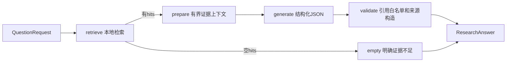

# 基础RAG与证据关联回答（P1-09）

本任务交付可复用的Python问答服务、真实LangGraph工作流、DeepSeek JSON生成适配器及基础引用门禁。已提供[CLI业务入口](cli.md)和P1-11的[HTTP入口](api.md)，飞书仍未实现。[任务SPEC](specs/tasks/p1-09-basic-rag.md)、[执行记录](development-plan.md)。

## 准备与运行

先按[数据库](postgres.md)、[模型](local-embedding.md)和[离线入库](offline-ingestion.md)说明准备文献、固定E5资产及数据库。完整当前开发环境需要三个extra，uv同步会移除未选中的可选依赖：

```powershell
.venv/Scripts/python.exe -m uv sync --locked --extra ml --extra db --extra rag --system-certs
```

通过调用进程显式设置数据库环境变量，以及DEEPSEEK_API_KEY、DEEPSEEK_BASE_URL、DEEPSEEK_MODEL。应用不自动读取.env。密钥不要写入源码、共享终端记录或命令示例；DeepSeekSettings使用SecretStr，不回显密钥。允许端点为https://api.deepseek.com及其/v1路径，模型必须显式提供。

用户指定deepseek-chat；2026-10-27实测响应model为deepseek-flash，表明服务端按别名解析，不能把别名视为不可变模型版本。后续评估需记录实际响应模型。本次未验证其他供应商或任意兼容端点。

以下真实装配方式会将问题与检索命中的原文片段发送给已配置DeepSeek服务；不会发送书目字段、本机路径字段或向量。运行前应确认所用文献允许发送至该服务，调用按服务收费。

```python
from pathlib import Path
from uuid import uuid4

from clinical_agent.adapters.deepseek import DeepSeekSettings, deepseek_generator
from clinical_agent.adapters.embedding import REVISION, LocalModelConfig, load_local_embedder
from clinical_agent.adapters.postgres.connection import DatabaseSettings, database_engine
from clinical_agent.adapters.postgres.retrieval import PostgresRetriever
from clinical_agent.application.research import ResearchService
from clinical_agent.application.retrieval import RetrievalService
from clinical_agent.domain.research import QuestionRequest
from clinical_agent.domain.retrieval import RetrievalOptions

embedder = load_local_embedder(LocalModelConfig(
    snapshot_dir=Path("models/multilingual-e5-base") / REVISION,
))
with database_engine(DatabaseSettings()) as engine:
    retrieval = RetrievalService(embedder=embedder, retriever=PostgresRetriever(engine))
    with deepseek_generator(DeepSeekSettings()) as generator:
        service = ResearchService(retriever=retrieval, generator=generator)
        answer = service.answer(QuestionRequest(
            request_id=uuid4(), question="已导入研究报告了哪些局限？",
            options=RetrievalOptions(top_k=5, min_similarity=0.0),
        ))
        print(answer.model_dump_json(indent=2))
```

此装配代码可供已准备环境调用；本任务真实LLM测试使用合成检索替身，未执行上述E5→PG→DeepSeek完整真实链路。P1-08已独立验证E5/PG，不能拼接两份独立测试并声称整条链路已验证。

## 工作流与边界



服务构造时编译一次StateGraph，每次请求独立状态；没有工具、记忆、checkpoint、自动重试或自建状态机。检索返回后数据库事务已释放，生成期间不持有会话。LangSmith追踪通过tracing_context(enabled=False)显式关闭，不依赖调用者清除环境变量，也不修改其全局配置。

空hits只表示未检索到符合条件的证据，不能推导无效；此分支不调用模型。非空hits全部提供，超过上下文预算报context_limit，不偷偷裁剪来源。相似度分数不是证据质量，不在本任务做证据等级或冲突分析。

ResearchLimits默认总预算90秒、生成60秒、上下文24000字符、输出32000 UTF-8 bytes。上下文按含schema/固定规则的GenerationInput JSON计数，不是模型token计数；供应商上下文溢出仍可能报错。端口收到剩余预算；HTTP connect/write/pool最多5秒、read按剩余生成预算，响应最多128000解压后bytes。HTTP inactivity timeout及节点间计时不是进程级硬墙钟限制，不能强杀正在执行的线程。

## 可信引用与生成文本

生成输入仅包含问题、chunk_id、原文、获取范围及定位，以及固定规则和输出schema。原文中的指令只是证据数据，不提供工具执行权限；提示词不能保证模型永不受注入影响，结构门禁也不能自动证明语义正确。

模型只允许返回claims，不能提交文献标题、作者、PMID、DOI或URL等书目字段。每项claim均有text、kind、evidence_chunk_ids及limitations；evidence/inference/uncertainty三类都必须关联本次命中片段。未知或重复引用、额外字段、缺引用、非JSON/重复键/NaN/截断输出均拒绝整个回答，不发布部分合法结论。显式书目标记在生成文本中保守拒绝，标识由sources呈现；不能识别所有自然语言编造。

claim_id由应用依次生成c1/c2。CitationSource只从可信命中快照挑选书目、精度日期、获取范围及实际引用片段，不接受模型补全；来源仅列实际引用内容，不造未知作者或日期。answer.sources不含source_uri、EmbeddingInfo或向量；片段原文仍按实际内容保留。标题来源filename不会变成正式标题，摘要不会变成全文。

ResearchAnswer含request_id、status、claims、sources、limitations、retrieval_scope及UTC时间；固定局限说明本地覆盖范围、结构引用校验局限和科研用途。用户界面未来必须按kind区分证据、推断和不确定信息，不能只展示claim.text而省略来源/局限。

## 错误与验收

输入错误使用Pydantic ValidationError。检索错误保持RetrievalError稳定码；生成/流程使用ResearchError：model_output_invalid、citation_invalid、generation_failed、generation_timeout、research_timeout、context_limit、research_failed。异常不包含原始上游body、凭据、问题或文献。失败与insufficient_evidence分开。

```powershell
.venv/Scripts/python.exe -m pytest tests/unit/test_research.py tests/integration/test_deepseek.py -q
.venv/Scripts/python.exe -m pytest -q
# 显式配置DeepSeek环境后，只发送测试中的人工合成段落；会产生一次模型请求费用。
$env:CLINICAL_AGENT_TEST_EVIDENCE_DIR = '.artifacts/your-run'
.venv/Scripts/python.exe -m pytest tests/integration/test_research_live.py -m external -q --tb=short
```

真实HTTPX测试使用MockTransport，不访问供应商；真实LangGraph分支不是Mock。外部测试缺配置会失败，不skip冒充通过。本次真实DeepSeek仅验证一份虚构样例的协议、关联与范围，未做临床专家审查、医学质量评估、真实数据库/模型/LLM整链路或生产性能验收。Phase1仍未完成。
