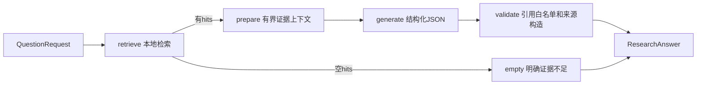

# 基础RAG与证据关联回答（P1-09）

## Phase 5 本地混合检索（2026-10-28）

默认mode=vector保留原行为；API的options增加mode=keyword|vector|hybrid、candidate_limit（默认50、1–100且不小于top_k）、keyword_query（可选ASCII文本）、date_from/date_to（成对ISO日期）。CLI对应 --retrieval-mode、--candidate-limit、--keyword-query、--local-date-from/--local-date-to。本地日期仅接纳完整出版日，未知/年/月精度条目明确排除，不补造日期。

keyword不计算查询Embedding，hybrid计算一次原问题Embedding，再在同一PostgreSQL快照内取得FTS/向量候选并按chunk_id做RRF（k=60），同分UUID升序，不合并掉同文献不同片段。任何必需通道失败即报错，不静默降级；空通道为成功。非vector模式不支持非零min_similarity，不能用余弦阈值过滤RRF/FTS。

FTS为simple ASCII词项匹配与精确PMID/DOI辅助查询，不是BM25或中文分词。中文问题可显式给英文keyword_query；不提供时keyword/hybrid返回retrieval_language_unsupported（API422），vector仍用既有多语言模型。

结果ResearchAnswer增加local_retrieval_mode/strategy、local_channel_status和retrieval_warnings；Python RetrievalResult的hits还保留keyword_rank/vector_rank/fusion_score与score_type。分数不表示医学质量，引用仍来自原证据门禁。scope=hybrid表示本地与在线来源，options.mode=hybrid表示本地算法，两者独立；在线条目不参加本地RRF，PubMed日期仍使用pubmed对象设置。

**现有数据库需显式 `alembic upgrade head` 到 p501_0003**：该迁移增加STORED search_vector与GIN，旧文献/片段/向量/ID保留，新写入自动更新。应用不会自动迁移；本次真实迁移测试仅在隔离测试库执行，没有改用户现有库。用法/范围见 [P5-01](specs/tasks/p5-01-hybrid-retrieval.md)、[学习导航](learning/phase-05/README.md)及[验收记录](phase5-acceptance.md)。以下历史说明按原时点阅读。

## Phase 4 在线来源（2026-10-28）

CLI `ask` 增加 `--scope local|online|hybrid`，API `POST /v1/questions` 接受同名 scope（默认local）及可选 pubmed 对象。pubmed 有 query、date_from/date_to（成对ISO日期）、date_field=pdat|edat、sort=relevance|pub_date、max_results（默认10，1–20）。CLI 对应 --pubmed-query、--date-from/--date-to、--date-field、--sort、--max-results。date_* 仅约束在线分支；online/hybrid 不支持本地 document_ids 或非零 min_similarity。

正式装配仍复用现有 LLM/E5/数据库资源。online 不调用本地向量检索；hybrid 合并本地和PubMed来源、预留名额并去重，不是 Phase 5 的关键词/向量融合。飞书纯文本入口继续默认local，未新增消息语法；渲染器可显示带在线来源的共享结果。

JSON 的 retrieval_scope 与实际请求一致，search_provenance 记录实际query/官方translation、时间、日期/排序、数量、截断、partial和缺失PMID。在线摘要保留真实官方URL/快照hash/字符定位与出版类型、更正关联。无摘要仅metadata_only，不能当claims证据；不自动入库、不代表全文或全部最新研究。仅本地回答的原有引用规则保留。

可选环境 PUBMED_TOOL/PUBMED_EMAIL/PUBMED_API_KEY；基础公开小请求不要求key，部署时登记真实tool/contact。每进程串行/至少0.34秒间隔，总期限30秒，最多20条/8次HTTP尝试。不同进程不协调，启用在线检索的实例需限制为一个并考虑同IP其他工具配额。API 的 pubmed_failed/invalid/timeout 对应503/502/504；获取失败不伪装成完整零结果，partial明确显示。

详情见 [P4-01 SPEC](specs/tasks/p4-01-pubmed-online.md)、[学习导航](learning/phase-04/README.md)及[验收记录](phase4-acceptance.md)。Phase 3 和更早验收记录按当时事实阅读，不当成当前仅local的限制。

## Phase 3 PICO 接入（2026-10-28）

正式共享装配默认先做一次 PICO 分类/抽取，复用 LLM_* 配置和现有模型连接，默认上限 20 秒并受研究总期限限制。每次普通问答会增加一次模型调用；即使本地没有证据也先执行规划。直接构造 ResearchService 不传 planner 时保持原行为，不代表正式入口会在规划失败后静默跳过。

结果 JSON 新增 query_plan，保留原问题、分类、PICO、候选扩展词与原文区间。现有 QuestionRequest 先去首尾空白，区间相对 query_plan.original_question 的 Python 码点索引。检索/生成仍用原问题，未接入 PubMed 或新的关键词通道。

status 新增 needs_clarification：仅 uncertain 且有具体歧义时返回，claims/sources 为空；补充问题后重新提交，无持久对话状态。缺 comparator 合法保留 null，不自动补造。规划错误为 extraction_failed/timeout，不能伪装成证据不足；API 对应 502/504，CLI 沿用错误 JSON/非零退出码，飞书显示澄清与 PICO。

完整契约、阶段验收边界见 [P3-01 SPEC](specs/tasks/p3-01-pico.md)及[开发进度](development-plan.md)。真实模型三例未验收时不声称已证明 PICO 语言理解准确率；原有命令/历史验证按各自时点阅读。

## 当前模型接入方式（2026-10-27 修订）

LangGraph 负责 Agent 状态、节点与分支编排；LangChain 负责标准消息和模型调用。`adapters/llm.py` 中的 `LLMSettings` / `open_llm` 通过通用 `ChatOpenAI` 装配模型，`LangChainAnswerGenerator` 使用 `BaseChatModel.invoke`，领域层独立核验引用。DeepSeek 仅是配置示例中的 API 服务商，不存在供应商专属模块、类型、依赖或业务分支。

显式设置 `LLM_BASE_URL`、`LLM_API_KEY`、`LLM_MODEL`，三项均必填；可选 `LLM_MAX_TOKENS` 默认 1500。旧供应商变量不再读取。URL 可含 `/v1` 或网关路径前缀；远端使用 HTTPS，本地回环可使用 HTTP；禁止 URL 内嵌凭据、查询参数或 fragment。应用不自动读取 `.env`。部署时 API 和飞书共享 Compose 的三项通用模型配置。

调用关系：入口 → `ResearchService` / LangGraph → `AnswerGenerator` → `LangChainAnswerGenerator` → LangChain `ChatOpenAI` → 配置的模型 API URL。服务需兼容 OpenAI Chat Completions 的标准消息、JSON mode、`max_tokens` 与非流式响应；不使用供应商推理扩展字段。HTTPX 仅负责受限传输，保留超时、响应上限、无重试及资源关闭。

直接依赖固定为 `langchain-core==1.7.0` 与 `langchain-openai==1.7.3`。[调整 SPEC](specs/tasks/langchain-model-boundary.md)。以下按任务日期保留的直连协议与真实调用结果属于迁移前历史证据，不代表新实现已执行在线验收。


P1-17当前更新（2026-10-27）：已通过真实E5/PG/DeepSeek的合成PDF与固定NCBI摘要闭环，累计2次授权付费请求；Python3.12.16宿主/共享镜像已核验，六份学习材料已交付。医学支持关系人工审查按用户选择待完成，Phase1未标完成。详见[阶段报告](phase1-acceptance.md)和[学习导航](learning/phase-01/README.md)。下文旧任务结果按各自时点阅读。

本任务交付可复用的Python问答服务、真实LangGraph工作流、通用模型 API 生成适配器及基础引用门禁。已提供[CLI业务入口](cli.md)和P1-11的[HTTP入口](api.md)，飞书已完成[P1-12纯事件过滤](feishu-events.md)，尚未接入业务运行时。[任务SPEC](specs/tasks/p1-09-basic-rag.md)、[执行记录](development-plan.md)。

## 准备与运行

先按[数据库](postgres.md)、[模型](local-embedding.md)和[离线入库](offline-ingestion.md)说明准备文献、固定E5资产及数据库。当前全量开发/测试环境需要ml/db/rag/api四个extras，uv同步会移除未选中的可选依赖；只运行Python RAG服务可省略api：

```powershell
.venv/Scripts/python.exe -m uv sync --locked --extra ml --extra db --extra rag --extra api --system-certs
```

通过调用进程显式设置数据库环境变量，以及LLM_API_KEY、LLM_BASE_URL、LLM_MODEL。应用不自动读取.env。密钥不要写入源码、共享终端记录或命令示例；LLMSettings使用SecretStr，不回显密钥。服务地址、密钥与模型必须通过 LLM_BASE_URL、LLM_API_KEY、LLM_MODEL 显式提供，不限制供应商域名。

用户指定deepseek-chat；2026-10-27实测响应model为deepseek-flash，表明服务端按别名解析，不能把别名视为不可变模型版本。后续评估需记录实际响应模型。该历史真实请求记录不证明当前通用适配器已通过所有供应商在线验证。

以下真实装配方式会将问题与检索命中的原文片段发送给已配置的模型 API 服务；不会发送书目字段、本机路径字段或向量。运行前应确认所用文献允许发送至该服务，调用按服务收费。

```python
from pathlib import Path
from uuid import uuid4

from clinical_agent.adapters.llm import LLMSettings, open_llm
from clinical_agent.adapters.embedding import REVISION, LocalModelConfig, load_local_embedder
from clinical_agent.adapters.postgres.connection import DatabaseSettings, database_engine
from clinical_agent.adapters.postgres.retrieval import PostgresRetriever
from clinical_agent.application.research import ResearchService
from clinical_agent.application.retrieval import RetrievalService
from clinical_agent.domain.research import QuestionRequest
from clinical_agent.domain.retrieval import RetrievalOptions

embedder = load_local_embedder(LocalModelConfig(
    snapshot_dir=Path("models/multilingual-e5-base") / REVISION,
))
with database_engine(DatabaseSettings()) as engine:
    retrieval = RetrievalService(embedder=embedder, retriever=PostgresRetriever(engine))
    with open_llm(LLMSettings()) as generator:
        service = ResearchService(retriever=retrieval, generator=generator)
        answer = service.answer(QuestionRequest(
            request_id=uuid4(), question="已导入研究报告了哪些局限？",
            options=RetrievalOptions(top_k=5, min_similarity=0.0),
        ))
        print(answer.model_dump_json(indent=2))
```

此装配代码可供已准备环境调用；本任务真实LLM测试使用合成检索替身，未执行上述E5→PG→DeepSeek完整真实链路。P1-08已独立验证E5/PG，不能拼接两份独立测试并声称整条链路已验证。

## 工作流与边界



服务构造时编译一次StateGraph，每次请求独立状态；没有工具、记忆、checkpoint、自动重试或自建状态机。检索返回后数据库事务已释放，生成期间不持有会话。LangSmith追踪通过tracing_context(enabled=False)显式关闭，不依赖调用者清除环境变量，也不修改其全局配置。

空hits只表示未检索到符合条件的证据，不能推导无效；此分支不调用模型。非空hits全部提供，超过上下文预算报context_limit，不偷偷裁剪来源。相似度分数不是证据质量，不在本任务做证据等级或冲突分析。

ResearchLimits默认总预算90秒、生成60秒、上下文24000字符、输出32000 UTF-8 bytes。上下文按含schema/固定规则的GenerationInput JSON计数，不是模型token计数；供应商上下文溢出仍可能报错。端口收到剩余预算；HTTP connect/write/pool最多5秒、read按剩余生成预算，响应最多128000解压后bytes。HTTP inactivity timeout及节点间计时不是进程级硬墙钟限制，不能强杀正在执行的线程。

## 可信引用与生成文本

生成输入仅包含问题、chunk_id、原文、获取范围及定位，以及固定规则和输出schema。原文中的指令只是证据数据，不提供工具执行权限；提示词不能保证模型永不受注入影响，结构门禁也不能自动证明语义正确。

模型只允许返回claims，不能提交文献标题、作者、PMID、DOI或URL等书目字段。每项claim均有text、kind、evidence_chunk_ids及limitations；evidence/inference/uncertainty三类都必须关联本次命中片段。未知或重复引用、额外字段、缺引用、非JSON/重复键/NaN/截断输出均拒绝整个回答，不发布部分合法结论。显式书目标记在生成文本中保守拒绝，标识由sources呈现；不能识别所有自然语言编造。

claim_id由应用依次生成c1/c2。CitationSource只从可信命中快照挑选书目、精度日期、获取范围及实际引用片段，不接受模型补全；来源仅列实际引用内容，不造未知作者或日期。answer.sources不含source_uri、EmbeddingInfo或向量；片段原文仍按实际内容保留。标题来源filename不会变成正式标题，摘要不会变成全文。

ResearchAnswer含request_id、status、claims、sources、limitations、retrieval_scope及UTC时间；固定局限说明本地覆盖范围、结构引用校验局限和科研用途。用户界面未来必须按kind区分证据、推断和不确定信息，不能只展示claim.text而省略来源/局限。

## 错误与验收

输入错误使用Pydantic ValidationError。检索错误保持RetrievalError稳定码；生成/流程使用ResearchError：model_output_invalid、citation_invalid、generation_failed、generation_timeout、research_timeout、context_limit、research_failed。异常不包含原始上游body、凭据、问题或文献。失败与insufficient_evidence分开。

```powershell
.venv/Scripts/python.exe -m pytest tests/unit/test_research.py tests/integration/test_llm.py -q
.venv/Scripts/python.exe -m pytest -q
# 显式配置DeepSeek环境后，只发送测试中的人工合成段落；会产生一次模型请求费用。
$env:CLINICAL_AGENT_TEST_EVIDENCE_DIR = '.artifacts/your-run'
.venv/Scripts/python.exe -m pytest tests/integration/test_research_live.py -m external -q --tb=short
```

真实HTTPX测试使用MockTransport，不访问供应商；真实LangGraph分支不是Mock。外部测试缺配置会失败，不skip冒充通过。本次真实DeepSeek仅验证一份虚构样例的协议、关联与范围，未做临床专家审查、医学质量评估、真实数据库/模型/LLM整链路或生产性能验收。Phase1仍未完成。
