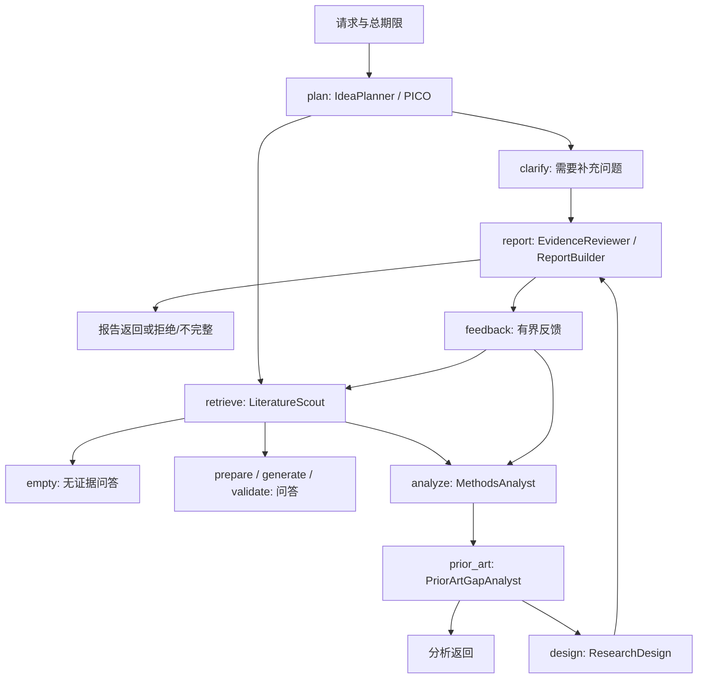

# 当前实现与研究工作流

> 2026-10-31 检索收敛第 2 层（工作区，未部署；回滚点 `f271ab3`）：删除 `domain/hybrid.py`、`application/retrieval.py`、`db/retrieval.py`。`KnowledgeRebuilder.evaluate` 只在临时 schema 里核对入库片段能否原样读回，不再做向量/关键词检索。新增迁移 `oa3002_0010`：删除 `source_type='pubmed'` 的文献行，并删除已停用的 `fulltext_indexes` / `fulltext_vectors`。PDF 行和表结构保留；该迁移未执行。入库接口仍可再次写入 PubMed 摘要。下文“本地RetrievalService”一段描述的是已删除实现。
>
> 2026-10-31 代码审查修复（工作区，未部署）：report 节点计算反馈去向并写入 `feedback_target`，条件边只读该字段，不再在路由函数中修改报告；ResearchService 四个入口共用 `_run`（同一 deadline、recursion_limit 与错误码转换）。`_prepare` 在副本上裁剪全文上下文，不再删除仍以 `evidence.text` 出现的锚点段落，避免模型合法引用后被判 `citation_invalid`。API/CLI/Graph 中把未知异常转换为错误码的位置统一用 `log_unexpected` 记录 `stage` 与 `exception_type`（不记录异常消息）。Graph 节点、边和对外接口不变；真实服务未复验。

> 2026-10-31 架构收敛：API 与 CLI/飞书共用 `research_runtime.open_research_service` 装配唯一科研服务。该上下文接收调用者已有的 engine/embedder，管理三类 HTTP 客户端；API 仍让入库与科研共用同一模型和 engine。FulltextService 删除历史 PMC 关键词参数，直接接收当前 source/store。持久化格式、索引签名和检索策略未修改。专项验证与剩余问题见 [本轮报告](../architecture-convergence.md)。

> 2026-10-30 OpenAlex-only：科研发现只请求 `https://api.openalex.org/works`。全文先用已有缓存，再按 OpenAlex 实际返回的 `content_urls`、`best_oa_location.pdf_url` 和 `locations[].pdf_url` 下载。不猜测地址，不爬落地页。域名、`is_oa` 和许可不作为下载前置条件；许可只随段落保存。仍只接受 HTTPS，并检查公网地址、重定向、大小、超时、文件类型和论文身份。成功的全文分块、Embedding 并写入 pgvector。摘要只用于筛选。没有全文则返回 `insufficient_evidence`。比较题不会因为一侧已有全文就放弃另一侧。历史库表保留，但不作为科研证据。工作区已改代码，服务未重新构建或部署。

> 2026-10-30工作区可行性分析增量：同次联合分析增加四维feasibility及候选experiments，进入原ReportClaim审核。无证据输出unknown核查项。代码未部署、pytest未执行，见[任务SPEC](../specs/tasks/evidence-feasibility.md)。

> 2026-10-30自然语言路由增量（工作区未部署、待测试）：同次规划输出task_intent，respond在原图内选择回答/报告，阻断歧义先澄清；普通飞书调用respond，/report保留。见[任务SPEC](../specs/tasks/natural-intent-routing.md)。历史验收不能代表本次改动。

> 2026-10-30第四阶段增量：OpenAlex软覆盖补检、同工作去重、原方法参考、evidence_groups/study_role、最多3段OA正文和分组综述输出已实现。比较题补入架构章节，避免只用对照实验段解释主模型。详见[当前实测与部署状态](../openalex-stage4/acceptance.md)。API健康，机器人仍退出；不得以先前connected记录覆盖当前故障，未进入下一阶段。

> 2026-10-29 OpenAlex第三阶段增量：原FulltextService追加基于DOI稳定键的OA全文路径，复用LlamaIndex分块、E5和pgvector；PMC OAI/JATS及明确许可出版方PDF经身份校验后缓存，全文段落绑定章节/页码/字符区间。新OA缓存表独立于旧PMID表。普通问答引用区分实际使用的摘要/全文；analysis/report真实全文分支未完整验收。详见[数据流、实测与限制](../openalex-stage3/acceptance.md)。后续业务库已升级oa3001_0009、API/机器人新镜像已部署，并完成真实API全文正例与飞书用户实收补验；[未通过项](../openalex-stage3/deployment/acceptance.md)仍保留。

> 2026-10-29 增量：command_runtime/api_runtime的在线文献发现已替换为OpenAlex。Planner复用同次模型抽取科研约束，统一语义筛选本地与在线候选；OpenAlex快照仅请求局部保存，生成上下文不携带完整元数据快照。下文PubMed在线段落保留旧链路说明，不代表当前runtime装配；历史离线解析/快照仍有效。详情见[本轮SPEC](../specs/openalex-stage2.md)与[技术核验及质量缺口](../openalex-stage2/acceptance.md)。

适用范围：2026-10-28 工作区源码，包含Phase8、MA-02及Phase9离线评价。本文是当前架构唯一入口；完成状态以 [状态表](../development-plan.md) 及其原始验收链接为准。旧设计保存在 [快照](../archive/architecture-before-governance.md)。

## 目标与边界

从医学科研想法出发，规划查询、收集已有文献、分析研究方法与相似性，形成有证据的候选缺口和八部分报告。问答、结构化分析、报告共用研究链路。文献事实、推断、待验证假设分别标记；缺证据不判创新。来源verified不等于医学正确，当前真实报告与独立医学验收仍有缺口。

## 模块定位与依赖

| 层/文件 | 职责 |
| --- | --- |
| [domain](../../src/clinical_agent/domain) | Pydantic DTO及纯规则；citations核对回答，hybrid执行融合规则，report定义报告；不读外部系统 |
| [research.py](../../src/clinical_agent/application/research.py) / [graph.py](../../src/clinical_agent/agents/graph.py) | ResearchService保留业务入口/节点/路由；agents注册编译唯一Graph |
| [state.py](../../src/clinical_agent/agents/state.py) | 请求局部WorkflowState、角色步骤与patch类型；旧workflow同对象导出 |
| [nodes.py](../../src/clinical_agent/agents/nodes.py) | 六角色行为，复用现有用例；旧application.agents同对象导出 |
| [application](../../src/clinical_agent/application) | pico、retrieval、openalex、analysis、report、ingestion及updates等用例；Protocol在消费者处定义 |
| [rag](../../src/clinical_agent/rag) / [integrations](../../src/clinical_agent/integrations) / [db](../../src/clinical_agent/db) | 本地解析/快照/E5；外部模型/在线文献/来源复核；PostgreSQL实现。旧adapters子模块保留同模块别名 |
| [command_runtime](../../src/clinical_agent/command_runtime.py) / [api](../../src/clinical_agent/api) / [research_runtime](../../src/clinical_agent/research_runtime.py) | 命令上下文；API工厂/lifespan/有界执行；共享科研资源装配 |
| [feishu](../../src/feishu) | main装配和SDK连接，events过滤，dedup租约，worker分派，sender渲染发送 |

入口依赖application/domain，在runtime装配rag/integrations/db实现；适配实现使用domain并实现原用例端口。agents集中Graph注册编译，ResearchService保留业务协调；domain不反向依赖框架或基础设施。没有统一Factory/Repository层。

## 一条工作流

未注入planner时直接检索。普通问答按命中进入prepare或empty；分析请求即使无证据也走分析路径。只需澄清的分析直接返回，报告请求仍经报告出口；分析不请求报告时prior_art后结束。Reviewer按现有身份/支持度门禁产出报告或拒绝。反馈默认最多1轮，可配0–2：unsupported回方法分析，无证据/partial按既定策略回检索；身份错误停止，耗尽仍保持不完整或拒绝。所有轮次共享原始deadline，不重置总预算。Methods复用联合抽取，PriorArt做独立规则校验，Design整理待评估方案；六角色不意味着六次独立模型调用或独立医学审稿。见 [角色测试](../../tests/unit/test_agent_roles.py)、[反馈测试](../../tests/unit/test_feedback_agents.py)。

## 检索、证据与引用

本地语料的向量/关键词检索已删除。入库后的读取只发生在重建验收：临时 schema 中保存片段并按 chunk 原文读回。历史排序规则见 [SPEC05](../specs/05-hybrid-retrieval.md)，对应实现已不在当前代码中。

科研检索由 OpenAlexRetrievalService 完成。Works API 仍是唯一发现来源。全文入口按缓存、`content_urls.grobid_xml`、`content_urls.pdf`、`best_oa_location.pdf_url`、`locations[].pdf_url` 排列；相同地址只请求一次。可持久保存的文本写入 `oa_fulltext_indexes` / `oa_fulltext_vectors`。许可字段随段落保存，不决定能否下载。缓存签名包含解析版本和 Embedding 模型，命中则不重复下载。科研回答不读取 PubMed 摘要。这些摘要存在 `documents` 中，迁移 `oa3002_0010` 会删掉 `source_type='pubmed'` 的行；迁移尚未执行，已有库在升级前仍保留它们。

PDF保留页与区间，PubMed摘要保留章节与Unicode区间，未知元数据不补造。分析每项保留证据指针与原文约束；报告先验证快照和身份，再审核支持度，由可信命中构造引用。检索、分析、生成和来源核验不是医学专家签署。见 [引用测试](../../tests/unit/test_citation_report.py)、[证据分析测试](../../tests/unit/test_evidence_analysis.py)。

## 持久化与维护

PostgreSQL/pgvector保存文献、chunk、版本、运行账本、别名/状态事件、在线批次和重建记录；Schema以 [ORM](../../src/clinical_agent/db/models.py) 和 [Alembic历史](../../alembic/versions) 为准。普通离线入库、显式版本发布、批次checkpoint恢复、来源治理、在线窗口同步和候选重建共享已有边界；旧版本和引用不因发布被删除。重建经校验后按源签名与事务切换，不能借整理更改版本发布规则。

维护由 [scripts](../../scripts) 显式调用，没有因脚本存在而默认启用后台调度。使用步骤分别见 [版本/运行账本](../learning/phase-08/update-runs.md)、[来源治理](../learning/phase-08/source-governance.md)、[同步与重建](../learning/phase-08/maintenance.md)。Phase9评价读取冻结输入、保存hash与范围，零分母和缺标注保留null；失败基线不修改为通过。

## 入口与资源生命周期

`clinical-agent`和`python -m clinical_agent`调用CLI；API由`clinical_agent.api:create_app --factory`建立lifespan；飞书为`clinical-feishu`或`python -m feishu.main`。command_runtime上下文管理engine、HTTP/模型资源；API长期复用资源并用有界线程池接纳；飞书复用open_research，Redis原子租约与owner检查防重复工作，发送队列和工作容量分别限制，关闭走明确清理路径。

Docker共享镜像，Compose profile区分api/bot，迁移需显式执行；不自动迁移业务库。模型、快照、文献允许根目录、数据库/Redis及外部凭据由操作者配置。来源目录与只读挂载限制、超时和协作取消不等于硬进程沙箱。详见 [运行部署索引](../guides/README.md) 及 [runtime测试](../../tests/unit/test_command_runtime.py)。本轮未复验真实数据库、模型、Redis、飞书或远端CI；历史通过仅限各原记录时点与范围。

## 探索型发现决策增量

新Planner输出通过blocking_ambiguities区分阻断与可选问题；缺C/O或影像模态不构成阻断。有原文锚定主题且阻断列表为空时，uncertain也可进入同一个retrieve节点。旧输出未带该字段时保留原契约兼容。Scout按scope调度，PubMed对新契约使用字面候选OR查询，显式pubmed.query优先；仍是一次原预算查询，不增加请求名额。默认scope为hybrid（本地+PubMed），API/CLI可显式local/online/hybrid，飞书文本默认hybrid。见[增量SPEC](../specs/tasks/exploratory-discovery.md)及[实际验收](../exploratory-discovery-acceptance.md)。

## Agents 结构迁移 Phase 1（2026-10-31）

请求级状态现位于`agents/state.py`，六角色位于`agents/nodes.py`，Graph注册和编译位于`agents/graph.py`的`build_research_graph`。ResearchService继续保留业务方法、路由决策、预算与输出契约；构建函数只注册原绑定节点及边。旧application.workflow/application.agents同对象重导出保留，三入口和资源装配未改。相对基线的兼容专项验证完成，完整回归保留既有失败，详见[实际验收](../agents-migration-phase1/acceptance.md)。未开展API整理。

## API结构迁移 Phase 2（2026-10-31）

HTTP接入现为api包：app.py创建应用/管理lifespan/注册异常，routes.py注册原路由，schemas.py保留原请求响应及配置，middleware.py承载原ASGI请求边界与安全错误响应，execution.py保留原有界池和同步适配。runtime.py原样装配API共享资源并复用research_runtime；旧api_runtime.py和clinical_agent.api:create_app同对象兼容导出。没有改变API协议、执行机制、容量、数据库或业务算法。相对基线结构兼容验证完成，整库原29失败保持开放，见[实际验收](../api-migration-phase2/acceptance.md)。未进入RAG/Integrations/DB迁移。

## RAG / Integrations / DB结构迁移 Phase 3（2026-10-31）

21个适配实现已按职责归入rag（4）、integrations（6）、db（11），旧adapters子模块以同模块别名保留，避免测试注入、ORM和锁重复。活动src/scripts及Alembic入口使用新导入，九份迁移原文不动；application/domain保持业务职责。动态模型加载、HTTP/engine生命周期、事务、切分/检索与来源校验均保留。完整离线1595通过/29原有失败/122排除，结构专项兼容检查通过，真实依赖与医学仍未验证，见[实际验收](../rag-db-migration-phase3/acceptance.md)及[文件映射](../rag-db-migration-phase3/migration-map.md)。未进入飞书迁移。

## 飞书与工程配置结构迁移 Phase 4（2026-10-31）

飞书唯一实现现位于`clinical_agent.channels.feishu`，继续按main/events/dedup/worker/sender五个职责文件组织。Phase 4当时保留顶层`feishu`同对象别名；Phase 5已删除该兼容包，并将Docker/Compose入口切到canonical模块。事件Schema、稳定请求ID、Redis原子owner租约、工作池与发送队列容量、未知交付语义、SDK循环和worker→sender→资源的关闭顺序未改。依赖与锁文件、Alembic历史版本及数据库Schema未由架构清理改动。验证范围见[Phase 4验收](../feishu-migration-phase4/acceptance.md)和[Phase 5验收](../legacy-cleanup-phase5/acceptance.md)。

## 遗留兼容层清理 Phase 5（2026-10-31）

Agents、API、RAG/Integrations/DB和飞书的映射内兼容文件已删除，活动调用方改为canonical路径。`clinical_agent.api:create_app`、`clinical-agent`和`clinical-feishu`保留。application/domain及canonical实现不在该清理范围。Phase 5结束后，工作区另有未提交的检索模块删除和新迁移文件`oa3002_0010`；这不属于兼容层清理，迁移未执行，完整回归因此没有稳定通过结果。详见[实际验收](../legacy-cleanup-phase5/acceptance.md)。
