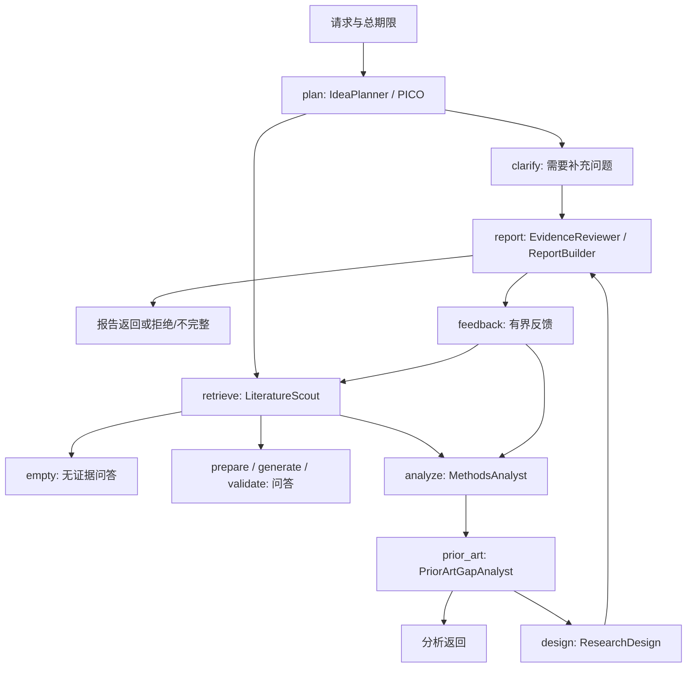

# 当前实现与研究工作流

> 2026-10-30工作区可行性分析增量：同次联合分析增加四维feasibility及候选experiments，进入原ReportClaim审核。无证据输出unknown核查项。代码未部署、pytest未执行，见[任务SPEC](../specs/tasks/evidence-feasibility.md)。

> 2026-10-30自然语言路由增量（工作区未部署、待测试）：同次规划输出task_intent，respond在原图内选择回答/报告，阻断歧义先澄清；普通飞书调用respond，/report保留。见[任务SPEC](../specs/tasks/natural-intent-routing.md)。历史验收不能代表本次改动。

> 2026-10-30第四阶段增量：OpenAlex软覆盖补检、同工作去重、原方法参考、evidence_groups/study_role、最多3段OA正文和分组综述输出已实现。比较题补入架构章节，避免只用对照实验段解释主模型。详见[当前实测与部署状态](../openalex-stage4/acceptance.md)。API健康，机器人仍退出；不得以先前connected记录覆盖当前故障，未进入下一阶段。

> 2026-10-29 OpenAlex第三阶段增量：原FulltextService追加基于DOI稳定键的OA全文路径，复用LlamaIndex分块、E5和pgvector；PMC OAI/JATS及明确许可出版方PDF经身份校验后缓存，全文段落绑定章节/页码/字符区间。新OA缓存表独立于旧PMID表。普通问答引用区分实际使用的摘要/全文；analysis/report真实全文分支未完整验收。详见[数据流、实测与限制](../openalex-stage3/acceptance.md)。后续业务库已升级oa3001_0009、API/机器人新镜像已部署，并完成真实API全文正例与飞书用户实收补验；[未通过项](../openalex-stage3/deployment/acceptance.md)仍保留。

> 2026-10-29 增量：command_runtime/api_runtime的在线文献发现已替换为OpenAlex。Planner复用同次模型抽取科研约束，统一语义筛选本地与在线候选；OpenAlex快照仅请求局部保存，生成上下文不携带完整元数据快照。下文PubMed在线段落保留旧链路说明，不代表当前runtime装配；历史离线解析/快照仍有效。详情见[本轮SPEC](../specs/openalex-stage2.md)与[技术核验及质量缺口](../openalex-stage2/acceptance.md)。

适用范围：2026-10-28 工作区源码，包含Phase8、MA-02及Phase9离线评价。本文是当前架构唯一入口；完成状态以 [状态表](../development-plan.md) 及其原始验收链接为准。旧设计保存在 [快照](../archive/architecture-before-governance.md)。

## 目标与边界

从医学科研想法出发，规划查询、收集已有文献、分析研究方法与相似性，形成有证据的候选缺口和八部分报告。问答、结构化分析、报告共用研究链路。文献事实、推断、待验证假设分别标记；缺证据不判创新。来源verified不等于医学正确，当前真实报告与独立医学验收仍有缺口。

## 模块定位与依赖

| 层/文件 | 职责 |
| --- | --- |
| [domain](../../src/clinical_agent/domain) | Pydantic DTO及纯规则；citations核对回答，hybrid执行融合规则，report定义报告；不读外部系统 |
| [research.py](../../src/clinical_agent/application/research.py) | ResearchService编译唯一LangGraph；节点、分支路由、总期限、反馈控制 |
| [workflow.py](../../src/clinical_agent/application/workflow.py) | 请求局部WorkflowState、角色步骤与patch类型 |
| [agents.py](../../src/clinical_agent/application/agents.py) | 六角色行为，复用现有用例，无第二工作流 |
| [application](../../src/clinical_agent/application) | pico、retrieval、pubmed、analysis、report、ingestion及updates等用例；Protocol在消费者处定义 |
| [adapters](../../src/clinical_agent/adapters) | E5、LangChain模型、PDF/XML、官方PubMed、来源快照、PostgreSQL实现 |
| [command_runtime](../../src/clinical_agent/command_runtime.py) / [api_runtime](../../src/clinical_agent/api_runtime.py) | 命令资源上下文、API lifespan与有界线程池装配 |
| [feishu](../../src/feishu) | main装配和SDK连接，events过滤，dedup租约，worker分派，sender渲染发送 |

入口依赖application/domain，并在runtime装配adapters；adapters实现用例端口并使用domain；domain不反向依赖框架或入口。应用层调用LangGraph属于预期。没有统一Factory/Repository层。

## 一条工作流

未注入planner时直接检索。普通问答按命中进入prepare或empty；分析请求即使无证据也走分析路径。只需澄清的分析直接返回，报告请求仍经报告出口；分析不请求报告时prior_art后结束。Reviewer按现有身份/支持度门禁产出报告或拒绝。反馈默认最多1轮，可配0–2：unsupported回方法分析，无证据/partial按既定策略回检索；身份错误停止，耗尽仍保持不完整或拒绝。所有轮次共享原始deadline，不重置总预算。Methods复用联合抽取，PriorArt做独立规则校验，Design整理待评估方案；六角色不意味着六次独立模型调用或独立医学审稿。见 [角色测试](../../tests/unit/test_agent_roles.py)、[反馈测试](../../tests/unit/test_feedback_agents.py)。

## 检索、证据与引用

本地RetrievalService复用PostgresRetriever；vector使用固定模型身份，keyword不编码，hybrid按固定k=60 RRF融合，保留通道排名、稳定去重与过滤。来源hydration和模型身份检查位于可信边界；排序细节以 [SPEC05](../specs/05-hybrid-retrieval.md) 和 [测试](../../tests/unit/test_hybrid_retrieval.py) 为准。

PubMedRetrievalService通过官方ESearch/EFetch适配器检索，复用XML映射；在线与本地scope的hybrid来源合并不同于本地mode的关键词/向量融合。在线快照保存规范化XML、hash和来源定位，不默认发布入库。PubMed请求有分页、日期、限流、重试和总期限；限流是进程内约束，部署需遵循 [在线指南教材](../learning/phase-04/troubleshooting.md)。

PDF保留页与区间，PubMed摘要保留章节与Unicode区间，未知元数据不补造。分析每项保留证据指针与原文约束；报告先验证快照和身份，再审核支持度，由可信命中构造引用。检索、分析、生成和来源核验不是医学专家签署。见 [引用测试](../../tests/unit/test_citation_report.py)、[证据分析测试](../../tests/unit/test_evidence_analysis.py)。

## 持久化与维护

PostgreSQL/pgvector保存文献、chunk、版本、运行账本、别名/状态事件、在线批次和重建记录；Schema以 [ORM](../../src/clinical_agent/adapters/postgres/models.py) 和 [Alembic历史](../../alembic/versions) 为准。普通离线入库、显式版本发布、批次checkpoint恢复、来源治理、在线窗口同步和候选重建共享已有边界；旧版本和引用不因发布被删除。重建经校验后按源签名与事务切换，不能借整理更改版本发布规则。

维护由 [scripts](../../scripts) 显式调用，没有因脚本存在而默认启用后台调度。使用步骤分别见 [版本/运行账本](../learning/phase-08/update-runs.md)、[来源治理](../learning/phase-08/source-governance.md)、[同步与重建](../learning/phase-08/maintenance.md)。Phase9评价读取冻结输入、保存hash与范围，零分母和缺标注保留null；失败基线不修改为通过。

## 入口与资源生命周期

`clinical-agent`和`python -m clinical_agent`调用CLI；API由`clinical_agent.api:create_app --factory`建立lifespan；飞书为`clinical-feishu`或`python -m feishu.main`。command_runtime上下文管理engine、HTTP/模型资源；API长期复用资源并用有界线程池接纳；飞书复用open_research，Redis原子租约与owner检查防重复工作，发送队列和工作容量分别限制，关闭走明确清理路径。

Docker共享镜像，Compose profile区分api/bot，迁移需显式执行；不自动迁移业务库。模型、快照、文献允许根目录、数据库/Redis及外部凭据由操作者配置。来源目录与只读挂载限制、超时和协作取消不等于硬进程沙箱。详见 [运行部署索引](../guides/README.md) 及 [runtime测试](../../tests/unit/test_command_runtime.py)。本轮未复验真实数据库、模型、Redis、飞书或远端CI；历史通过仅限各原记录时点与范围。

## 探索型发现决策增量

新Planner输出通过blocking_ambiguities区分阻断与可选问题；缺C/O或影像模态不构成阻断。有原文锚定主题且阻断列表为空时，uncertain也可进入同一个retrieve节点。旧输出未带该字段时保留原契约兼容。Scout按scope调度，PubMed对新契约使用字面候选OR查询，显式pubmed.query优先；仍是一次原预算查询，不增加请求名额。默认scope为hybrid（本地+PubMed），API/CLI可显式local/online/hybrid，飞书文本默认hybrid。见[增量SPEC](../specs/tasks/exploratory-discovery.md)及[实际验收](../exploratory-discovery-acceptance.md)。
