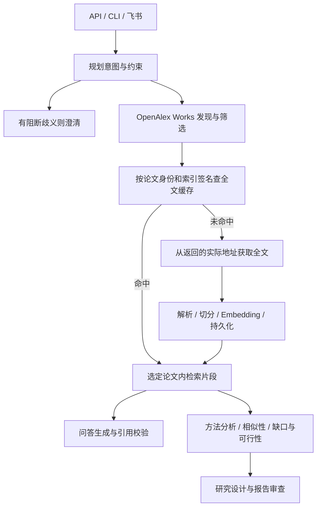

# 当前架构

依据：src/clinical_agent，2026-11-01。本次退役公开 local 参数；内部历史 DTO 与隔离测试仍保留，避免将公开入口治理扩大成历史模型重构。

## 模块职责

| 模块 | 实际职责 |
| --- | --- |
| domain | Pydantic 数据契约、来源与引用规则、分析和报告结构 |
| application | 入库、规划、科研用例、分析与报告、维护用例 |
| agents | LangGraph 状态、六角色节点和图组装 |
| integrations | LLM、OpenAlex、全文 HTTP 获取、来源快照核验 |
| rag | PDF/XML 解析、本地 E5 加载及向量化 |
| db | PostgreSQL/pgvector、全文缓存、事务和维护实现 |
| api | HTTP 边界、应用生命周期、中间件、有界工作池 |
| channels/feishu | 飞书事件、Redis owner 租约、工作调度和发送 |
| research_runtime | API/CLI/飞书共享科研资源装配 |

## 科研请求执行顺序

ResearchService 是研究入口；agents/graph.py 只组图，nodes.py 调用既有用例。普通飞书消息调用 respond，由原图内规划选择问答或报告。反馈次数有上限，各轮共享原始期限。没有全文时保留证据不足状态，不把摘要包装成全文证据。

application/oa_fulltext.py 的 enrich_openalex 遍历在线选中的 result.hits，先 oa_store.load(key, SIGNATURE)，未命中再下载、分块和缓存。因此已入库论文未被这次在线选中时，不会主动参加回答；缓存不能提供离线全库问答。

## PDF 入库

CLI ingest / POST /v1/documents/import → ImportRequest → IngestionService → OfflineReader → 切分与 E5 → PostgresStore。仅接收 PDF。保留快照、内容哈希、页码/区间与幂等状态；入库成功不意味着科研查询会搜索该 PDF。

## 资源与保障

入口显式加载模型、创建 engine、进入 HTTP 客户端上下文，退出时关闭。导入不建立连接。API WorkerPool 在提交前获取容量槽，槽随真实 Future 完成释放。飞书工作容量与发送容量分别受限，Redis owner 检查和租约避免重复处理。未知交付不能冒充已送达。

来源身份、快照和引用定位校验保留；它们不等于医学语义审核。数据库迁移由 Alembic 显式运行，应用启动不迁移。正式业务库是否已迁移不能从源码推出。

## 2026-11-02 核心链路修复后的边界

当前集中验收范围和结果见 [验收记录](../acceptance/consolidated-20261102/README.md)。
默认研究总预算180秒，全文最多60秒并给后续阶段预留60秒；反馈按剩余期限准入，
不足返回当前审核状态，不提升rejected/uncertain。
分析保留模型可引用的全文片段，受字符预算约束选择完整证据句；报告仅用合法全文ID
重建OpenAlex来源，不把摘要作为全文证据。
审核同时受字符预算和每批最多6条论断约束，携带原始想法/研究约束/比较维度，
每批响应ID必须完整且不重复。输入小不代表输出一定完整，length响应仍被拒绝。
sample_size的内部选择说明数量主体；综述只有明确汇总参与者样本可以填入，
被引单项研究不作为综述自身样本。模型分类仍需原文及人工质量复核。
