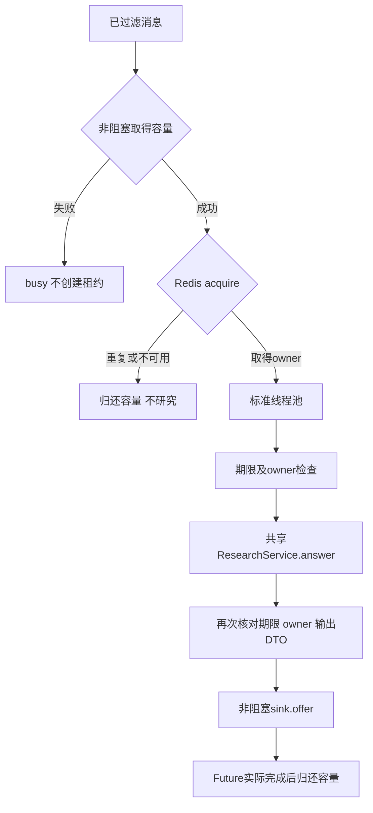

# 飞书有界任务分派（P1-14）

`src/feishu/worker.py` 已实现消息接纳到研究结果交接；契约见[任务 SPEC](specs/tasks/p1-14-feishu-worker.md)。仅接收通过[P1-12过滤](feishu-events.md)的 `MessageEnvelope`，不接收官方 SDK 对象。P1-15已实现[受限发送](feishu-sender.md)，完整机器人还需要P1-16长连接与生产装配。

`Dispatcher` 显式借用共享 `ResearchPort`、`RedisDeduplicator` 和实现 `DeliveryPort` 的 sink。核心调用仍是 `ResearchService.answer(QuestionRequest)`，不创建模型、数据库或新工作流。消息文本与稳定 request_id 原样映射，答案保留原有 sources、位置、引用和局限。每条请求有独立图状态，研究服务在进程内复用。



默认最多2个在途任务，可配置1–4；线程数等于在途容量，没有额外研究排队额度。取得容量先于Redis，满载不会错误创建processing。重复消息、Redis失败、提交失败均有独立返回状态。研究异常或输出非法转成固定 `research_failed` 交接项，不传播异常文本。入口根据 `Submission.status` 决定后续通知；本模块不执行网络发送。

处理预算默认90000ms，交接后发送预算15000ms，另留5000ms裕量。构造要求Redis的lease_ms与max_processing_ms都覆盖两者及裕量。P1-13默认60秒租期因此不能直接使用；装配需显式注入例如 `DedupPolicy(lease_ms=120000)`，不会静默修改原策略。固定租期已经覆盖预算，不创建后台续租线程；发送端可使用现有有限renew，但不能延长首次占位总期限。

本地预算从Redis占位前开始计算，Redis I/O也计入；研究前后检查owner和期限，超时/失租/不可用的结果不会交给sink。超时不能杀死Python工作线程；调用方等待超时或cancel正在运行的Future，容量仍被占用到实际完成。阻塞适配器依然要遵守自身超时；这不是进程级硬资源隔离。

`Delivery` 包含消息快照、租约、单调时钟发送截止时间deadline，以及合法answer或固定error_code。deadline为min(处理截止,交接时单调时间)+handoff_ms；只适用于同一进程。`sink.offer()`必须是非阻塞有界入队：

| 结果 | 租约责任 |
| --- | --- |
| True | sender接管，出队检查deadline及owner；成功投递后complete |
| False | 确定未入队，worker按owner release，WorkResult为delivery_failed |
| 抛异常 | 可能已入队，保留TTL，WorkResult为delivery_unknown；不盲删、不重试 |

queued只表示交接成功，不能当作飞书投递成功。sender出队必须重查owner；检查与远端发送仍非跨系统原子操作，不能声称exactly-once。完成标记与发送失败/未知策略已由[P1-15](feishu-sender.md)落实，不在研究结束时提前complete。

关闭时先停止SDK事件接纳，再 `dispatcher.close(timeout_seconds=5.0)`。返回False表示仍有真实工作，禁止关闭共享模型/HTTP/数据库/Redis/sink；可稍后再次close。返回True说明工作及清理回调排空，然后排空sender，最后由装配层关闭共享资源。close不自动关闭借用端口，也不取消正在运行的工作。timeout用于取得接纳锁后的排空等待；已进入接纳的Redis调用受自身1秒I/O超时约束。

测试命令（仓库根目录，开发环境）：

```powershell
.venv/Scripts/python.exe -m pytest tests/unit/test_feishu_worker.py -q
```

测试使用实际标准线程池、Event/Barrier控制并发；替身只替代Redis和发送。两条真实LangGraph请求在生成阶段由Barrier强制重叠，比较直接服务调用的完整DTO，并检查来源位置与问题隔离。另测空召回不生成。合成证据不代表真实医学结论或外部LLM验收；Redis脚本原子性沿用[P1-13独立真实Redis记录](feishu-dedup.md)，本轮没有启动真实Redis/模型/飞书。

真实RED/GREEN及回归记录统一见[开发进度](development-plan.md#p1-14-本次执行2026-10-27)。Phase1仍未整体验收。


## P1-16 当前装配入口

此前正文中的待装配描述保留为本任务交付时点；P1-16现已提供[官方SDK与生命周期入口](feishu-runtime.md)，复用本模块。真实服务及容器运行结果以[开发进度](development-plan.md#phase-1-任务进度)为准，不将离线用例解释为整体验收。
