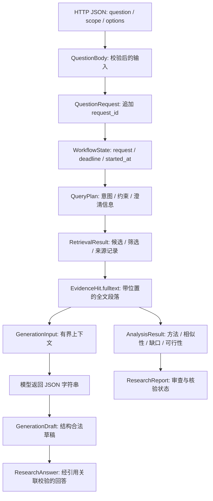
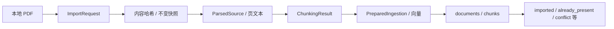

# 从数据流动学习整个项目

## 只追踪一个问题

贯穿例子：用户提交“MedSAM 在医学图像分割中有哪些局限？”。这只是追踪用的输入示例，不预设能搜到哪些论文、取得全文或得出什么结论。当前真实全文冒烟仍有失败，见 [验收记录](../../acceptance.md)。

建议先沿 HTTP 问答走通一条纵线，再接分析、报告、入库、飞书和维护。表格中的函数均从实际 AST 定位，源码链接附实际行号；输入输出描述包含返回值和对 state/数据库的写入，不应只看 Python return。

本指南逐个解释学习调用链上的函数；模型字段验证器与维护细节按专题继续阅读，不把所有历史兼容分支当作当前生产必经步骤。构造函数一般保存依赖和预算，不等于执行业务；Protocol 的同名函数只声明契约，没有实际远程调用。

## 先记住数据如何变形

阅读任何函数时只问四件事：**拿到什么数据 → 改了什么 → 交给谁 → 如果删除它会破坏什么**。下面“为什么需要”回答第四个问题。

## 第 0 站：先有资源，再有请求

API 启动与每次请求是两种时间尺度。模型、engine、HTTP 客户端由启动上下文持有；request/state 属于单次请求。请求结束不必卸载共享模型。关闭时先等真实工作结束，再释放工作需要的资源。

| 函数（点击源码；行号为生成时实际位置） | 输入 → 输出 / 写入 | 功能与为什么需要 |
| --- | --- | --- |
| [api/app.py:24 · create_app](../../../src/clinical_agent/api/app.py#L24) | 配置/工厂 → FastAPI 应用，注册 lifespan 和路由 | 将应用定义与资源启动分开，便于注入隔离测试 |
| [api/app.py:34 · create_app.lifespan](../../../src/clinical_agent/api/app.py#L34) | 启动时装配 ServiceBundle 和 WorkerPool；退出时关闭 | 确保任务仍运行时不会提前关闭其 HTTP/数据库资源 |
| [api/runtime.py:20 · open_api_runtime](../../../src/clinical_agent/api/runtime.py#L20) | ApiSettings → ingestion/research 服务上下文 | 将环境、模型、engine 与业务对象集中装配，避免业务代码自己找资源 |
| [research_runtime.py:9 · open_research_service](../../../src/clinical_agent/research_runtime.py#L9) | engine/embedder/模型配置 → ResearchService | 三种入口共用同一科研装配，统一 HTTP 客户端的打开和关闭 |
| [application/research.py:48 · ResearchService.__init__](../../../src/clinical_agent/application/research.py#L48) | 依赖与限额 → 节点对象及已编译图 | 确定业务能力和预算；构造时不执行在线搜索 |
| [agents/graph.py:13 · build_research_graph](../../../src/clinical_agent/agents/graph.py#L13) | 服务绑定方法 → 编译后的 LangGraph | 将节点和条件边接起来；不在组图代码里重新实现科研算法 |
| [db/connection.py:36 · database_engine](../../../src/clinical_agent/db/connection.py#L36) | 数据库配置 → engine 上下文，退出 dispose | 集中连接超时、连接池和资源释放；不会自动执行迁移 |
| [rag/embedding.py:156 · load_local_embedder](../../../src/clinical_agent/rag/embedding.py#L156) | 模型快照配置 → LocalEmbedder | 显式校验并加载 E5；共享模型避免每个节点重复加载 |
| [integrations/llm.py:198 · open_llm](../../../src/clinical_agent/integrations/llm.py#L198) | LLMSettings → 生成器上下文 | 管理 HTTP 与模型 SDK 生命周期，安装响应边界约束 |
| [integrations/openalex.py:91 · open_openalex](../../../src/clinical_agent/integrations/openalex.py#L91) | OpenAlex 配置 → OpenAlexClient 上下文 | 显式管理在线发现客户端，凭据不混进文献快照 |

**此站产物：** ServiceBundle(ingestion, research)，以及 ready 状态和有界工作池。不要把 create_app、lifespan 和 ResearchService.answer 画成同一条每次都执行的链。

## 第 1 站：外部 JSON 变成可信请求

发送形式：`{"question":"MedSAM 在医学图像分割中有哪些局限？","scope":"online"}`。QuestionBody 不接收 local；内部历史 QuestionRequest 的默认值不能用来判断公开接口能力。

| 函数（点击源码；行号为生成时实际位置） | 输入 → 输出 / 写入 | 功能与为什么需要 |
| --- | --- | --- |
| [api/middleware.py:53 · _Boundary.__call__](../../../src/clinical_agent/api/middleware.py#L53) | ASGI scope/receive/send → 检查后的请求或安全错误 | 在业务前限制请求、关联 ID 和体积，避免边界数据直接冲进业务 |
| [api/middleware.py:37 · identity](../../../src/clinical_agent/api/middleware.py#L37) | Request → UUID | 让 HTTP、业务输出和日志使用同一个请求身份 |
| [api/middleware.py:41 · _error_response](../../../src/clinical_agent/api/middleware.py#L41) | 请求/错误码 → JSONResponse | 统一脱敏错误格式和关联 ID |
| [api/app.py:73 · create_app.invalid](../../../src/clinical_agent/api/app.py#L73) | 请求验证失败 → 422 错误响应 | 公开输入不合法时就停止，local 在这里被拒绝 |
| [api/routes.py:18 · register_routes](../../../src/clinical_agent/api/routes.py#L18) | 应用/state → 注册健康、入库与科研路由 | 让 HTTP 接入与资源装配、科研算法保持独立 |
| [api/routes.py:33 · register_routes.question](../../../src/clinical_agent/api/routes.py#L33) | QuestionBody + 请求 ID → QuestionRequest → ResearchAnswer | 将外部契约转换为用例输入，并检查输出请求关联 |
| [api/execution.py:65 · execute](../../../src/clinical_agent/api/execution.py#L65) | 同步业务 operation → 异步可等待的结果/错误响应 | 同步模型/数据库工作不直接堵塞事件循环，业务错误安全映射为 HTTP |
| [api/execution.py:39 · WorkerPool.submit](../../../src/clinical_agent/api/execution.py#L39) | 无参 operation → concurrent Future | 提交前占容量槽；实际任务完成才释放，避免无限排队 |
| [api/execution.py:51 · WorkerPool.close](../../../src/clinical_agent/api/execution.py#L51) | 关闭状态 → 等待工作结束 | 阻止新任务，并让资源按依赖顺序释放 |

**断点：** routes.question 中 QuestionRequest 建成后，看 question、request_id、scope、options。此时还没有查询论文。WorkerPool 限制并发，不能把请求取消当作后台线程已停止。

## 第 2 站：请求进入图，文字变成规划

| 函数（点击源码；行号为生成时实际位置） | 输入 → 输出 / 写入 | 功能与为什么需要 |
| --- | --- | --- |
| [application/research.py:402 · ResearchService.answer](../../../src/clinical_agent/application/research.py#L402) | QuestionRequest → ResearchAnswer | 定义明确的问答入口，其他接入方不用了解图的内部结构 |
| [application/research.py:342 · ResearchService._run](../../../src/clinical_agent/application/research.py#L342) | 请求 + 结果提取函数 + 标志 → 图输出的目标对象 | 复制请求、建立单一 deadline 和递归限额，统一图边界错误 |
| [application/research.py:147 · ResearchService._remaining](../../../src/clinical_agent/application/research.py#L147) | state.deadline → 剩余秒数，超时抛错 | 所有阶段共享预算，反馈不能重置总期限 |
| [application/research.py:82 · ResearchService._plan](../../../src/clinical_agent/application/research.py#L82) | state → 含 query_plan 的 patch | 接入规划角色；自然路由还可设置分析/报告标志 |
| [agents/nodes.py:40 · IdeaPlannerAgent.__call__](../../../src/clinical_agent/agents/nodes.py#L40) | state.request.question → QueryPlan patch 与耗时 | 把规划包进角色，并保留统一期限与步骤轨迹 |
| [application/pico.py:201 · PicoPlanner.plan](../../../src/clinical_agent/application/pico.py#L201) | ClassificationRequest → 已核对的 QueryPlan | 解析模型 JSON、核对用户原文、概念约束和澄清状态；不盲信结构化输出 |
| [integrations/langchain_generation.py:67 · LangChainAnswerGenerator.extract](../../../src/clinical_agent/integrations/langchain_generation.py#L67) | 问题 + 输出 Schema → 模型 JSON 字符串 | 向模型说明需要返回哪些规划字段，此处尚未证明字段正确 |
| [application/pico.py:35 · _unique](../../../src/clinical_agent/application/pico.py#L35) | JSON 键值对 → 无重复键字典 | 防止重复字段让解析器和审查者看到不同语义 |
| [application/pico.py:44 · _invalid_constant](../../../src/clinical_agent/application/pico.py#L44) | 非标准 JSON 常量 → 拒绝 | 避免 NaN/Infinity 混入应受约束的结构 |
| [application/pico.py:140 · log_extraction_rejection](../../../src/clinical_agent/application/pico.py#L140) | 封闭阶段/规则码 → 安全诊断日志 | 定位规划失败而不把问题、模型正文和秘密写入日志 |
| [application/research.py:103 · ResearchService._plan_route](../../../src/clinical_agent/application/research.py#L103) | query_plan → clarify/retrieve | 阻断歧义与可继续检索的规划分流 |
| [application/research.py:110 · ResearchService._clarify](../../../src/clinical_agent/application/research.py#L110) | 规划/请求 → needs_clarification 回答或分析对象 | 缺少必要条件时明确向用户说明，不虚构已检索结论 |

**此站产物：** state 增加 query_plan。PICO/术语是对问题的结构化表达，不是数据库搜索结果。source_span 指向用户原话，不能用模型生成的偏移量冒充经过核对的位置。阻断歧义导致 clarify，缺少某些可选字段不必阻断。

## 第 3 站：规划变成在线候选与筛选记录

| 函数（点击源码；行号为生成时实际位置） | 输入 → 输出 / 写入 | 功能与为什么需要 |
| --- | --- | --- |
| [application/research.py:153 · ResearchService._retrieve](../../../src/clinical_agent/application/research.py#L153) | state → retrieval patch，并尝试补全文 | 把发现与全文补充接在一个图节点后，保留完整警告 |
| [agents/nodes.py:68 · LiteratureScoutAgent.__call__](../../../src/clinical_agent/agents/nodes.py#L68) | 请求/规划 → RetrievalResult patch | 根据当前装配调用发现服务，并核对选项、范围与预算 |
| [application/openalex.py:441 · OpenAlexRetrievalService.retrieve](../../../src/clinical_agent/application/openalex.py#L441) | RetrievalRequest + QueryPlan → RetrievalResult | 执行查询、去重、语义筛选、补检与选择，保留候选去向和证据缺口 |
| [application/openalex.py:188 · compile_queries](../../../src/clinical_agent/application/openalex.py#L188) | 规划/策略 → 查询字符串列表 | 把保留的语义约束变成在线可执行词项，防止扩展时丢掉必要锚点 |
| [application/openalex.py:133 · method_names](../../../src/clinical_agent/application/openalex.py#L133) | QueryPlan → 方法名称集合 | 识别比较/方法问题中的对象，支持有依据的查询调度 |
| [application/openalex.py:153 · paper_identity](../../../src/clinical_agent/application/openalex.py#L153) | 论文记录/目标 → 身份匹配判断 | 区分“找到同名论文”和“原文支持方法来源”这两件事 |
| [integrations/openalex.py:26 · OpenAlexClient.search](../../../src/clinical_agent/integrations/openalex.py#L26) | 词项/日期/排序/超时 → records、数量、警告 | 隔离 Works API HTTP 细节、状态分类与响应规范化 |
| [domain/openalex.py:139 · OpenAlexRecord.from_work](../../../src/clinical_agent/domain/openalex.py#L139) | 外部 work 字典 → 规范文献记录和快照 | 把外部字段收敛为项目可追溯的数据对象 |
| [domain/openalex.py:92 · decode_abstract](../../../src/clinical_agent/domain/openalex.py#L92) | 倒排摘要结构 → 顺序文本 | 重建可筛选的摘要，不把词位置结构直接交给生成器 |
| [domain/openalex.py:59 · resolve_dates](../../../src/clinical_agent/domain/openalex.py#L59) | 研究时间约束/今天/显式日期 → 起止日期 | 将“最近几年”等语义变成可执行日历范围 |
| [domain/openalex.py:110 · normalize_doi](../../../src/clinical_agent/domain/openalex.py#L110) | DOI 文本 → 规范 DOI 或空值 | 跨来源去重和论文身份匹配需要稳定表示 |
| [application/openalex.py:337 · record_hit](../../../src/clinical_agent/application/openalex.py#L337) | 规范论文记录 → EvidenceHit | 将外部论文接到现有证据 DTO；此刻通常仍是摘要候选 |
| [integrations/langchain_generation.py:103 · LangChainAnswerGenerator.screen_candidates](../../../src/clinical_agent/integrations/langchain_generation.py#L103) | 候选上下文 → 筛选 JSON | 让模型判断候选是否适合问题；业务层随后校验，不由模型直接决定可信证据 |
| [domain/openalex.py:225 · parse_assessments](../../../src/clinical_agent/domain/openalex.py#L225) | 筛选 JSON + 实际候选 → CandidateAssessment 列表 | 核对候选身份、原文引文和完整性，拒绝伪造评估 |
| [application/openalex.py:390 · _missing_comparison_side](../../../src/clinical_agent/application/openalex.py#L390) | 问题/候选/已选集合 → 缺侧优先级 | 比较问题避免一侧已有好文章就挤掉另一侧 |
| [application/openalex.py:407 · _has_fulltext_url](../../../src/clinical_agent/application/openalex.py#L407) | 论文记录 → 是否有全文获取线索 | 作为候选选择信号；不是保证下载一定成功 |
| [application/openalex.py:70 · log_evidence_trace](../../../src/clinical_agent/application/openalex.py#L70) | 封闭阶段计数 → 安全日志 | 区分搜索、筛选、选择等失败，不暴露查询和密钥 |

**此站产物：** RetrievalResult.hits + search_provenance。hit.chunk 此时可能是摘要候选；它不自动获得“全文证据”资格。候选快照、筛选理由、返回数量与警告属于来源追溯信息。

**特别观察：** OpenAlexRetrievalService.retrieve 内的 normalized、literal、usable、add、quality 等嵌套辅助函数就近读：规范词项、构造字面条件、判断候选可用性、合并去重、排序。它们服务于同一次 retrieve；不是新的 Agent 或额外数据库层。循环内的 HTTP/模型调用会消耗共同期限，数量目标不能替代证据质量。

## 第 4 站：候选论文变成可以引用的全文

| 函数（点击源码；行号为生成时实际位置） | 输入 → 输出 / 写入 | 功能与为什么需要 |
| --- | --- | --- |
| [application/fulltext.py:13 · FulltextService.enrich](../../../src/clinical_agent/application/fulltext.py#L13) | 问题/RetrievalResult/deadline → 补全文的结果 | 为研究节点提供统一全文补充入口，内部委托 OpenAlex 路径 |
| [application/oa_fulltext.py:142 · enrich_openalex](../../../src/clinical_agent/application/oa_fulltext.py#L142) | 本次选中文献 → 缓存/下载/向量/全文片段 | 把论文级候选变为有身份、有位置、可引用的证据段落 |
| [domain/fulltext.py:49 · paper_key](../../../src/clinical_agent/domain/fulltext.py#L49) | 文献记录 → 稳定论文键 | 缓存和片段都绑定同一真实论文，而不只靠标题 |
| [db/fulltext.py:15 · PostgresFulltextStore.load](../../../src/clinical_agent/db/fulltext.py#L15) | paper_key + SIGNATURE → 未过期 payload 或 None | 避免同篇同配置重复下载和编码；签名不符不误用旧索引 |
| [db/fulltext.py:24 · PostgresFulltextStore.reuse_content](../../../src/clinical_agent/db/fulltext.py#L24) | 论文键/签名/表示哈希 → 是否续用并延长缓存 | 内容未变时复用既有向量，避免无意义重建 |
| [integrations/oa_fulltext.py:429 · fulltext_candidates](../../../src/clinical_agent/integrations/oa_fulltext.py#L429) | OpenAlex 实际字段 → 按序全文 URL 列表 | 只试来源给出的地址，不猜路径或爬落地页 |
| [integrations/oa_fulltext.py:588 · OAFulltextSource.fetch_record](../../../src/clinical_agent/integrations/oa_fulltext.py#L588) | 记录/deadline/请求计数 → Acquisition | 依序尝试实际地址，保留失败类别与共同预算 |
| [integrations/oa_fulltext.py:574 · OAFulltextSource._acquire](../../../src/clinical_agent/integrations/oa_fulltext.py#L574) | 候选 URL/类型 → 下载并解析的 Acquisition | 把一次获取绑定正确解析器、最终地址和许可元数据 |
| [integrations/oa_fulltext.py:495 · OAFulltextSource.download](../../../src/clinical_agent/integrations/oa_fulltext.py#L495) | HTTPS URL → 有界字节与最终地址 | 控制协议、跳转、大小、时间和文件类型，外部内容不能无限读 |
| [integrations/oa_fulltext.py:138 · screen_url](../../../src/clinical_agent/integrations/oa_fulltext.py#L138) | URL → 形状核验/拒绝 | 在 DNS/网络前拒绝危险 URL 形式 |
| [integrations/oa_fulltext.py:170 · pinned_ip](../../../src/clinical_agent/integrations/oa_fulltext.py#L170) | 域名 → 已核验公网地址 | 防止全文请求进入私网或利用 DNS 变化绕过检查 |
| [integrations/oa_fulltext.py:194 · PinnedBackend.connect_tcp](../../../src/clinical_agent/integrations/oa_fulltext.py#L194) | 连接目标 → 固定已核验地址的网络流 | 让实际连接遵守地址核验结果，而非只检查一次字符串 |
| [integrations/oa_fulltext.py:239 · parse_tei](../../../src/clinical_agent/integrations/oa_fulltext.py#L239) | GROBID XML + 论文记录 → FulltextUnit 列表 | 安全解析正文并核对论文身份，保留章节和字符位置 |
| [integrations/oa_fulltext.py:302 · parse_oa_pdf](../../../src/clinical_agent/integrations/oa_fulltext.py#L302) | PDF 字节 + 论文记录 → FulltextUnit 列表 | 取得真实页文本和位置，同时防止下载错文献 |
| [integrations/oa_fulltext.py:383 · _pdf_identity](../../../src/clinical_agent/integrations/oa_fulltext.py#L383) | PDF 文本/元信息 + 记录 → 身份校验 | URL 能打开不意味着文件就是目标论文 |
| [rag/embedding.py:315 · LocalEmbedder.embed_passages](../../../src/clinical_agent/rag/embedding.py#L315) | 全文文本列表/deadline → 向量列表 | 复用已加载 E5 的 passage 前缀，为论文内检索准备表示 |
| [db/fulltext.py:36 · PostgresFulltextStore.publish](../../../src/clinical_agent/db/fulltext.py#L36) | payload + 向量 → 原子替换缓存和片段 | 同篇论文以事务和锁保持文本与向量对应，避免半发布 |
| [rag/embedding.py:260 · LocalEmbedder.embed_query](../../../src/clinical_agent/rag/embedding.py#L260) | 问题文本 → QueryEmbedding | 用 query 前缀编码检索意图，使查询与段落向量可比较 |
| [db/fulltext.py:66 · PostgresFulltextStore.search](../../../src/clinical_agent/db/fulltext.py#L66) | 论文键/问题向量/limit → 片段 payload | 限定单篇论文的 pgvector 距离检索；不是全库召回 |
| [application/oa_fulltext.py:129 · _nearest](../../../src/clinical_agent/application/oa_fulltext.py#L129) | 未持久化段落/向量/问题向量 → 邻近片段 | 仅对本轮内存向量提供对应检索路径 |
| [application/oa_fulltext.py:17 · section_priority](../../../src/clinical_agent/application/oa_fulltext.py#L17) | 问题 + 章节名 → 章节优先级 | 架构、结果、局限等不同问题需要不同正文部位 |
| [application/oa_fulltext.py:112 · preferred_sections](../../../src/clinical_agent/application/oa_fulltext.py#L112) | 问题 → 偏好章节集合 | 把明确的问题方向映射到章节偏好，辅助补齐候选 |
| [application/oa_fulltext.py:41 · rerank_passages](../../../src/clinical_agent/application/oa_fulltext.py#L41) | 候选片段 + 问题 → 最多3段全文 | 结合原始向量顺序、词项和章节，避免只按一个粗分数取片段 |

**此站产物：** hit.fulltext，每段带 paper_key、chunk_id、text、section、page/start/end 等真实定位信息。

缓存命中路径：在线选中论文 → load → embed_query → search → 定位核验 → rerank。未命中路径在 load 后多走 fetch_record → 解析 → 切分 → embed_passages → publish。当前不是先对整个缓存库搜索，再与在线结果合并。

`enrich_openalex` 使用 LlamaIndex SentenceSplitter 切分；不是调用 PDF 导入支线的 chunk_source。数据库 search 使用论文键限制范围，并按向量距离排序；rerank_passages 再结合词项与章节意图，最多保留3段。全文获取失败写入警告，不能用摘要伪装全文。

## 第 5 站：证据变成上下文、草稿和最终回答

| 函数（点击源码；行号为生成时实际位置） | 输入 → 输出 / 写入 | 功能与为什么需要 |
| --- | --- | --- |
| [application/research.py:170 · ResearchService._route](../../../src/clinical_agent/application/research.py#L170) | retrieval/请求标志 → empty/prepare/analyze | 将缺全文、普通问答和结构化分析分开 |
| [application/research.py:182 · ResearchService._prepare](../../../src/clinical_agent/application/research.py#L182) | 检索结果副本 → GenerationInput + 对齐后的 retrieval | 控制上下文大小、建立章节证据与 chunk_id 对应，避免引用身份与内容脱节 |
| [application/research.py:222 · ResearchService._prepare.generation_evidence](../../../src/clinical_agent/application/research.py#L222) | 单个 hit → GenerationEvidence | 生产 OpenAlex 路径把全文锚点放入 evidence.text，不把摘要当作全文 |
| [application/research.py:276 · ResearchService._generate](../../../src/clinical_agent/application/research.py#L276) | 有界上下文 → GenerationDraft patch | 分配生成预算、调用模型，并进入草稿解析 |
| [integrations/langchain_generation.py:61 · LangChainAnswerGenerator.generate](../../../src/clinical_agent/integrations/langchain_generation.py#L61) | GenerationInput → 原始 JSON 字符串 | 序列化问题与证据，选择问答模型提示 |
| [integrations/langchain_generation.py:120 · LangChainAnswerGenerator._invoke](../../../src/clinical_agent/integrations/langchain_generation.py#L120) | 指令/payload/预算 → 纯文本模型输出 | 统一真实 SDK 调用、超时、输出形状和错误转换 |
| [integrations/llm.py:65 · _guard_response](../../../src/clinical_agent/integrations/llm.py#L65) | 模型 HTTP 响应 → 有界且校验过的 provider envelope | SDK 解码前控制字节与响应结构，避免不受控输出 |
| [domain/citations.py:46 · parse_draft](../../../src/clinical_agent/domain/citations.py#L46) | 原始模型 JSON → GenerationDraft | 检查字节、JSON 与草稿 Schema；这一步不等于引用已核验 |
| [application/research.py:290 · ResearchService._validate](../../../src/clinical_agent/application/research.py#L290) | request/retrieval/draft → ResearchAnswer patch | 在图中明确设置业务校验出口 |
| [domain/citations.py:95 · build_answer](../../../src/clinical_agent/domain/citations.py#L95) | 请求/真实检索/草稿 → 最终回答 | 校验 chunk 引用，使用可信检索材料构造来源和范围说明 |
| [domain/citations.py:60 · unobtained_works](../../../src/clinical_agent/domain/citations.py#L60) | 检索与已取得全文状态 → 未获取论文说明 | 让用户分清“发现过”与“实际取得可引用证据” |
| [application/research.py:298 · ResearchService._empty](../../../src/clinical_agent/application/research.py#L298) | 无可用证据状态 → insufficient_evidence 回答 | 明确缺证据，不要求模型编出结论 |
| [application/research.py:370 · ResearchService._answer_output](../../../src/clinical_agent/application/research.py#L370) | 图输出 → 重新验证的 ResearchAnswer | 把内部图状态收成对外对象，附回实际规划 |

**此站产物：** ResearchAnswer。GenerationDraft 只表示模型 JSON 形状合法；build_answer 才把声称引用的 chunk ID 与真实检索片段连接起来。来源和引用关联有效，不代表医学语义已经过专家审核。

上下文裁剪发生在副本上；锚点正文仍保留为 evidence.text 时不能顺手移除其可引用身份。跟踪 chunk_id 比只盯最终 text 更容易理解引用链。

## 第 6 站：同一份证据进入分析与报告

| 函数（点击源码；行号为生成时实际位置） | 输入 → 输出 / 写入 | 功能与为什么需要 |
| --- | --- | --- |
| [application/research.py:376 · ResearchService.respond](../../../src/clinical_agent/application/research.py#L376) | 自然语言请求 → 回答或报告 | 飞书普通消息无需用户先选输出模式；在同一次图运行里路由 |
| [application/research.py:395 · ResearchService.analyze](../../../src/clinical_agent/application/research.py#L395) | 请求 → AnalysisResult | 设置 analysis_requested，复用相同规划与证据链 |
| [application/research.py:388 · ResearchService.report](../../../src/clinical_agent/application/research.py#L388) | 请求 → ReportResult(report, markdown) | 设置分析/报告标志；输出结构化报告和渲染文本 |
| [application/research.py:306 · ResearchService._analyze](../../../src/clinical_agent/application/research.py#L306) | state → 分析角色 patch | 将图节点接到真实分析用例；未装配分析器则明确失败 |
| [agents/nodes.py:119 · MethodsAnalystAgent.__call__](../../../src/clinical_agent/agents/nodes.py#L119) | 请求/检索/规划 → AnalysisResult patch | 复用联合分析器，不为角色名另加一次重复模型调用 |
| [application/analysis.py:601 · EvidenceAnalyzer.analyze](../../../src/clinical_agent/application/analysis.py#L601) | 请求/检索/规划 → AnalysisResult | 准备证据目录、调用模型、组装事实/推断并做业务核验，记录失败阶段 |
| [application/analysis.py:202 · quote_catalog](../../../src/clinical_agent/application/analysis.py#L202) | 实际检索证据 → quote_id 目录 | 模型只能选择已提供的引文身份，程序能取回原文 |
| [integrations/langchain_generation.py:86 · LangChainAnswerGenerator.analyze_evidence](../../../src/clinical_agent/integrations/langchain_generation.py#L86) | 分析上下文/输出预算 → 分析 JSON | 提供分析专用指令与 token 预算，而非复用普通回答提示 |
| [application/analysis.py:297 · build_draft](../../../src/clinical_agent/application/analysis.py#L297) | 模型选择/引文目录/问题等 → 分析草稿数据 | 确定性回填逐字事实，避免让模型随意改写事实值 |
| [application/analysis.py:263 · _quote](../../../src/clinical_agent/application/analysis.py#L263) | 目录/quote_id/允许文献 → 目录项或无匹配 | 确保选中的引文属于当前允许的论文 |
| [application/analysis.py:241 · _fact_item](../../../src/clinical_agent/application/analysis.py#L241) | 真实目录项 → 事实项 | 将逐字引文和定位绑定为 reported_fact |
| [application/analysis.py:251 · _inference_item](../../../src/clinical_agent/application/analysis.py#L251) | 推断/验证说明/引文 → 推断项 | 推断要可追溯并标明需要验证，不能混成文献原话 |
| [application/analysis.py:231 · _missing_item](../../../src/clinical_agent/application/analysis.py#L231) | 缺失原因 → 明确未知项 | 方法字段缺失不能靠默认事实补全 |
| [agents/nodes.py:141 · PriorArtGapAnalystAgent.__call__](../../../src/clinical_agent/agents/nodes.py#L141) | AnalysisResult → 核对后的分析 patch | 独立核对 idea_quote、论文和引文归属，避免只相信联合模型输出 |
| [agents/nodes.py:184 · ResearchDesignAgent.__call__](../../../src/clinical_agent/agents/nodes.py#L184) | 分析状态 → research_designs patch | 整理待评估方向，保留证据边界；不是新增真实实验结果 |
| [agents/nodes.py:232 · EvidenceReviewerAgent.__call__](../../../src/clinical_agent/agents/nodes.py#L232) | 请求/分析/检索 → report patch | 把报告用例接入角色并保留预算、耗时与轨迹 |
| [application/report.py:43 · collect_claims](../../../src/clinical_agent/application/report.py#L43) | AnalysisResult → 报告 claim 列表 | 把方法、缺口与可行性拆成可逐项审查的陈述 |
| [application/report.py:154 · ReportBuilder.build](../../../src/clinical_agent/application/report.py#L154) | 请求/分析/实际检索 → ResearchReport | 重新绑定可信来源，核对身份和支持度，确定报告与核验状态 |
| [integrations/report_snapshot.py:15 · SnapshotVerifier.check](../../../src/clinical_agent/integrations/report_snapshot.py#L15) | 引用来源 + 检索 → valid/invalid/unavailable | 重开快照核对原文位置，文件名和模型引用本身不算证据 |
| [integrations/langchain_generation.py:113 · LangChainAnswerGenerator.review_claims](../../../src/clinical_agent/integrations/langchain_generation.py#L113) | 待审 claim/证据 → 审查 JSON | 执行支持度审查，结果仍由业务门禁约束 |
| [application/research.py:311 · ResearchService._report](../../../src/clinical_agent/application/research.py#L311) | 报告 patch → 报告 + feedback_target | 在节点中决定反馈与耗尽状态，条件边只读取决策 |
| [agents/nodes.py:252 · EvidenceReviewerAgent.feedback](../../../src/clinical_agent/agents/nodes.py#L252) | 报告状态 → stop/methods/scout | 将可行动反馈归到重新分析或重新发现，身份错误等不能无界重试 |
| [application/research.py:331 · ResearchService._feedback](../../../src/clinical_agent/application/research.py#L331) | state → 增量轮次/历史/清空设计 | 记录反馈并防止旧设计被误当成本轮新产物 |
| [domain/report.py:93 · render_report](../../../src/clinical_agent/domain/report.py#L93) | ResearchReport → Markdown | 对已形成的结构做展示，渲染不应重新发明科研内容 |

分析不是对普通回答重新排版。分析模型选择 quote_id，程序从 quote_catalog 取回逐字事实；推断须带验证说明。报告将分析事实/推断转换成待审 claim，再做来源身份与支持度检查。失败、partial、unknown、verification_incomplete 都是有意义的状态，不应改名为成功。

反馈路径：report 节点决定 feedback_target → 条件边只读它 → _feedback 增加轮数 → 回 analyze 或 retrieve。原始 deadline 不重置；默认最多一轮，不是无限自我优化。

## 第 7 站：PDF 入库是独立支线

| 函数（点击源码；行号为生成时实际位置） | 输入 → 输出 / 写入 | 功能与为什么需要 |
| --- | --- | --- |
| [api/routes.py:69 · register_routes.ingest](../../../src/clinical_agent/api/routes.py#L69) | ImportBody + 服务端根目录 → BatchIngestionResult | 解析并限制服务端相对路径，阻止请求任意读取文件 |
| [command_runtime.py:47 · open_ingestion](../../../src/clinical_agent/command_runtime.py#L47) | IngestionCommand → 入库服务上下文 | 为 CLI 装配 reader/embedder/store；更新模式显式选择版本存储 |
| [application/ingestion.py:78 · IngestionService.ingest](../../../src/clinical_agent/application/ingestion.py#L78) | ImportRequest → 每个条目的导入状态 | 建立入库期限、读取批次并分别处理成功/拒绝/失败 |
| [application/ingestion.py:64 · IngestionService._call](../../../src/clinical_agent/application/ingestion.py#L64) | deadline/操作/错误类别 → 操作结果 | 入库边界检查时间，并将步骤失败归为可诊断类别 |
| [rag/offline.py:37 · OfflineReader._snapshot](../../../src/clinical_agent/rag/offline.py#L37) | 原文件/允许根目录 → 哈希快照路径与 digest | 解析固定内容，避免原文件变化或路径越界破坏追溯 |
| [rag/offline.py:75 · OfflineReader.read](../../../src/clinical_agent/rag/offline.py#L75) | ImportRequest → ParsedBatch | 从快照选择 PDF 解析，返回包含来源和解析器信息的条目 |
| [rag/pdf.py:55 · parse_pdf](../../../src/clinical_agent/rag/pdf.py#L55) | 允许目录下 PDF/元数据/限额 → ParsedPdf | 逐页提取文本与位置，区分损坏、加密、无文本等必要边界 |
| [domain/ingestion.py:44 · document_id_for](../../../src/clinical_agent/domain/ingestion.py#L44) | 来源类型/稳定来源身份 → UUID | 让同份来源有确定身份，支持幂等与关联 |
| [application/ingestion.py:107 · IngestionService._ingest_source](../../../src/clinical_agent/application/ingestion.py#L107) | ParsedSource → IngestionResult | 串联切分、Embedding、PreparedIngestion 与持久化 |
| [domain/chunking.py:79 · chunk_source](../../../src/clinical_agent/domain/chunking.py#L79) | 解析文本/计数器/前缀/策略 → ChunkingResult | 按真实 tokenizer 限额切分，保留来源位置而非盲目按字符长度截断 |
| [domain/ingestion.py:48 · chunk_id_for](../../../src/clinical_agent/domain/ingestion.py#L48) | document_id/模型配置/切分策略/位置 → UUID | 片段身份跟随实际切分与配置，避免版本变化后串引用 |
| [rag/embedding.py:240 · LocalEmbedder.count_tokens](../../../src/clinical_agent/rag/embedding.py#L240) | 文本 → token 数 | 切分预算应包含真实前缀和模型特殊 token |
| [rag/embedding.py:277 · LocalEmbedder.embed_chunks](../../../src/clinical_agent/rag/embedding.py#L277) | ChunkingResult → EmbeddedChunk 列表 | 把每个片段绑定对应向量及模型版本信息 |
| [domain/ingestion.py:124 · PreparedIngestion.validate_bindings](../../../src/clinical_agent/domain/ingestion.py#L124) | 来源/切分/向量组合 → 一致性校验 | 防止把一份来源的向量和另一份来源的片段混合入库 |
| [db/store.py:34 · records_for](../../../src/clinical_agent/db/store.py#L34) | PreparedIngestion → ORM 文献/片段行 | 明确业务 DTO 到数据库列的对应关系 |
| [db/store.py:186 · PostgresStore._session](../../../src/clinical_agent/db/store.py#L186) | engine → 限定隔离级别的 Session | 控制数据库资源范围，调用方决定事务 |
| [db/store.py:200 · PostgresStore.save](../../../src/clinical_agent/db/store.py#L200) | PreparedIngestion → StoreResult | 事务内插入文献和片段；重复来源分类为 already_present/needs_update/conflict 等 |
| [domain/ingestion.py:188 · equivalent_content](../../../src/clinical_agent/domain/ingestion.py#L188) | 已保存/待保存材料 → 是否等价 | 重复身份还要核对内容和编码配置，不能只看 ID 就伪成功 |
| [db/store.py:192 · PostgresStore.load](../../../src/clinical_agent/db/store.py#L192) | document_id → PreparedIngestion 或 None | 为维护/验收重建业务数据；不是向量问答检索 |
| [db/store.py:85 · prepared_from_records](../../../src/clinical_agent/db/store.py#L85) | 数据库文献/片段记录 → PreparedIngestion | 恢复结构化数据及绑定关系，数据库行不是未经核对的答案 |

文件路径 → 快照路径 → document_id → chunk_id → 向量，是此支线最重要的身份链。source_uri 是来源追踪，不该原样泄漏到公开回答。数据库事务保证文献与片段一致；重复导入不是重复插入。

**不要画一条不存在的箭头：** documents/chunks 入库成功，当前不会直接连到生产科研问答的全库本地召回。线上全文使用 oa_fulltext_indexes/oa_fulltext_vectors 这组缓存表。两条入库路径复用部分解析/Embedding 思想，但用途与表不同。

## 第 8 站：CLI 与飞书只是不同接入方式

| 函数（点击源码；行号为生成时实际位置） | 输入 → 输出 / 写入 | 功能与为什么需要 |
| --- | --- | --- |
| [cli.py:215 · main](../../../src/clinical_agent/cli.py#L215) | argv → 子命令分派/退出码 | 先解析参数和帮助，再装配资源；公开 local 在解析阶段退出2 |
| [cli.py:47 · _business](../../../src/clinical_agent/cli.py#L47) | 命令参数 → 请求/服务调用/输出 | 隔离输入校验、入口选择、错误输出和资源上下文 |
| [command_runtime.py:75 · open_research](../../../src/clinical_agent/command_runtime.py#L75) | 模型路径/限额 → ResearchPort 上下文 | 显式创建 E5、engine，再复用共享科研装配 |
| [channels/feishu/main.py:233 · build_runtime](../../../src/clinical_agent/channels/feishu/main.py#L233) | 飞书配置 → BotRuntime | 接好去重、研究、工作池与发送器，并集中持有资源 |
| [channels/feishu/main.py:123 · Receiver.__call__](../../../src/clinical_agent/channels/feishu/main.py#L123) | SDK 事件 → 过滤结果/工作提交 | SDK 回调快速交出工作，不能等待整份研究报告 |
| [channels/feishu/events.py:195 · filter_event](../../../src/clinical_agent/channels/feishu/events.py#L195) | 第三方事件对象 → EventDecision | 过滤类型、身份、文本与被提及条件，降低误触发 |
| [channels/feishu/events.py:48 · _request_id](../../../src/clinical_agent/channels/feishu/events.py#L48) | 事件/消息身份 → 稳定 UUID | 同一事件重投仍使用同一业务请求身份 |
| [channels/feishu/worker.py:109 · Dispatcher.submit](../../../src/clinical_agent/channels/feishu/worker.py#L109) | MessageEnvelope → accepted/duplicate/busy 等提交结果 | 容量和原子去重共同控制，忙时不应抢占消息状态 |
| [channels/feishu/dedup.py:89 · dedup_key](../../../src/clinical_agent/channels/feishu/dedup.py#L89) | 消息身份/prefix → Redis 键 | 稳定区分应用/消息/事件，测试可用独立命名空间 |
| [channels/feishu/dedup.py:125 · RedisDeduplicator.acquire](../../../src/clinical_agent/channels/feishu/dedup.py#L125) | 身份 → lease/重复/不可用 | 原子确定谁有权处理，不能靠先 GET 后 SET |
| [channels/feishu/dedup.py:104 · RedisDeduplicator._execute](../../../src/clinical_agent/channels/feishu/dedup.py#L104) | 租约/动作 → 原子 Lua 结果 | owner、状态、TTL 与操作在服务端一起判断 |
| [channels/feishu/worker.py:157 · Dispatcher._run](../../../src/clinical_agent/channels/feishu/worker.py#L157) | 信封/租约/期限 → 调用研究并向发送队列提交 | 普通消息走 respond，/report 走 report；工作与发送分开限流 |
| [channels/feishu/worker.py:144 · Dispatcher._guard](../../../src/clinical_agent/channels/feishu/worker.py#L144) | 租约/期限 → 可继续或停止状态 | 研究结束和发送前都不能假设 owner 仍有效 |
| [channels/feishu/dedup.py:137 · RedisDeduplicator.check](../../../src/clinical_agent/channels/feishu/dedup.py#L137) | lease → owned/lost/unavailable | 使用时校验所有权，旧 worker 不得操作新 owner 的任务 |
| [channels/feishu/dedup.py:141 · RedisDeduplicator.renew](../../../src/clinical_agent/channels/feishu/dedup.py#L141) | lease → 续租结果 | 有效 owner 才可延长处理租约，仍受总处理时间限制 |
| [channels/feishu/sender.py:542 · Sender.offer](../../../src/clinical_agent/channels/feishu/sender.py#L542) | 回答/信封/lease → 入发送队列结果 | 把完成计算与实际消息发送分开，独立控制队列容量 |
| [channels/feishu/sender.py:277 · render_answer](../../../src/clinical_agent/channels/feishu/sender.py#L277) | ResearchAnswer → 飞书可读文本 | 保留完整 claim/引用关联；不能截一半证据当完整回答 |
| [channels/feishu/sender.py:397 · split_report_text](../../../src/clinical_agent/channels/feishu/sender.py#L397) | 完整报告 → 有界消息分片 | 保留报告字符与顺序，并处理平台提及/长度限制 |
| [channels/feishu/sender.py:659 · Sender._run](../../../src/clinical_agent/channels/feishu/sender.py#L659) | 队列任务 → 循环处理 | 发送器拥有独立消费生命周期，不占用科研工作线程 |
| [channels/feishu/sender.py:591 · Sender._process](../../../src/clinical_agent/channels/feishu/sender.py#L591) | 一项发送任务 → 交付状态与租约处理 | 依据真实发送结果完成/释放，未知交付不能伪成功 |
| [channels/feishu/sender.py:443 · OfficialMessageAPI.send](../../../src/clinical_agent/channels/feishu/sender.py#L443) | 信封/文本/期限/guard → 平台发送结果 | 隔离真实飞书 HTTP、发送前所有权与错误语义 |
| [channels/feishu/main.py:154 · TenantToken.__call__](../../../src/clinical_agent/channels/feishu/main.py#L154) | 调用需求 → 有效 tenant token | 集中鉴权获取与缓存，避免业务代码处理令牌 |
| [channels/feishu/dedup.py:144 · RedisDeduplicator.complete](../../../src/clinical_agent/channels/feishu/dedup.py#L144) | lease → 标记完成的结果 | 只有 owner 的成功终态才能阻止后续重复处理 |
| [channels/feishu/dedup.py:148 · RedisDeduplicator.release](../../../src/clinical_agent/channels/feishu/dedup.py#L148) | lease → 释放结果 | 允许明确可重试工作恢复，但不删除别人持有的租约 |
| [channels/feishu/worker.py:210 · Dispatcher.close](../../../src/clinical_agent/channels/feishu/worker.py#L210) | 关闭期限 → 是否排空 | 先停止接收再等待真实工作，避免资源仍被使用就关闭 |
| [channels/feishu/sender.py:675 · Sender.close](../../../src/clinical_agent/channels/feishu/sender.py#L675) | 关闭期限 → 是否排空发送 | 科研结束后发送可能仍在进行，必须单独等待 |
| [channels/feishu/main.py:209 · BotRuntime.close](../../../src/clinical_agent/channels/feishu/main.py#L209) | 运行时 → 按工作/发送/依赖顺序关闭 | 统一处理退出和资源释放，避免后台任务遗留 |

CLI 根据 --analyze/--report 显式选 analyze/report/answer；飞书普通消息调用 respond，由图内意图路由，/report 则显式生成报告。不是所有入口都调用 answer。

飞书有两段容量：工作池与发送队列。Redis 标记 completed 必须在相应成功终态后；发送请求失败时可能出现未知交付，不能简单理解为“重发就一定安全”。

## 第 9 站：最后学习维护与评价

这些函数由维护入口显式触发，不是每次提问的必经链。先阅读源码索引中对应模块，再沿脚本传入的对象跟踪。当前 online 维护模块含历史能力，不能据其存在声称生产发现源增加了 PubMed。

| 函数（点击源码；行号为生成时实际位置） | 输入 → 输出 / 写入 | 功能与为什么需要 |
| --- | --- | --- |
| [application/updates.py:40 · dry_plan](../../../src/clinical_agent/application/updates.py#L40) | 更新输入/历史读取器 → 无写入更新计划 | 学习如何先比较再决定，不把 dry-run 变成真实发布 |
| [application/updates.py:112 · UpdateService.run](../../../src/clinical_agent/application/updates.py#L112) | 更新任务/账本/历史与存储 → 更新结果 | 用运行身份、租约和 checkpoint 支持有界更新与恢复 |
| [application/online_updates.py:59 · OnlineUpdateService.run](../../../src/clinical_agent/application/online_updates.py#L59) | 在线同步配置 → 批次处理结果 | 维护同步窗口/检查点；不同于实时问答发现 |
| [db/update_runs.py:71 · PostgresUpdateLedger.start](../../../src/clinical_agent/db/update_runs.py#L71) | 运行元信息 → 运行记录 | 让更新有可查账本，不靠日志猜测是否执行 |
| [db/update_runs.py:88 · PostgresUpdateLedger.checkpoint](../../../src/clinical_agent/db/update_runs.py#L88) | 当前运行/位置/结果 → 持久进度 | 失败恢复从明确位置继续，避免重复发布 |
| [db/versions.py:74 · VersionedPostgresStore.save](../../../src/clinical_agent/db/versions.py#L74) | PreparedIngestion → 版本化保存结果 | 显式更新保留版本，不直接覆盖历史引用所指内容 |
| [db/versions.py:77 · VersionedPostgresStore.publish](../../../src/clinical_agent/db/versions.py#L77) | 版本发布输入 → 发布结果 | 将候选保存与实际切换分开 |
| [db/governance.py:121 · SourceGovernance.change_status](../../../src/clinical_agent/db/governance.py#L121) | 来源身份/状态/依据等 → 状态事件 | 来源被阻断、撤销等变化要可追溯，而非随意删行 |
| [db/rebuild.py:57 · KnowledgeRebuilder.plan](../../../src/clinical_agent/db/rebuild.py#L57) | 来源/配置 → 候选重建计划 | 重建前固定输入与签名，避免边跑边改范围 |
| [db/rebuild.py:72 · KnowledgeRebuilder.stage](../../../src/clinical_agent/db/rebuild.py#L72) | 候选重建计划 → 临时索引材料 | 构建与正式激活分开，失败不破坏当前可用数据 |
| [db/rebuild.py:224 · KnowledgeRebuilder.evaluate](../../../src/clinical_agent/db/rebuild.py#L224) | 候选材料 → 临时 schema 保存与原文读回核对 | 目前不再执行已删除的本地向量/关键词召回评价 |
| [db/rebuild.py:146 · KnowledgeRebuilder.activate](../../../src/clinical_agent/db/rebuild.py#L146) | 通过必要校验的候选 → 激活结果 | 按事务切换，不能将失败候选直接当正式版本 |
| [application/evaluation.py:15 · evaluate](../../../src/clinical_agent/application/evaluation.py#L15) | 冻结评价输入/标注 → 指标与结果 | 让质量结论有明确分母和证据，缺标注或零分母保留未知 |

## 数据在哪些地方停留

| 数据 | 生命周期 / 位置 | 为什么区分 |
| --- | --- | --- |
| 原始请求与 WorkflowState | 请求内存，沿图传递 patch | 防止不同用户互相污染状态 |
| HTTP/LLM 客户端、engine、E5 | 显式 runtime 生命周期 | 复用昂贵资源，并能确定关闭顺序 |
| PDF 快照 | 文件系统 | 保证后续引用能对应实际解析的文件 |
| PDF 文献与片段 | documents/chunks | 入库幂等与来源管理；不是当前生产全库检索入口 |
| 在线全文与向量 | oa_fulltext_indexes/oa_fulltext_vectors | 对选中的同篇论文复用缓存 |
| 消息租约与完成状态 | Redis、有期限 | 原子去重、owner 检查和恢复边界 |
| 原始验收日志 | docs/acceptance/evidence | 运行事实与实现、历史结论分开 |

## 你可以照着执行的学习顺序

1. 第一遍只看第1–5站，自己画出 QuestionBody → ResearchAnswer，不展开所有验证器。
2. 第二遍在 routes.question、_run、PicoPlanner.plan、retrieve、enrich_openalex、_prepare、build_answer 放断点；每站记录对象类型、字段新增、外部调用和异常去向。
3. 第三遍用 tests/unit/test_openalex.py、test_oa_fulltext.py、test_research.py、test_citation_report.py 的隔离替身观察空结果、缓存命中、错误引用。测试内部 local 替身不代表公开 local 可用。
4. 然后读第6站，对比 AnalysisResult 与 ResearchAnswer，再读报告反馈。
5. 跟踪一个教学 PDF 入库两次，观察 imported 与 already_present，核对数据库和快照身份。
6. 最后把同一服务接回 CLI/飞书，理解边界层的不同与资源关闭；维护/评价最后学。

运行最小输入契约 Demo：`.venv/Scripts/python.exe -X utf8 docs/learning/current/demo.py`。本文是文档阅读任务，没有重跑外部系统；此前测试结果与当前缺口见验收记录，不预设断点运行一定会获取全文。

完成标准：你能用自己的话解释“为什么已有缓存仍先在线发现”“为什么模型生成后还有引用校验”“为什么请求结束不能立刻关共享 engine”“为什么入库成功不等于科研回答可用”。
