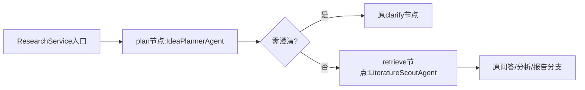

# 真实执行顺序

application/workflow.py定义共享状态和角色补丁。ResearchService构造两个角色，在原plan/retrieve节点委托执行；其他节点、递归上限、入口DTO和装配保持。

IdeaPlannerAgent先检查deadline，构造ClassificationRequest，再调用PicoPlanner.plan；后者仍用原严格源区间门禁。返回后复核deadline，添加内部角色耗时记录。阻断澄清由原图路由，不调用Scout。

LiteratureScoutAgent沿scope调用本地检索或PubMedRetrievalService；hybrid继续原来源合并，不重新设计FTS/RRF。异常保留原错误码，结果scope/options仍要与原请求一致，复制验证后的结果再返回。调用前后检查同一deadline。

服务持有既有连接/模型端口，角色不创建资源。command_runtime/api_runtime仍负责统一创建关闭；没有额外模型实例或独立服务。agent_steps只在内部图状态，不把实现细节加入医生的报告。
