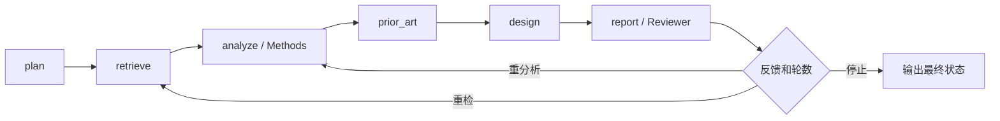

# 执行路径

application/agents.py定义四角色，workflow.py新增研究方案、反馈轮数和历史；ResearchReport增加待评估方案、反馈历史与停止原因，Markdown来自同一结构。ResearchService的反馈路由决定是否重跑，_feedback只增加轮数并清空旧设计；新的模型分析/报告覆盖旧结果。普通问答不走反馈；分析入口经过PriorArt后结束，澄清直接输出未检索状态。默认1轮，可构造服务时设置max_feedback_rounds=0关闭。

资源仍由原装配创建关闭，角色不另开连接或供应商SDK。ReportBuilder内部确定性门禁不能被反馈修改。耗尽不支持保持rejected，无证据/partial保持verification_incomplete，不伪标verified。
