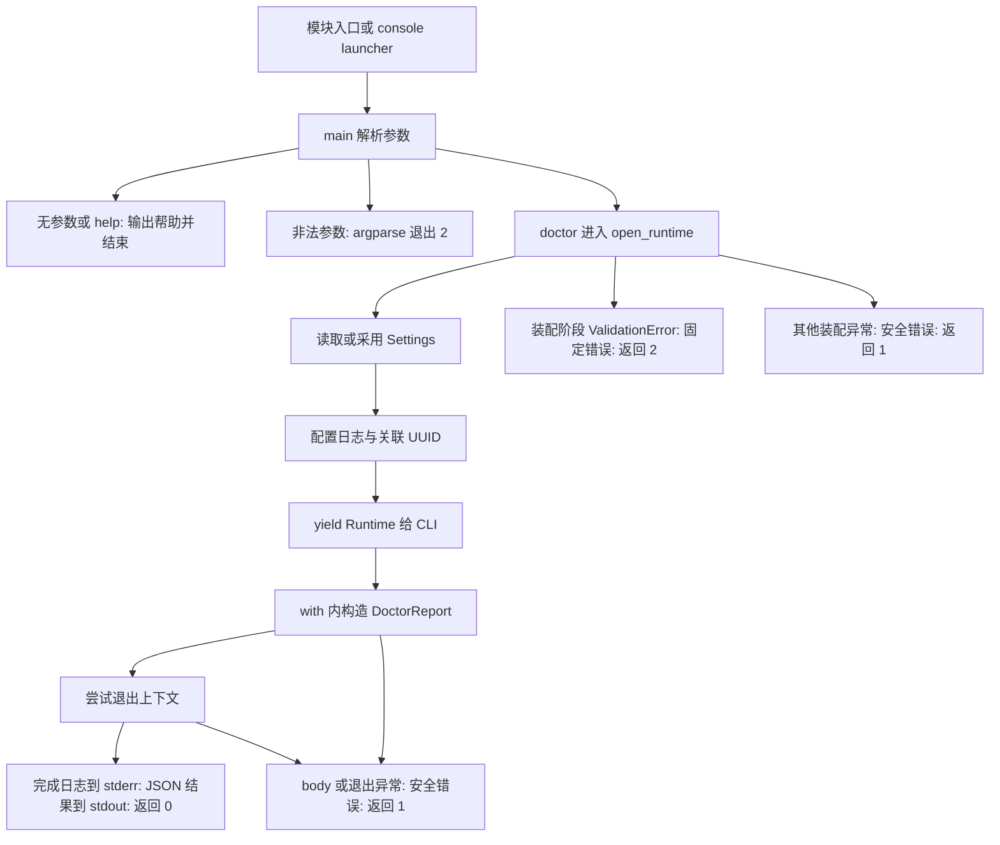

# 按实际执行顺序读代码

历史范围：本文记录Phase 0对应任务/教材时点，旧测试数、模块数及“下一任务”不表示当前状态。当前进度见[任务表](../../development-plan.md#phase-1-任务进度)；在当前仓库跑全量测试须安装ml/db/rag/api四个extras，基础doctor示例仍无需这些业务依赖。

先完成 [最小 Demo](tutorial.md)，再打开下面链接逐个定位。本页只解释当前六个源模块；architecture.md 中未来的 domain/application/adapters/feishu 不属于已实现调用链。

## 1. 安装如何生成两个入口

[pyproject.toml](../../../pyproject.toml) 的 project.scripts 将 clinical-agent 指向 clinical_agent.cli:main。安装工具生成 console launcher；它调用 main，并把返回整数用作进程退出码。更改脚本声明后需要重新安装项目。

`python -m clinical_agent` 则先进入 [__main__.py](../../../src/clinical_agent/__main__.py)，只有 __name__ 为 __main__ 时才执行 `raise SystemExit(main())`。普通 import clinical_agent.__main__ 不运行 CLI。[__init__.py](../../../src/clinical_agent/__init__.py) 只有包说明，没有读取配置或构建客户端。

## 2. main：先解析，不先装配

[cli.main](../../../src/clinical_agent/cli.py) 的输入是 argv 或当前进程参数，以及可选 runtime_factory。它先创建 argparse 解析器和 doctor 子命令，再 parse_args。

无子命令打印帮助并返回 0；--help/doctor --help 按 argparse 行为抛 SystemExit(0)；未知命令/参数抛 SystemExit(2)。这些路径在 with factory() 之前结束，所以坏环境变量也不影响帮助。解析器的 SystemExit 不属于后面的 Exception 捕获范围。

这里导入 config/bootstrap 并不等于读取环境：模块中只定义类和函数，真正的 Settings 构造被延后。区别应通过 [隔离导入测试](../../../tests/unit/test_package.py) 验证，不能只靠代码外观判断。

## 3. open_runtime：真正进入运行上下文

main 只有处理 doctor 才选择工厂：传入工厂优先，否则用 [bootstrap.open_runtime](../../../src/clinical_agent/bootstrap.py)。调用 contextmanager 函数先返回管理器，with 进入时才执行 yield 前的代码。

顺序是：显式 Settings 或 load_settings() → configure_logging(settings) → 传入 UUID 或 uuid4() → 构造 Runtime → yield 给 CLI。

[config.load_settings](../../../src/clinical_agent/config.py) 每次只构造一次新 Settings；没有全局缓存。显式 Settings 直接使用，不会再读冲突环境。[test_bootstrap](../../../tests/unit/test_bootstrap.py) 通过禁止额外读取和记录调用次数证明这两个分支。

当前 Runtime 只有数据，不持有数据库、模型或线程。它的 contextmanager 没有额外清理工作；未来引入实际资源时才需要相应关闭逻辑，不能把现在的退出测试解释成数据库已正确释放。

## 4. configure_logging：两条日志路径汇合

[logging_config.configure_logging](../../../src/clinical_agent/logging_config.py) 查找 clinical_agent 命名 logger，移除/关闭名称为 clinical_agent.json 的自有 handler，保留其他 handler；新建 stderr StreamHandler，设置级别和 ProcessorFormatter，关闭向 root 的传播。

标准 logging 记录由 ExtraAdder 选择允许上下文；structlog 记录先经 filter_by_level、字段筛选、wrap_for_formatter。最终 formatter 生成真实 level/UTC timestamp，再筛选字段，由 JSONRenderer 编码。原始 exc_info/stack_info 不进入输出，不调用被丢弃对象的自定义序列化。

重复配置更新级别，不叠加自有输出；它是进程级日志装配，不随 Runtime 退出而撤销。[test_logging_config](../../../tests/unit/test_logging_config.py) 在新进程测试这些行为，避免测试之间残留全局日志状态。

## 5. build_doctor_report：报告构造与发布分开

CLI 在 with 内标记 entered=True，再调用 build_doctor_report(runtime)。该函数读取 sys.version_info 的主/次/补丁，取出 runtime.settings.app_env 和 runtime.request_id，交给 Pydantic DoctorReport。

| 字段 | 实际来源/含义 |
| --- | --- |
| status / scope | 模型固定值 ok / local_environment |
| external_services_checked | 固定 false，明确无真实服务检查 |
| python_version | 当前解释器版本，不输出解释器绝对路径 |
| app_env | 当前 runtime 的配置 |
| request_id | 当前 runtime 的 UUID；JSON 序列化为字符串 |

DoctorReport 构造成功还不能立刻发布。main 先离开 with，退出成功后才记录 local_check_completed 并 print(report.model_dump_json())。否则可能出现“清理失败，但用户已经收到成功 JSON”。

## 6. 真实成功与失败流程



图中的 R→F/R→I 是进入阶段失败；此时未获得 runtime，不强制初始化错误日志。body/退出阶段的 ValidationError 也属于执行失败，返回 1，而不是把任意数据验证错误都指责为用户配置错误。

main 用 entered 标记区分阶段：装配 ValidationError 输出 Invalid configuration.；其余 Exception 输出 Local check failed.，已进入时附受控 local_check_failed 日志，只有关联 ID、环境、固定错误码、异常类型名，不记录异常消息/traceback。KeyboardInterrupt 等 BaseException 不是本地错误映射的对象。

## 7. 如何注入工厂并证明执行顺序

下面是完整教学脚本，不连接服务，也不修改全局配置。Fake 工厂只提供当前 Runtime，finally 记录退出；成功后验证顺序。其输出 JSON 来自真实 main：

```python
from contextlib import contextmanager
from uuid import UUID

from clinical_agent.bootstrap import Runtime
from clinical_agent.cli import main
from clinical_agent.config import Settings

events = []

@contextmanager
def factory():
    events.append("enter")
    try:
        yield Runtime(
            Settings(app_env="test", log_level="INFO"),
            UUID("00000000-0000-4000-8000-000000000005"),
        )
    finally:
        events.append("exit")

code = main(["doctor"], runtime_factory=factory)
assert code == 0
assert events == ["enter", "exit"]
```

这是依赖注入：调用方决定如何提供依赖，核心流程只消费它。Fake 工厂没有配置项目日志，所以这个示例不用于证明真实 JSON 日志；日志行为由教程的真实 runtime Demo 和现有日志测试验证。

## 8. 测试如何证明关键边界

| 文件 | 直接证明的内容 |
| --- | --- |
| [test_package.py](../../../tests/unit/test_package.py) | 六模块独立导入，无配置构造/网络/线程/日志配置副作用，来源是已安装开发包 |
| [test_config.py](../../../tests/unit/test_config.py) | 17 个参数化配置场景，含当前/父目录 .env 和错误输入 |
| [test_logging_config.py](../../../tests/unit/test_logging_config.py) | 真实双路径日志、级别、重复配置、敏感对象/异常过滤 |
| [test_bootstrap.py](../../../tests/unit/test_bootstrap.py) | 2 个装配 + 7 个 CLI 生命周期场景；成功、body/进入/退出错误、阶段分类 |
| [test_cli.py](../../../tests/integration/test_cli.py) | 24 个安装入口/解析/离线场景，临时 cwd 与有界子进程 |

生命周期测试在 finally 内断言 stdout 仍空，再检查退出后的结果，因此不仅是在验证 entered/exited 两个标记。P0-07e 的 wheel 来源检查另行证明分发包来自 site-packages；开发包测试预期来自 src，不应强行拿它的路径断言来测 wheel。

## 9. 设计取舍复盘

用 argparse/contextlib/dataclass 和既有 Pydantic 即可完成当前边界，没有必要加入命令框架或容器。Runtime 是简单上下文数据，工厂是 callable；没有工厂继承树。日志字段筛选短小，格式化交给成熟库。每层有真实职责和失败测试，后续加入业务前仍能单独运行 help/测试。

这套结构为下一阶段提供装配点，但还没有共享业务服务、Repository、数据库迁移或 Agent 工作流。下一步先定义文献/证据契约，再逐项引入对应能力。
