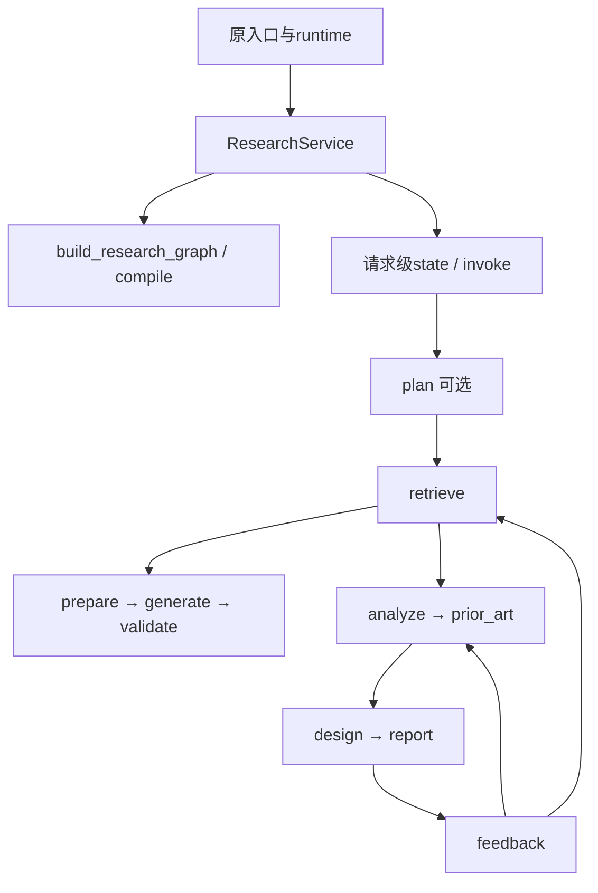

# 按实际执行顺序读代码

1. API/CLI/飞书通过原runtime显式装配依赖；本次不移动资源所有权。
2. application/research.py 的ResearchService.__init__验证反馈轮数，保存retriever/generator等依赖，创建六角色实例，然后调用agents/graph.py的build_research_graph。
3. 构建函数创建StateGraph(State)，注册retrieve、prepare、generate、validate、empty、analyze、report、prior_art、design、feedback；有Planner再注册plan和clarify，最后compile并返回。无数据库/HTTP/线程创建。
4. answer/respond/analyze/report构造请求级state，设置deadline和模式标志，在禁用追踪的上下文中invoke，保留递归限制12+8*反馈上限。
5. plan调用IdeaPlannerAgent；retrieve调用LiteratureScoutAgent并保留服务中的全文补充；prepare/generate/validate仍由ResearchService处理上下文、生成和引用。
6. analyze委托MethodsAnalystAgent，随后prior_art校验引用；报告经design到EvidenceReviewerAgent。反馈到methods回analyze，到scout回retrieve。轮数限制和超时仍在服务中。
7. 四个公开方法验证最终领域对象并映射既有错误；外部runtime负责关闭资源。旧application.workflow和application.agents直接重导出同一对象，不创建第二套实现。

图示省略empty、clarify和END分支；完整分支以agents/graph.py及冻结fixture为准。
