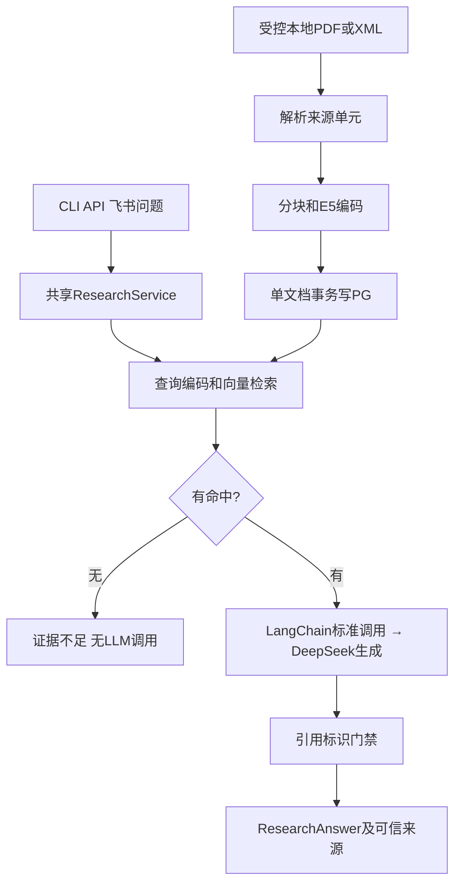

# 从零理解医学文献RAG

## 是什么
RAG是“先检索，再生成”：从已导入文献中找片段，把问题和片段交给模型，最后检查回答引用。LLM能组织语言，却不能凭语言流畅证明研究存在。数据库负责持久保存来源，模型负责有限上下文内的生成，两者职责不同。

## 为什么需要
直接问模型可能得到无法追溯的结论。项目保留document_id、chunk_id、content_hash、content_scope和location：同一段文字不仅有内容，还知道属于哪份快照、哪一页或摘要章节的哪个字符区间。PMID未知可以为空，不能为了格式完整自行填写。

## 底层原理
PDF适配器读取有文本层的页面，不做OCR；XML适配器只读取本地PubMed导出，不在线搜索。解析先保留source units，分块不跨页/摘要单元；位置使用规范化文本内的半开区间[start,end)，所以text[start:end]能回建证据。它不是PDF字节偏移，也不保证所有复杂版面正确。

Embedding把文本映射到768维向量。固定E5模型使用passage: / query:前缀，前缀参加token计数但不混进证据正文。token不是汉字数或Python字符串长度；先用实际tokenizer计算完整输入长度，超限明确失败，不能截断后丢掉原始定位。相似度衡量向量接近程度，不是证据质量或医学结论概率。

PostgreSQL的pgvector扩展保存向量，Python pgvector包提供类型映射，两者版本不能混用。解析、分块、编码在事务外；PostgresStore.save在一个文档事务中写来源单元与片段。数据库唯一约束处理并发重复，同身份内容改变返回needs_update，MVP不覆盖旧证据。这比“先查不存在再插入”更可靠，因为并发请求可能同时看到不存在。

LangChain提供标准模型消息、invoke调用与AIMessage响应，DeepSeek只是当前供应商，通过配置URL的ChatOpenAI调用兼容模型API。通用Agent工具也按LangChain工具接口接入，具体能力按阶段实现。

LangGraph组织已有函数的分支，当前只有一次检索、一次生成与检查，没有多Agent角色。空命中直接返回insufficient_evidence，绝不调用LLM补知识。非空命中让模型只输出claims及给定chunk_id；可信书目由存储命中构造。未知引用拒绝整个回答，不悄悄删除错误项。结构合法仍可能语义错误，所以每条医学结论还需要人工核对支持关系。

## 最小Demo
先阅读[运行命令](README.md)，再打开[实际Demo](demo.py)。Retriever返回一个合成EvidenceHit；Generator返回一个引用该chunk的JSON；ResearchService运行真实图；空命中时调用次数不增加；把引用改成未提供UUID后抛citation_invalid。Demo没有真实向量计算，因此不能据此判断检索效果。

运行后按顺序观察：answered的来源证据等于正文；empty没有claims/sources；错误引用作为ResearchError被捕获。只看最终字符串不够，应在ResearchService._retrieve、_generate和build_answer设置断点，观察request/options、deadline和引用集合。

## 项目真实代码与执行流程
详细函数和跳转见[代码解析](code-walkthrough.md)。最小主干如下：

飞书回调还要经过纯过滤、Redis owner占位、有界Dispatcher和Sender。Redis只记短期处理状态，不保存文献真相；线程池max_workers本身不限制待执行队列，所以接纳前另设容量。资源只能在实际工作结束后回收，超时等待不等于杀死线程。

## 调试、修改练习和面试表达
用[练习](exercises.md)证明自己理解空召回和生成错误的差别，用[排错](troubleshooting.md)选择相应测试。30秒表达：“我先把来源、定位和模型版本作为契约保存，再让模型引用给定片段，最后从可信元数据渲染来源；标识检查保证关联，人工复核才判断医学支持关系。”

设计取舍：同步服务易测试，入口用受限线程隔离；简单Lua保证单键原子性；HTTP只做有限单次请求，不承诺跨Redis/飞书的exactly-once。后台恢复、实时PubMed、混合检索、自动语义核验属于后续阶段。
