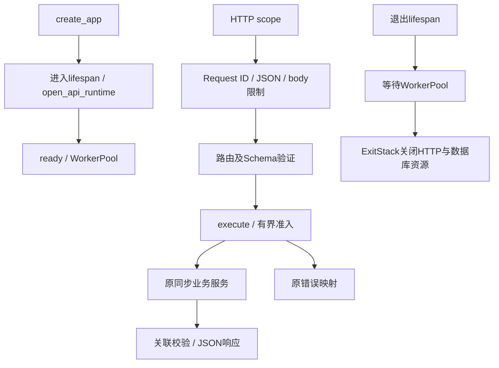

# 按执行顺序读真实代码

1. `clinical_agent.api:create_app`从api/__init__.py取得api/app.py的同一个函数。调用工厂创建独立_State并注册lifespan、中间件、异常处理和路由，不创建业务资源。
2. Lifespan读取ApiSettings并配置日志，使用asyncio.to_thread进入api/runtime.py的open_api_runtime。它加载既有embedder、数据库engine及共享open_research_service。成功后创建WorkerPool并置ready。
3. api/middleware.py的_Boundary为HTTP请求解析或生成UUID，控制媒体类型、Content-Length和流式body大小、10秒读体超时，并在响应写入同一X-Request-ID。
4. api/routes.py的register_routes只注册原路径。请求模型在schemas.py；领域ResearchAnswer/AnalysisResult/ReportResult仍由domain持有。每条业务路由构造同步operation并调用execute(state, request, operation)。
5. api/execution.py先检查ready，再提交WorkerPool；池满抛BusyError，映射503、retryable=true及Retry-After:1。operation完成后按原逻辑验证请求关联ID或导入结果。
6. execute保留原ResearchError/RetrievalError映射和未知错误脱敏；框架验证、404/405等由app中的异常处理器注册。middleware中的_error构造相同ApiError。
7. Lifespan退出先置not_ready，再在线程中等待池关闭，最后关闭ExitStack；startup_failed/shutdown_failed保持原语义。

变更前源码快照位于docs/api-migration-phase2/before-api.py和before-api_runtime.py，AST核对结果见ast-review.json。它们只是审查依据，不是运行入口。
