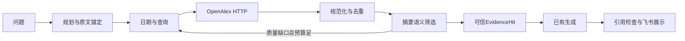

# 按执行顺序读真实代码

1. 飞书worker构造QuestionRequest；CLI/API同样走ResearchService。command_runtime/open_api_runtime在上下文中创建模型、HTTP和数据库，退出时关闭。
2. application/pico.py:PicoPlanner.plan调用extract。domain/pico.py携带ResearchConstraints，原文锚定校验在QueryPlan中执行。
3. application/agents.py:LiteratureScoutAgent识别OpenAlex服务；hybrid先取得本地证据，再将其交给相同语义筛选。历史PubMed替身仍供旧测试回放，生产runtime不装配。
4. application/openalex.py:retrieve解析日期交集，compile_queries保留科学概念并排除时间词。每轮按相关性和发表日期获取候选，最多4请求。
5. adapters/openalex.py:OpenAlexClient.search发Bearer认证，限制响应字节和期限，错误只输出稳定code。OpenAlexRecord.from_work保留canonical快照与hash，verify_snapshot核对全部规范字段。
6. retrieve对日期、缺摘要与来源政策先过滤；候选去重后批量screen_candidates；schema、ID集合、quote与维度逐层验证。部分坏项不连累已验证项，也不能混入生成。
7. 质量与回答维度有缺口时才补检。最终只选direct且constraints_match的证据，按实验信息/代表性/OA/年份稳定排序，不跨通道比较分数。
8. record_hit构建EvidenceChunk/DocumentSummary，保留OpenAlex来源，无伪PMID；ResearchService._prepare只把精简provenance送模型。原始快照留在结果审计中。
9. build_answer校验引用ID，SnapshotVerifier可重建摘要验证区间；sender复用已有可信参考文献展示。全文服务当前只支持已有PubMed证据，不能把OpenAlex摘要说成全文。

