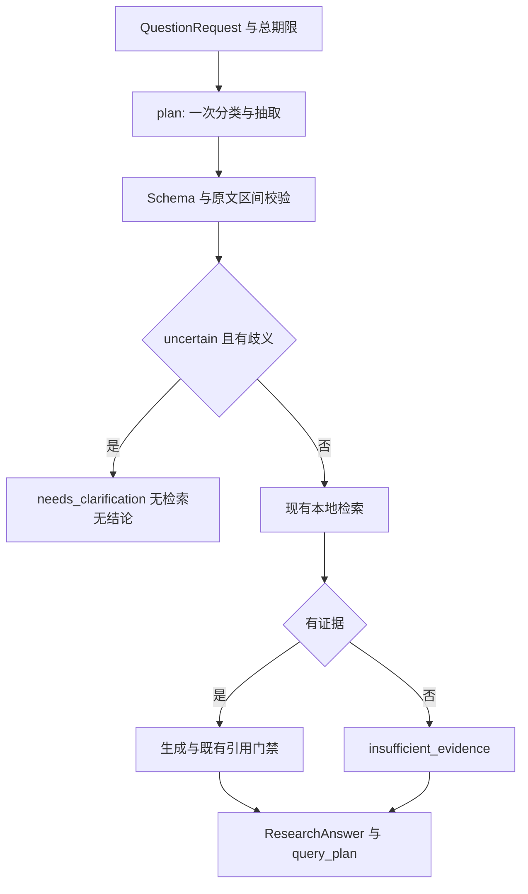

# 真实代码执行顺序

1. `command_runtime.open_research` / `api_runtime.open_api_runtime` 复用现有模型、E5 和 PostgreSQL 生命周期，并将 `PicoPlanner(extractor=generator)` 注入 ResearchService。飞书复用命令运行时。
2. `application/research.py` 的 `answer` 深拷贝请求，设置总期限，执行已编译 LangGraph 的 plan 节点。
3. `application/pico.py` 的 `plan` 以剩余总时间和默认 20 秒中较小值调用 extractor。`adapters/langchain_generation.py` 的 `extract` 使用固定系统指令，问题和 schema 放入 HumanMessage JSON；`_invoke` 复用现有 ChatOpenAI/HTTPX 超时、JSON mode、禁工具输出门禁及禁 tracing。
4. `ExtractionDraft` 拒绝多余字段，`ExtractedField` 核对来源/span 的结构，`QueryPlan.validate_provenance` 精确核对原文切片。`StructuredQuestion.consistent_status` 固定分支规则，模型不能直接指定流程状态。
5. `ResearchService._plan_route` 对阻断歧义转 clarify；其余继续 retrieve → prepare → generate → validate。没有命中走 empty。检索和生成沿用原问题，不用扩展词替换。
6. `answer` 将计划附加到 ResearchAnswer 再完整验证。CLI/API 输出 JSON；`feishu.sender.render_answer` 显示 PICO/扩展/歧义并继续使用现有转义、长度预算和引用渲染。

PicoPlanner 不创建连接/线程，只使用注入依赖。模型和数据库由原上下文退出关闭。同步调用超时是传输预算与返回后检查，不能强杀阻塞线程。规划失败为 extraction_failed/timeout，不能冒充证据不足；不新增持久任务系统。
