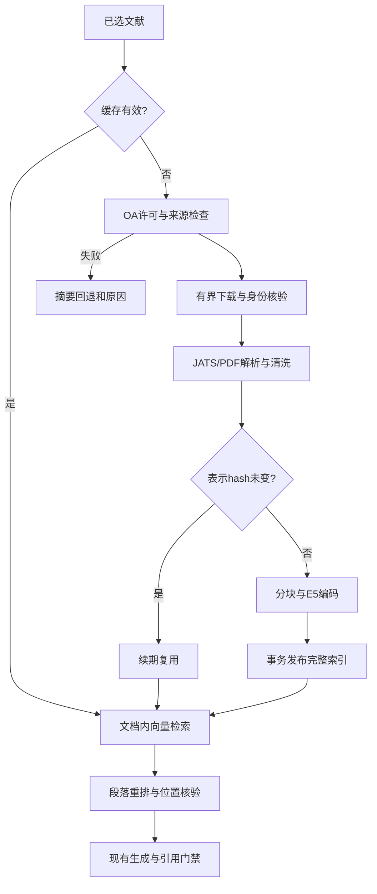

# 按真实执行顺序读代码

1. ResearchService._retrieve调用原有Scout，得到筛过的文献；普通answer调用FulltextService.enrich。analysis/report仍有既有分支范围，不能声称本轮已复验全部报告全文链。
2. FulltextService保留旧PMC/BioC分支，并将OpenAlex命中交给application/oa_fulltext.py:enrich_openalex。所有操作共享研究总期限。
3. OAFulltextSource.fetch_record从已选OpenAlex locations中找允许的OA来源，优先PMC结构化全文；download检查白名单和逐跳重定向，复用进程级串行限流门，不打开任意落地页。
4. parse_jats核验DOI、题名和JATS中的许可链接，输出FulltextUnit；parse_oa_pdf复用已有parse_pdf，核验首页面DOI/题名，按显式章节与原页码组织文本。临时文件由TemporaryDirectory关闭清理。
5. enrich_openalex先读缓存，过期时重取并比较表示hash；按source_units分块，利用节点真实字符偏移验证原文切片，不从改写文本猜位置。超过块数或期限则不发布。
6. PostgresFulltextStore(openalex=True)使用新OA表；默认参数仍访问旧PMID表。publish通过advisory事务锁、完整替换及zip(strict=True)保证一致性。向量查询限制paper_key。
7. 候选段经过paper_key/hash/section/page/字符区间验证，再由rerank_passages按问题重排。两段写入EvidenceHit.fulltext；摘要内容和原OpenAlex快照不改变。
8. ResearchService._prepare把正文段落带入现有GenerationInput；build_answer只接受真实chunk ID。全文引文保留页码/章节；只引用摘要不会借附带全文冒充全文证据。飞书渲染按实际引用范围显示。

