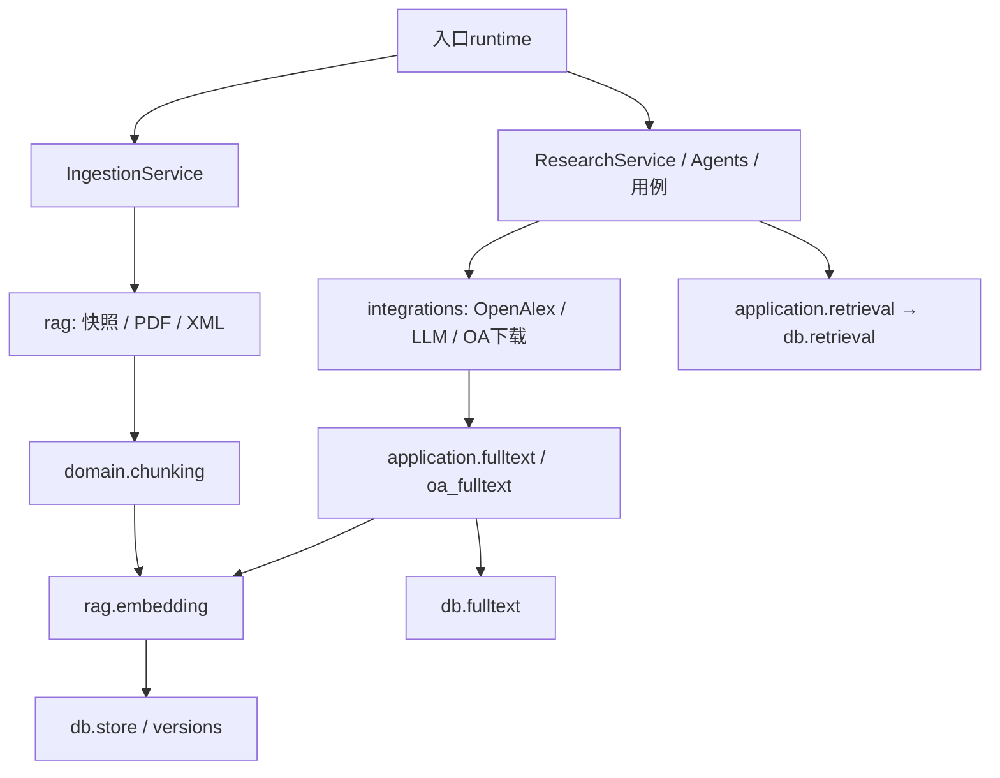

# 按实际调用顺序读代码

## 本地摄取
1. command_runtime.open_ingestion或api.runtime.open_api_runtime显式读取配置，通过rag.embedding.load_local_embedder加载既有模型并打开db.connection.database_engine。
2. application.ingestion.IngestionService接收reader/embedder/store；rag.offline.OfflineReader创建并核对不可变快照，再调用rag.pdf.parse_pdf或rag.pubmed_xml.parse_pubmed_xml。
3. domain.chunking按原来源区间切分，rag.embedding.LocalEmbedder编码；db.store.PostgresStore在原Session事务中保存文献和块，显式更新仍使用db.versions.VersionedPostgresStore。
4. 解析文件与流按原with/closing退出。engine在database_engine finally中dispose，模型仍由入口运行时持有，不增加通用close接口。

## 研究与全文
1. research_runtime.open_research_service借用engine/embedder，打开integrations.llm.open_llm、integrations.openalex.open_openalex和全文HTTP client。
2. 原ResearchService/Agents/应用用例调用OpenAlexRetrievalService发现和筛选；integrations.oa_fulltext.OAFulltextSource只处理真实返回URL的下载、解析及身份校验，不承担全部科研判断。
3. application.fulltext和application.oa_fulltext保留缓存签名、切分、Embedding及证据段落整理；db.fulltext.PostgresFulltextStore保留事务、向量和缓存读取。普通本地检索仍走application.retrieval→db.retrieval.PostgresRetriever。
4. integrations.langchain_generation.LangChainAnswerGenerator处理模型结构输出；integrations.report_snapshot.SnapshotVerifier保留来源复核，领域引用真实性校验不搬出domain。
5. 研究上下文退出关闭HTTP资源，入口上下文最终关闭engine；借用资源不由适配器重复关闭。

db治理、维护、更新账本、重建等11个模块全部保留独立文件，事务和版本发布规则未改。PubMed在线适配保留于integrations.pubmed_online，但当前科研装配继续只使用OpenAlex。
