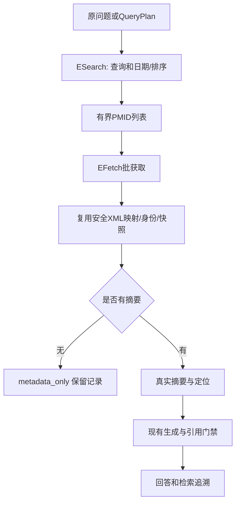

# 按执行顺序阅读代码

1. CLI 的 --scope 或 API 的 QuestionBody 形成 QuestionRequest，pubmed 选项仅用于 online/hybrid。飞书纯文本提问仍默认local。
2. 现有 ResearchService 先做PICO；需澄清仍不检索。_retrieve按scope选择原本地服务或application/pubmed.py。hybrid先本地再在线，复用总期限。
3. adapters/pubmed_online.py 的 PubMedClient.search 构造官方POST参数，_request进入全局RequestGate，锁等待和限流计入预算。key/email只在表单内，不在公开来源URL或日志。open_pubmed上下文负责HTTP连接关闭。
4. ESearch按页获得ID，再EFetch分批获取XML。重复/非请求ID和部分失败分开记录，不用正常空列表掩盖故障。
5. adapters/pubmed_xml.py 的 parse_pubmed_response 复用 _read_tree/_map_record，不放宽离线入口的无摘要拒绝策略；在线单独允许metadata_only，并带出版类型及更正关联标记。
6. domain/pubmed.py校验快照哈希、摘要/区间、计数；PubMedRetrievalService为有摘要记录生成本次内部UUID及未编码的EvidenceChunk，score_type=pubmed_rank。
7. 现有prepare/generate/validate使用实际摘要和可信元数据。domain/citations.py只从命中来源构建引用；ResearchAnswer附加search_provenance，渲染不再误称仅检索本地。

PubMedClient不写数据库、不调用模型。所有网络资源由共享上下文关闭；等待取消不能强杀同步线程。保留简单受控错误码，没有独立队列或通用重试体系。
