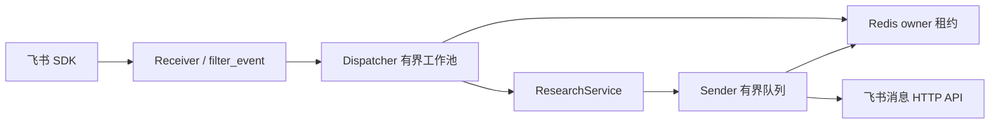

# 按真实执行顺序读代码

## 1. 启动与资源所有权

`main()` 先解析参数，再创建 `FeishuSettings`。`build_runtime()` 通过 `ExitStack` 依次打开科研服务、Redis 去重器、HTTP Client、Sender 和 Dispatcher。模块导入阶段不读取环境变量，也不创建客户端或线程。

`run_sdk()` 校验固定的 `lark-oapi` 版本，在专用事件循环中建立长连接。SDK 回调只调用 `Receiver`，不会等待科研结果。

## 2. 事件边界

`Receiver` 把 SDK 对象复制为已有字典契约，再调用 `events.filter_event()`。过滤器依次检查事件类型、Schema、App、发送者、消息类型、会话类型、群聊提及、文本长度和稳定身份。

只有 `accepted` 决策携带 `MessageEnvelope`。忽略事件与非法事件不会进入 Redis 或线程池。

## 3. 准入与幂等

`Dispatcher.submit()` 先非阻塞获取容量槽，再调用 `RedisDeduplicator.acquire()`。Lua 脚本使用 `SET NX PX` 建立带 owner 的 processing 租约。重复消息、Redis 不可用、容量已满和执行器提交失败都有原有明确状态。

工作函数在科研调用前后检查截止时间与租约所有权。普通文本调用 `ResearchService.respond()`；`/report ` 前缀调用 `report()`。生成结果的 request_id 必须与消息一致。

## 4. 发送与交付

worker 把 `Delivery` 非阻塞移交给 Sender 队列。Sender 在专用线程中再次检查租约，使用原渲染函数生成完整文本，并通过 `OfficialMessageAPI` 发送。

明确成功后标记 completed；明确失败可释放租约；超时或不确定响应保留 unknown，不执行可能造成重复消息的盲重试。日志继续使用 `feishu.*` 命名空间，因此原 JSON formatter 和现有日志采集规则保持有效。

## 5. 关闭顺序

`BotRuntime.close()` 先停止并排空 Dispatcher，再关闭 Sender，最后执行 `ExitStack.close()` 释放 HTTP、Redis 和科研资源。若前一层尚未排空，资源不会提前关闭。

本次迁移只改变模块归属和内部导入；上述状态、预算和关闭顺序均来自原实现。
