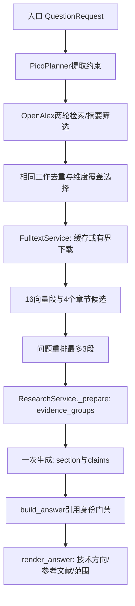

# 按真实执行顺序读代码

1. `application/openalex.py:compile_queries`保留研究锚点，必要时补充不同词法表达。`retrieve`仍限制两轮、四HTTP；不足五项独立直接证据时允许补检，筛选条件不放宽。`add`用DOI/PMID及题名摘要指纹去重；最后先补已证实的问题维度，再按质量选取，不把相关性分数当医学证据等级。
2. `application/oa_fulltext.py:enrich_openalex`先load缓存。缺失才尝试来源；`count`由HTTP边界增加，finally据是否发生HTTP计论文尝试，许可预检失败不会耗名额。最多三篇实际尝试、六HTTP，超过预算保留摘要和原因。缓存向量与原文hash仍按既有事务契约绑定。
3. `section_priority`只判断科研章节意图；`rerank_passages`组合章节优先、问题词和向量排名，最多三段。返回段落必须逐一验证其论文身份、hash、位置和原文切片。没有疾病或器官白名单。
4. `application/research.py:_prepare`从真实入选hit和已校验assessment建立维度→摘要chunk ID组及study_role标签，移除大快照/检索trace，构造GenerationInput。上下文超限先从段落最多的论文删末段，避免先清空最后一篇全文。研究总时间不变，全文给生成预留25秒。
5. `domain/research.py`的DraftClaim增加可选section，旧输出仍有效；bibliographic token检查也覆盖标题。INSTRUCTIONS要求先回答研究问题、按技术方向综合、区别摘要和全文、保留实验条件。
6. `domain/citations.py:build_answer`复用真实来源建立引用，不接受模型生成的DOI。`feishu/sender.py:_readable_answer_lines`按section组织段落；OpenAlex普通输出隐藏内部候选数，audit与API来源仍可追溯。研究特定限制不会被模糊删除。

HTTP客户端、数据库engine、模型由原runtime上下文管理；本轮没有新增工作流或持久化连接。可选全文失败在enrichment边界记录，结构化模型输出/引用失败仍明确拒绝，不修补未知引用后伪装成功。

比较题先查综合证据，再分别补两侧方法；study_role=method_origin且约束匹配、覆盖指定方法的partial论文，可以作为单侧方法参考，不伪装成双方法实验。单纯constraints_match=false仍拒绝。补检的新候选优先评估，避免旧预算剩余项一直占位。通用分析措辞不作必需研究对象，但终点不因粗糙计划被删除。
