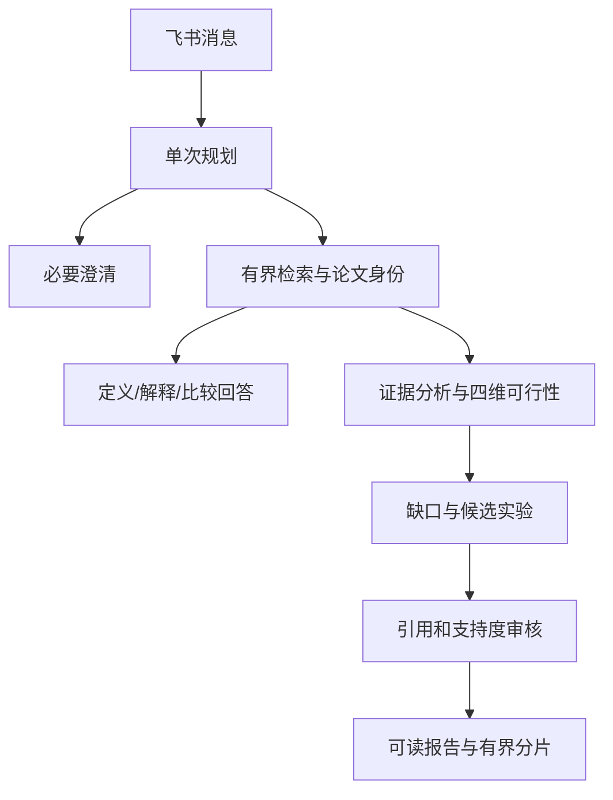

# 按执行顺序读代码

1. src/feishu/worker.py的Dispatcher._run构造QuestionRequest；普通消息借用research.respond，/report保留显式报告入口。worker借用资源，不创建数据库连接。
2. application/research.py的respond建立请求局部State、deadline并只invoke一次图。_plan调用IdeaPlannerAgent，将feasibility标为analysis_requested/report_requested；阻断歧义走_clarify。
3. application/openalex.py的compile_queries产生有界查询；retrieve筛选来源并记录purpose、identity_checks。DOI精确匹配与方法原文有来源支持的判断是不同强度的身份结果。
4. application/analysis.py的EvidenceAnalyzer.analyze先使用build_answer绑定可信来源，再调用一次联合分析。无hits直接返回unknown；有结果则核查四维与实验引用及gap索引。
5. application/agents.py的prior_art/design保留既有缺口校验和方案组织。application/report.py的collect_claims将可行性和候选实验加入审核条目，ReportBuilder核查来源和支持度。
6. domain/report.py的render_report默认生成可读报告；feishu/sender.py的split_report_text做有界分片。Sender持有发送租约，未知投递不盲目重试。

外部模型Schema错误保持失败；worker仅记录请求ID与安全错误码。数据库、HTTP和模型由command_runtime上下文管理，worker关闭先排空工作再由运行时释放借用资源。
