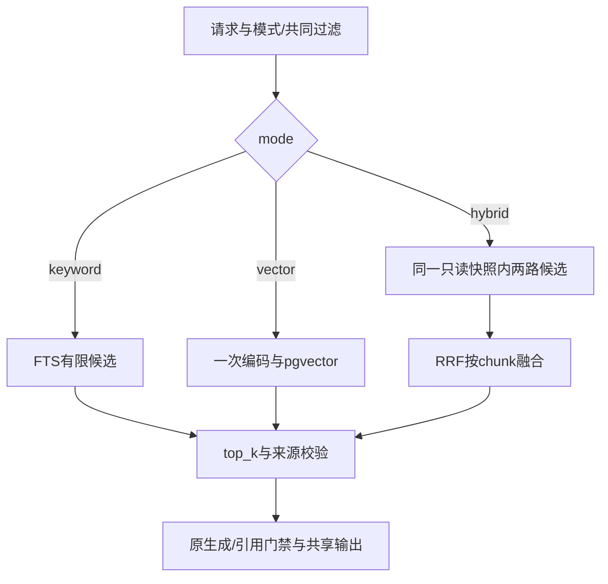

# 按请求执行顺序阅读

1. RetrievalOptions接纳mode/candidate_limit/keyword_query/本地日期。scope是来源范围，mode是本地算法；两种hybrid含义不同。
2. application/retrieval.py检查关键词语言，keyword跳过查询Embedding；vector/hybrid对原问题编码一次。原有超时、错误码和结果重验证保留。
3. adapters/postgres/retrieval.py的search/search_hybrid在一个REPEATABLE READ只读事务中分别获取候选。所有来源/范围/日期过滤复用，statement_timeout随剩余时间调整且不超过原10秒语句上限。
4. keyword查询生成列search_vector；vector使用原cosine距离。domain/hybrid.py的rank_candidates按chunk_id整合通道排名，手算公式固定，不另建排序服务。
5. 只对最终top_k执行_hydrate，复用prepared_from_records验证来源、片段归属/区间及模型身份。候选与来源在同一数据库快照内，避免两次请求看到不同版本。
6. RetrievalResult返回通道状态、策略、排名与分数；ResearchService继续既有生成/引用门禁。ResearchAnswer给出local_retrieval_mode/strategy及warnings，CLI/API/飞书复用装配。
7. scope=hybrid时，先得到本地结果再按Phase4名额与在线来源合并。在线PubMed排名不参与本地RRF，同一本地文献的不同片段不会因文档相同被删除。

迁移p501_0003在已有chunks增加STORED search_vector和GIN；PostgreSQL为旧行回填、新写自动计算。降级只移除此索引/列，保留片段、向量和旧迁移；生产升级必须显式运行Alembic，不让应用create_all。连接仍由既有database_engine上下文关闭，没有新线程/后台任务。
