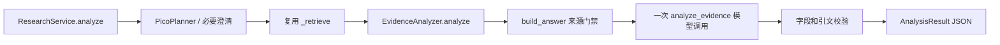

# 按真实执行顺序读代码

`application/research.py` 的 analyze 校验 QuestionRequest、建立总期限并以 analysis_requested 调用同一已编译 LangGraph；有 Planner 时先规划，需澄清直接结束，随后经过原 retrieve 节点，路由到新增 analyze 节点调用 _analyze，保留来源 scope、FTS/RRF 和在线快照行为。空结果也路由 analyze 并在分析器中跳过模型；clarify 节点按模式返回分析澄清结果。它不执行原回答 generate，也不生成 Phase 7 报告。

`application/analysis.py` 复制输入，调用现有 build_answer 验证并构造可信 CitationSource；此处临时 claims 仅用于来源门禁，不成为分析结论。过滤已标记撤回来源，把可信文献快照及 AnalysisDraft schema 送给模型。`adapters/langchain_generation.py` 的 analyze_evidence 复用 _invoke 的标准消息、JSON mode、总预算与异常处理；来源文本只在用户消息的数据中。

返回后用 `domain/analysis.py` 验证必需字段，再检查精确引文、文献归属、用户原文、重复研究和双侧比较。失败抛 ResearchError；成功返回完成或 partial 状态以及不带本地路径的可信来源。ResearchService 再检查总期限。

CLI `ask --analyze` 和 API `/v1/analyses` 使用同一 ResearchService。模型和数据库资源仍由 command_runtime/api_runtime 上下文创建和关闭，分析器不另建连接。普通 ask、/v1/questions 和飞书继续原问答路径。
