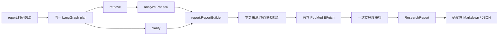

# 按实际执行顺序读代码

`ResearchService.report` 建立 request-local 状态、总期限及 report_requested 标志；复用原 plan/retrieve/analyze，新增 report 节点。澄清走 clarify 后输出无证据报告，检索故障保留错误，不假装无研究。普通 answer 和 analyze 路由仍保持。

`ReportBuilder.build` 复制分析结果，用原 build_answer 重新绑定来源；`collect_claims` 将方法、研究类型、逐维相似性、比较、缺口和方向转成稳定 claim_id。未知字段不补造，unknown 相似性不能靠模型升级为 supported。

`SnapshotVerifier.check` 只读取检索结果中的可信快照 URI，限制文件大小，使用原 PDF/XML 解析和 ParsedPdf/ParsedPubmedArticle.validate_chunk 规则回核定位，本地批量XML复用原文献ID生成规则；在线来源核对 XML hash 及摘要范围。不存在的快照是 unavailable，内容/位置矛盾是 invalid。

有 PMID 时 `PubMedClient.fetch_metadata` 复用官方 HTTP 门、有限重试和期限，批量核对现有元数据。身份字段冲突拒绝，作者/日期/期刊变化保留待复核。没有 DOI 仍合法。`LangChainAnswerGenerator.review_claims` 复用 _invoke 的标准模型边界，所有原文只作为数据；无效审核输出保持 uncertain，不删原结论。

`domain/report.py` 的 render_report 用同一报告对象生成八部分和编号。CLI ask --report、API /v1/reports 和飞书 /report 共用该链路。飞书 worker 接收报告，sender 在发送前构造有限分段；每段检查 lease 和期限，中途失败停止，部分发送后不自动重发。模型/数据库资源仍由原装配上下文创建关闭，没有新增依赖或表。
