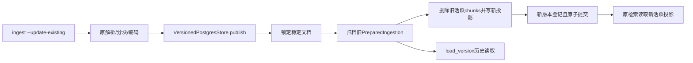

# 按执行顺序读源码

CLI将显式标志传给IngestionCommand，command_runtime只在该标志下装配VersionedPostgresStore，默认仍PostgresStore。编码在IngestionService原写事务外完成。

versions.py的fingerprint定义签名；versioned复制DTO并用版本UUID重命名原始/编码chunks，保持source单位和文档身份。publish锁定行，_read复用原重建验证，第一次更新旧库时归档旧IDs原样；同事务写入新chunks及版本行，异常回滚。load_version按不可变UUID还原内部DTO。新版本已存在于历史时拒绝自动回滚。

p801_0004增加document_versions与每文档仅一个活跃版本的部分唯一索引。迁移不改写旧记录，已有文献在第一次更新才惰性归档。业务库不会自动迁移。dry_run内部方法只分析已准备DTO，不写表，不代表免编码更新命令。

P8-02入口为scripts/update_literature.py，application/updates.py处理本地批次，adapters/postgres/update_runs.py负责会话锁和短事务checkpoint，domain/updates.py定义约束。原解析器完成免编码dry-run；实际发布仍复用IngestionService与版本存储。p802_0005只新增游标/运行表。详见update-runs.md。

## P8-03实际执行路径

scripts/govern_sources.py校验有界JSON，在database_engine上下文中调用SourceGovernance。claim先锁标识再锁文档，校验原生PMID/hash后幂等插入；resolve返回显式与当前原生候选集。change_status先锁事件键再锁文档，检查事件重放和expected_event_id，先flush事件再更新当前投影，退出事务提交。检索候选用NOT EXISTS统一排除阻断状态；hydration外连接当前状态，仍与原文同快照，不新增独立读取。CitationSource复制治理字段，render_report输出依据。历史versions和chunks不变；失败回滚与版本发布后状态保留的真实测试见test_source_governance.py。

## 收尾执行顺序

sync_pubmed.py装配官方客户端、OnlineBatchRepository、OnlinePublicationStore与原IngestionService；OnlineUpdateService先检查完整窗口，再冻结并创建哈希文件，由UpdateService推进文件游标。OnlinePublicationStore._published在文档发布事务内登记官方状态。PubMedRetrievalService合并官方明确标记和精确已知PMID状态，不借别名传播。

rebuild_knowledge.py plan→stage→activate分别调用KnowledgeRebuilder。stage的_sources在一致快照读出全库，chunk_source/Embedder在写事务外计算。evaluate在独立临时schema用真实PostgresStore/PostgresRetriever验证候选。activate持文档表写互斥锁，重新核对signature，然后一起切换chunks和DocumentVersionRecord；异常由事务回滚，finally清理评价schema。详见maintenance.md及实际测试。
