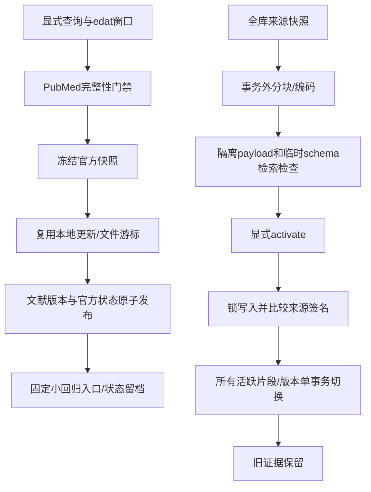

# Phase8在线窗口与显式重建

2026-10-28，配合[收尾SPEC](../../specs/tasks/p8-completion.md)和[实际验收](../../phase8-acceptance.md)使用。所有命令手动启动，不创建定时任务，不加载.env。请先配置CLINICAL_AGENT_DB_*，在目标环境由操作者显式升级Alembic到p804_0007。本轮只操作一次性测试库，没有迁移业务库。

## 在线增量是什么

现有PubMed检索获取的是一次查询结果；增量同步还要保证窗口、源快照、已发布项和游标可以追溯。当前实现采用显式edat日期窗口，包含起止日、最多31天和20篇。完整窗口才冻结和发布；partial、缺条目或truncated返回window_incomplete，不把前20篇当完整同步。窗口太大应缩小日期/查询并用新batch_id。edat是进入PubMed的日期，不保证捕捉所有旧记录更正；需要更正时显式重查对应PMID或重叠窗口。

online.json示例：

```json
{
  "batch_id": "sprint-window-v1",
  "query": "26551272[uid]",
  "date_from": "2015-11-01",
  "date_to": "2015-11-30",
  "staging_root": ".research-cache/phase8-online"
}
```

```powershell
.venv/Scripts/python.exe -I scripts/sync_pubmed.py --request online.json --dry-run
.venv/Scripts/python.exe -I scripts/sync_pubmed.py --request online.json --model-dir models/multilingual-e5-base/d128750597153bb5987e10b1c3493a34e5a4502a --snapshot-dir .research-cache/phase8-snapshots
```

`--dry-run`可调用官方网络，但不写文件、冻结批次、来源状态或游标，不装配模型。输出created/updated/metadata_updated/unchanged或metadata_only；不是零网络。真实执行先把完整官方结果冻结到online_update_batches，再生成有哈希约束的XML文件，复用原解析/分块/E5/版本发布及文件游标。恢复复用同一冻结快照；相同batch变更查询/日期/根拒绝，换新batch才能重查。快照文件不符时失败，不覆盖已有文件。

无摘要记录留在冻结批次和metadata_only清单，不伪造正文；无候选完整窗口可完成并保留查询依据。重叠窗口以稳定PMID和版本签名吸收重复。网络、发布、状态或checkpoint失败不能越过对应范围；正文提交后checkpoint失败重放仍幂等。

## 来源状态如何进入发布与检索

官方Retracted Publication/RetractionIn、Withdrawn Publication、ExpressionOfConcernIn及ErratumIn按明确方向映射到来源状态。通知自己的RetractionOf/ErratumFor不当作原论文状态。OnlinePublicationStore在原版本发布事务内写状态事件，状态失败时正文也回滚，避免先暴露已知撤稿正文。不会因新快照缺少标记自动解除旧阻断状态；元数据-only仅对已有文档写状态。

常规CLI/API在线检索也读取本地精确原生PMID的状态，阻断已登记来源的在线副本，并过滤官方明确阻断标记；查询失败不静默绕过门禁。状态不通过歧义别名自动传播。未登记状态是unreviewed；normal/corrected并非医学质量签署。JSON/Markdown报告保留治理依据，历史报告不自动改写。

## 显式重建是什么

重新分块或重编码不应逐条破坏当前检索。重建先复制当前来源快照，在写事务外重新分块、编码并存入rebuild_runs的隔离payload。暂存结果不是活跃索引。评价通过后，独立activate命令才锁住写入，比较完整来源集合签名，再在单事务替换全部活跃片段/版本；读请求保留其快照。失败或期间来源变化，原索引仍可用。

```powershell
.venv/Scripts/python.exe -I scripts/rebuild_knowledge.py plan
.venv/Scripts/python.exe -I scripts/rebuild_knowledge.py stage --run-id <新UUID> --model-dir models/multilingual-e5-base/d128750597153bb5987e10b1c3493a34e5a4502a --max-tokens 256 --evaluate
.venv/Scripts/python.exe -I scripts/rebuild_knowledge.py activate --run-id <同一个UUID>
```

plan只读，不加载模型。stage最多100文档，必须有文档，支持现有锁定E5/768维重新编码与source-unit-v1分块预算调整。未经验证的模型/revision/维度仍拒绝；本功能没有实现通用模型迁移，也不改变既定底层架构。超过容量需另行设计，不能用多个部分重建假装全库切换。

`--evaluate`用本次UUID命名的临时schema写入候选，真实运行vector/FTS/hybrid自检，核对命中文档和原文定位；结束删除仅本次schema。它是工程一致性检查，不能替代召回/医学人工评估或Phase9完整评价。没有评价、失败或not_accepted都不允许activate；不要手工修改数据库评价字段。每轮run_id固定策略；不同策略要新UUID。运行中的构建失败不能当激活成功，脚本返回错误，旧空间不变。

新chunk ID含run_id，因此即使正文不变也保留新旧重编码身份。旧版本和治理事件不删除；旧报告仍能读取原片段。普通入库仍受原模型/策略约束，不借重建放宽数据校验。重建为256-token预算后，后续sync_pubmed.py和update_literature.py需显式传入--max-tokens 256；默认仍为512，不隐式改变已有入库策略。CLI仅输出运行摘要，不泄露内部向量和来源载荷。

## 执行流程与调试



P8-02的update_literature.py --evaluate仍提供固定观察基线回放及passed/not_accepted/failed/not_run记录；不是新增文献医学评价。新在线同步的逐条结果保留UpdateResult.evaluation_status，未调用评价时为not_run。重建采用候选索引工程评价，两者目的和门槛不同。

先读domain/maintenance.py和domain/governance.py，再读application/online_updates.py、postgres/maintenance.py、online_publication.py、原UpdateService/VersionedPostgresStore，最后读postgres/rebuild.py。资源由上下文关闭；同批会话锁覆盖同步，编码不占用文档写事务，最终切换才锁写入。临时schema只使用生成的UUID名称，finally清理；不触碰用户自建schema。

测试入口：tests/unit/test_phase8_completion.py与tests/integration/test_phase8_completion.py。真实模型/官方网络测试带external+database标记，必须使用专用测试数据库；命令、模型身份、真实运行和未验证项以验收记录为准。常见问题：window_incomplete需要缩小范围；batch_scope_conflict需要恢复原范围或新ID；evaluation_required需要先通过候选检查；source_changed需要重新stage；unsupported_rebuild_model表示当前架构不支持目标模型。医学事实与候选缺口仍须独立医学人工复核。

离线最小Demo：`.venv/Scripts/python.exe -I docs/learning/phase-08/maintenance_demo.py`，验证窗口绑定与显式重建请求，不调用外部服务。真实执行Demo必须使用上述专用环境及实际验收命令。
