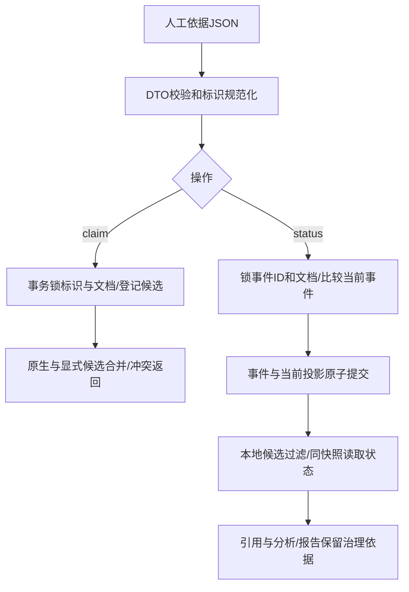

# 来源别名与状态治理（P8-03）

本功能是人工提交依据的本地登记与门禁。URI、SHA256、摘录和操作者用于追溯；系统不下载该URI、不核验摘要真实性，也不将登记当医学审核。测试全部使用合成材料。

## 运行

先在专用环境显式升级Alembic head到p803_0006；业务库迁移需由操作者自行确认，本轮没有执行。脚本读取原CLINICAL_AGENT_DB_*配置，不读取.env、不装配模型。

```powershell
.venv/Scripts/python.exe -I scripts/govern_sources.py --help
.venv/Scripts/python.exe -I scripts/govern_sources.py claim --request alias.json
.venv/Scripts/python.exe -I scripts/govern_sources.py resolve --namespace doi --value 10.1234/example
.venv/Scripts/python.exe -I scripts/govern_sources.py inspect --document-id <已有文档UUID>
.venv/Scripts/python.exe -I scripts/govern_sources.py status --request status.json
```

alias.json的完整形状（示例标识不是实际文献）：

```json
{
  "namespace": "doi", "value": "https://doi.org/10.1234/EXAMPLE",
  "document_id": "00000000-0000-0000-0000-000000000001",
  "evidence": {
    "uri": "https://example.org/curated-record", "snapshot_hash": "aaaaaaaaaaaaaaaaaaaaaaaaaaaaaaaaaaaaaaaaaaaaaaaaaaaaaaaaaaaaaaaa",
    "quote": "Synthetic example only", "recorded_by": "operator"
  }
}
```

先替换为真实已有文档与实际保存依据。支持pmid、doi、pdf_sha256。DOI去标准前缀/转小写，不按标题或文件名猜测。resolve合并显式登记与当前文档原生标识候选；多个候选返回conflicted和全部ID，命令退出1；无候选unmapped，单候选resolved。resolved只表示唯一关联，不是身份真实性已验证。重复登记不覆盖第一次依据；需要变更依据/冲突裁决或撤销登记的接口仍待后续明确设计。文档/片段不物理归并，别名不改变发布身份或检索去重。

status.json形状：

```json
{
  "event_id": "00000000-0000-0000-0000-000000000002",
  "document_id": "00000000-0000-0000-0000-000000000001",
  "status": "retracted", "expected_event_id": null,
  "evidence": {
    "uri": "https://example.org/notice", "snapshot_hash": "aaaaaaaaaaaaaaaaaaaaaaaaaaaaaaaaaaaaaaaaaaaaaaaaaaaaaaaaaaaaaaaa",
    "quote": "Synthetic notice only", "recorded_by": "operator"
  }
}
```

首次expected_event_id为空；后续变更必须先inspect并填写当前event_id，使用新event_id。旧请求原样重放不生成新事件、不覆盖新状态；同ID载荷不同失败。数据库异常/非法请求退出2，只输出错误类型，避免暴露原始输入与连接信息。不要将上述占位符直接写入业务库。

## 状态与使用范围

| 状态 | 本地新检索 | 含义 |
| --- | --- | --- |
| unreviewed | 保持可检索 | 没有显式审核登记，不表示正常或医学可靠 |
| normal | 可检索，附依据 | 显式人工状态断言，不是医学核验通过 |
| corrected | 可检索，附更正依据 | 必须继续核对更正后的具体论断；不会自动替换原正文 |
| retracted / withdrawn / expression_of_concern | 三种本地模式候选阶段统一排除 | 不删除原文/历史版本；新事件才可解除 |

每次本地检索带source_governance_local_policy提示；DocumentSummary.governance传到CitationSource，再进入分析上下文、报告JSON及Markdown。状态读取和原文hydration处在同一只读REPEATABLE READ快照，既有查询次数保持。已在进行的请求按其快照完成，不承诺撤回登记后取消所有在途请求。

治理仅作用于本地文档，不跨别名传播，也不拦截在线PubMed分支或hybrid中的在线副本；在线状态适配属于P8-04，不能声称已实现全来源封锁。历史报告保存的是生成时状态；实时读取当前状态可用inspect，历史报告不被静默改写。正文发布不重置状态。



## 测试和调试

离线可运行最小Demo：

```powershell
.venv/Scripts/python.exe -I docs/learning/phase-08/governance_demo.py
.venv/Scripts/python.exe -I -m pytest tests/unit/test_source_governance.py -q
```

真实数据库测试是tests/integration/test_source_governance.py，必须使用专用127.0.0.1、clinical_agent_test_*库与ALLOW_TEST_RESET=1；其中迁移回退测试会删除治理表，禁止用于业务库。固定命令/实际计数见阶段验收。真实PG测试仍使用合成文献/向量，未证明真实撤稿识别或医学判断正确。

源码按执行顺序读domain/governance.py → scripts/govern_sources.py → adapters/postgres/governance.py → retrieval.py → domain/citations.py → domain/report.py。p803_0006与ORM约束对应；advisory事务锁只在短事务中持有，异常自动回滚释放，数据库engine由上下文关闭。


P8-04收尾已补充在线适配：官方状态与新文献同事务提交，常规CLI/API在线检索按精确已知PMID状态过滤在线副本；上文仅本地的限制保留P8-03历史时点，当前行为见[维护说明](maintenance.md)。别名冲突仍不自动裁决或传播状态。
