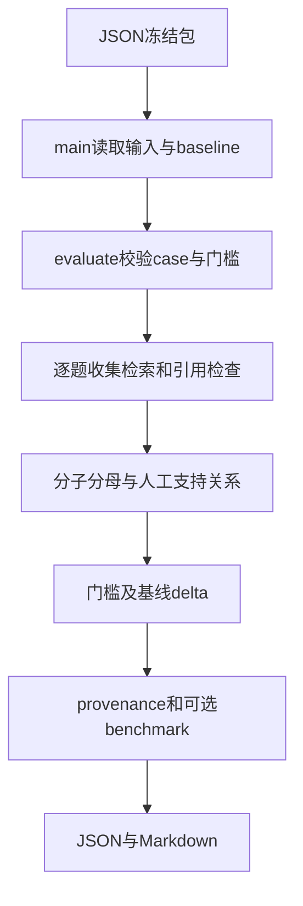

# 按执行顺序读真实代码

scripts/evaluate_phase9.py 的 main 解析bundle/output/baseline；输出目录不能在输入包内，baseline也不能被输出覆盖。load使用utf-8-sig兼容Windows BOM。输入结构错误直接失败，不产生通过报告。

application/evaluation.py 的 evaluate 先检查ID全集匹配、重复ID、相关片段有效性、标注状态、门槛名称和范围，再建立 by_id。逐题处理时，失败输出的检索/claims不进入成功指标，但仍占召回和success分母。对每个claim逐引用按冻结快照比身份及位置，再查 supported_by。不会把错误metadata改正后评分。

digest对排序JSON求SHA256。compatibility包括dataset和thresholds及其configuration，所以标签或模型revision不同就不能比较。comparison保留delta及regression_failures；失败优先于inconclusive。返回samples原始输出供审计。

main随后记录源码、依赖锁、配置及输入文件hash、Python与平台；可选benchmark固定1/2/4线程并收集全部任务耗时和异常。输出run_id及报告，退出码0/1/2分别是pass/fail/inconclusive。baseline为显式只读参数，不自动更新。没有网络、模型或数据库资源。
