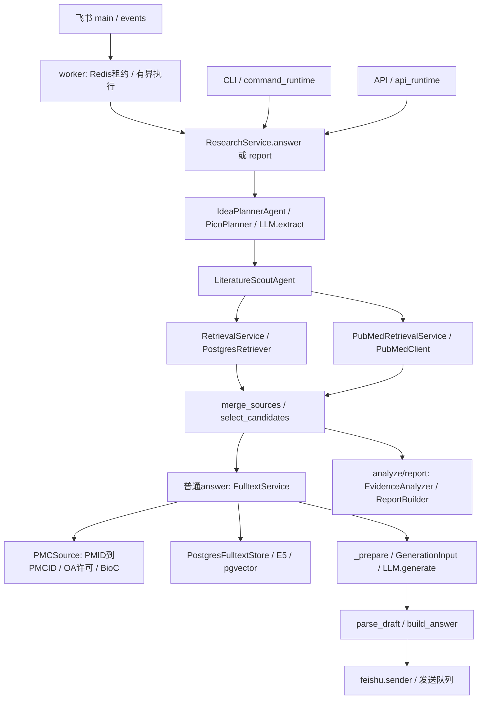

# OpenAlex 科研问答改造：第一阶段代码分析

日期：2026-10-29。范围：用户新需求的第一阶段，编号与历史 Phase 0–9 独立。本轮只做源码调查与实施设计，不改生产逻辑、不执行在线请求或测试、不迁移数据库。工作区已有大量修改和未跟踪文件，本报告基于当前工作区，不以 HEAD 或旧验收代表现状。密钥不入库。

## 1. 已确认的调用关系



- `src/feishu/main.py:233` 装配 `open_research`；`events.py:195` 过滤事件；`worker.py:149` 构造 hybrid 请求，普通文本走 answer，`/report` 走 report。
- `command_runtime.py:73` 与 `api_runtime.py:open_api_runtime` 分别装配模型、数据库、本地检索、PubMed 和全文服务；两处必须同步替换，不能只改飞书入口。
- `application/research.py:181` 检索后仅为非 analysis 请求补全文；`:198` 准备上下文；`:227` 生成；`:240` 引用检查。分析/报告分支不能据此声称已使用全文。
- `adapters/langchain_generation.py` 复用一个模型适配器提供 extract/generate/analyze_evidence/review_claims；保留现有调用和资源上下文。
- 本地 keyword/vector/hybrid 是检索模式，online/local/hybrid 是来源范围；两者不能混为一谈。

下文文件路径均相对项目根目录。

## 2. 缺陷与现有能力（源码事实）

| 位置 | 当前实现 | 对本次需求的影响 |
| --- | --- | --- |
| `domain/pico.py:ExtractionDraft/QueryPlan` | 已有 research_intent、概念映射、概念关系和来源区间；没有独立对象、任务、数据类型、论文类型、时间窗契约 | 不能把旧调查中的“没有科研意图”作为现状；仍缺可执行的细粒度约束 |
| `application/pico.py`、`application/agents.py`；`domain/pubmed.py:PubMedOptions` | 日期由调用方显式设置；未发现把“最新/近三年”转换成日期过滤的逻辑 | 自然语言时间约束不等于实际请求过滤，需可注入时钟和统一时间窗 |
| `domain/pubmed.py:PubMedSearchRequest.query_strategies` | 已区分直接查询与 related/narrower 扩展，保留显式 query 覆盖 | 复用概念关系；PubMed 的 Title/Abstract 字段语法不能直接用于 OpenAlex |
| `adapters/pubmed_online.py:191` | 有补充查询；是否继续取决于 returned_count 达到 min(5,max_results) 等预算条件 | 已有多轮能力，但数量达到阈值不能证明对象、任务或证据覆盖合格 |
| `application/pubmed.py:select_candidates` | 标题+摘要的 concept_groups 词面覆盖，优先不同文献，选后恢复来源顺序 | 不验证器官/病灶/亚区/预测语义，也不评估方法创新、实验信息或时间符合度；concept_relations 不能替代这里实际读取的 groups |
| `application/pubmed.py:retrieve/merge_sources` | 摘要缺失排除；PMID/UUID 去重，混合池先放部分本地再在线 | 元数据缺摘要不能进入当前回答链；尚无 DOI/OpenAlex 跨来源去重；合并不能视作质量审核 |
| `domain/models.py:SourceMetadata/EvidenceChunk`、`domain/retrieval.py:SourceType` | 来源只允许 pdf/pubmed；在线 URI 和摘要位置有 PubMed 专属校验 | 替换 HTTP 地址不足以接入新来源，必须同步 DTO、快照、校验和迁移 |
| `adapters/postgres/models.py` | source_type、位置和 alias namespace 有数据库检查约束 | OpenAlex ID 需要真实迁移；不得塞进 PMID 字段或伪造 PubMed 来源 |
| `application/fulltext.py:FulltextService.enrich` | 已有 LlamaIndex 分块、E5 编码、缓存、内容 hash 复用；只选 source_type=pubmed 且有 PMID 的文献 | 应改造既有服务；不是重新建设全文系统 |
| `domain/fulltext.py:FulltextPassage`、`adapters/postgres/fulltext.py` | PMID/PMCID 必需；缓存和向量按 PMID 定位；事务发布，30天缓存 | 无 PMID 的 OpenAlex 文献无法使用；需以稳定文献身份迁移，保留历史可引用证据 |
| `adapters/pmc_fulltext.py:66` | PMID 转 PMCID，再核验许可并取 BioC；只接纳代码中明确的 CC BY 4.0 / CC0 | 合法但覆盖受限；不支持从 OpenAlex OA 链接下载普通 PDF；OA 标志不等同许可证 |
| `adapters/pdf.py:parse_pdf` | 已有本地文本层PDF、页码、字节/页数/期限限制 | 可复用解析边界；尚无此在线链路的下载、跨页重复页眉页脚清洗及章节恢复 |
| `application/fulltext.py`、`adapters/postgres/fulltext.py:61` | 每文献向量相似度取2段，没有独立重排序 | 已有先选文献再选段落；还缺问题维度覆盖和段落重排序 |
| `application/research.py:198` | 已传 QueryPlan、provenance、标题和全文；超长时从后往前删除全文段落，最后报 context_limit | 旧调查的“没有传计划”已过时；现裁剪可能挤掉最有用方法段，且字符数不等于 Token 成本 |
| `domain/research.py:INSTRUCTIONS` | 已要求先回答、按科学问题综合、区分任务、不跨数据集排优劣、不重复通用局限 | 不能声称当前完全是摘要拼接；提示存在不代表真实回答已达到质量目标 |
| `domain/citations.py:build_answer` | 引用 ID、来源关联和位置校验；`DraftClaim` 禁止生成 DOI/URL，来源由可信元数据渲染 | 可复用真实性门禁；没有数值逐项支持和语义蕴含验证，不能声称医学准确 |
| `feishu/sender.py:_readable_answer_lines` | 已有可读模式、局限合并、全文定位和可信链接；audit 独立 | 应保留，避免重复重写已修过的展示问题 |

### 当前预算与资源事实

`ResearchLimits` 默认总期限90秒、生成最多60秒、上下文24000字符、输出32000字节。全文当前代码是总子预算35秒、获取子预算15秒、最多3篇、每篇最多128块、每篇召回2段；全文 SPEC 中20秒与源码不一致，后续以新冻结范围统一。缓存命中可跳过下载和文段编码，但仍需问题编码。没有实测延迟、Token/Embedding计数、价格或质量提升数据，本轮不提供估计值冒充结果。

外部下载 URL 必须作为不可信输入：来源与身份核对、许可、重定向目标、内网地址阻断、字节限制和超时属于新增下载边界的真实安全需求。保留已存在的任务资源释放、事务、去重、日志字段白名单和密钥隐藏机制；不引入新 Agent 或通用容错框架。

## 3. 目标数据流与最小变更范围（尚未实现）

科研问题 → 现有 Planner 扩展科研约束 → 直接/补充查询计划 → OpenAlex 唯一在线文献发现源 → 规范化快照与身份去重 → 摘要语义预筛选与覆盖判断 → 必要时有界补检 → 合法全文定位 → 缓存/解析/章节分块 → 现有 E5/pgvector → 文档内段落召回与重排序 → 问题维度证据组织 → 现有 LLM 生成 → 引用/数值支持检查 → 现有飞书渲染。

“移除 PubMed”指新在线发现和运行装配不再调用 PubMed 检索。历史 PubMed 快照、已发布版本和引用不能删除或改写。全文托管服务是下载来源，不是新增文献发现源；PMC是否保留为已确定文献的全文下载适配器在第三阶段契约中说明，不能借此继续 PubMed 搜索。

| 批次 | 新增候选文件 | 需修改的现有文件 |
| --- | --- | --- |
| 第二阶段 检索筛选 | `domain/openalex.py`、`adapters/openalex.py`、`application/openalex.py`、`tests/unit/test_openalex.py`、固定候选 fixtures | pico.py（domain/application）、retrieval.py、models.py、research.py（domain）、agents.py、两处 runtime、配置示例、CLI/API选项、引用与快照契约、Postgres models/迁移、相关装配测试 |
| 第三阶段 全文 | OA下载适配器、全文来源 fixtures、身份缓存迁移 | application/fulltext.py、domain/fulltext.py、adapters/pdf.py、postgres/fulltext.py、research.py；复用现有embedding.py和chunking.py |
| 第四阶段 综合回答 | 问题维度证据组织与数值核对测试 | domain/research.py、domain/citations.py、application/research.py、必要时analysis/report与sender；保持可信引用生成 |
| 第五阶段 验收 | 固定问题集、结果和失败归因报告、各阶段学习材料 | 既有评价框架、状态记录 |

文件名是实施边界建议，不代表已经创建生产模块。PubMed 专用入口参数不能静默解释为 OpenAlex 参数：通用 question/scope/result 接口尽量兼容；专属查询语法明确退役并在迁移说明中列出。OpenAlex API字段、查询表达和认证在第二阶段实施前核查官方文档并保存真实响应 fixtures，本轮没有验证外部 API 契约。

## 4. 第二阶段 SPEC 与验收设计草案

目标：先保证符合问题的候选进入证据链，不提前开发第三阶段下载器或第四阶段生成器。先写对应测试，阶段末集中测试；所有新增能力当前均待实现/待测试。

输入：原问题、可注入 today（Asia/Shanghai）、近期月数默认24、显式时间/来源选项、候选与HTTP/模型预算、已有 QueryPlan。输出：扩展后的意图、规范化候选、每条判定/依据、检索轮次和证据缺口；只有合格证据进入现有 RetrievalResult。

数据模型：ResearchConstraints（原文锚定对象/疾病、任务、数据类型、论文类型、回答意图、时间意图和解析日期）；OpenAlexRecord（OpenAlex ID、DOI、标题、作者、期刊、发表日期精度、摘要与缺失原因、OA位置/许可、快照hash）；CandidateAssessment（direct/partial/irrelevant/uncertain、约束符合状态、判定所引摘要区间、证据用途和缺口）。LLM判定也必须校验 schema 和引用区间，不能将评分当医学结论。

时间：最新按当天向前24个日历月；近三年按36个月；显式年份按对应自然年范围；经典研究不自动附近期下限。月末按目标月最后有效日截取。冻结时钟2026-10-29分别得到2024-10-29和2023-10-29。未知/低精度日期不能伪造到日，应标记无法确认边界，不能冒充满足严格近期窗。问题之间没有领域关键词硬编码。

筛选：硬约束先检查，语义判定任务与研究对象，再比较相关性、近期性、实验信息、代表性和全文可用性；引用量不是质量等价物。OA作为全文获取优先因素，不排除直接相关但仅有摘要的文献。低质量不得因未填满top_k而补入。摘要缺失保留元数据及原因，第二阶段不允许据标题生成实验结论。

补检：依据任务/对象/时间/回答维度缺口触发；保持硬约束，扩展科研表达，不自动放宽日期或把亚区换成整体分割。共享全请求预算与deadline，耗尽输出真实缺口。拟冻结初始预算：最多2轮、每轮最多2个查询、累计最多8次HTTP尝试（含重试）、最多40个唯一候选、30秒检索期限；结构化预筛最多2次批量模型调用，累计输入不超过12000模型Token、输出不超过4000 Token且服从90秒总期限。优先复用计划模型，不能无记录新增调用。上述预算为待第二阶段验证的设计值，不代表现有实现或已证明可满足延迟。

必要异常：认证/限流/超时分类记录；坏响应和无效摘要索引明确记录，不伪成功；缺摘要、无结果、部分查询失败、身份冲突分别可观察。API Key仅运行环境读取，URL/错误/日志不得记录密钥。不为未要求的历史API版本增加兼容层。

固定 fixtures 与标签：真实响应去密钥保存请求、获取日期、ID、快照hash；人工标注对象/任务/时间符合度、直接性、代表性和支持原句。每题至少包含直接、近邻任务、过期或日期不明的对照候选；真实缺直接研究时明确标空，不能编造正例。另留一个非肝脏领域问题验证通用性。人工未签署不得称医学验收通过。

| 验收问题 | 必需断言 |
| --- | --- |
| 肝脏分割最新研究有哪些？ | 时间窗实际进入请求；器官与肿瘤任务分开；近邻词命中不能替代任务判定 |
| 肝脏肿瘤亚区分割最新进展有哪些？ | 整体病灶分割、内部亚区划分、亚区特征下游预测分别标注；无直接证据不拿旧文填充 |
| MedSAM与nnU-Net有哪些区别？ | 比较意图与两个方法身份保留；无依据不加疾病或近期限制；方法指标不能跨数据集直接排序 |
| 最近三年MRI预测肝癌微血管侵犯有哪些研究？ | 36个月实际过滤；MRI与CT分开；预测终点和对象保留 |
| 肝脏肿瘤分割目前有哪些技术瓶颈？ | 研究局限用途与分割任务保留；“目前”不擅自等同明确24个月窗，记录时间解释 |

测试应覆盖倒排索引乱序/空缺/非法位置、摘要缺失、作者或来源缺失、规范DOI去重与冲突、两轮去重、时间边界、语义近邻误入、数量足但质量不足仍补检、耗尽与部分失败、凭据脱敏、旧本地历史引用可读。固定负例不得被标成直接证据；硬约束违反不得入合格集；所有入选项可追溯到快照和判定。真实召回率需要独立人工相关集，不能仅用当前检索结果作分母。

第二阶段集中验收命令（计划，文件创建后执行；本轮未执行）：

```powershell
.\.venv\Scripts\python.exe -m pytest tests/unit/test_openalex.py -q --basetemp=.pytest_openalex
.\.venv\Scripts\python.exe -m pytest tests/unit -q --basetemp=.pytest_openalex_regression
.\.venv\Scripts\python.exe -m ruff check src tests
```

数据库迁移/真实OpenAlex/模型冒烟的具体命令与fixture路径须在第二阶段开始时写入独立SPEC并冻结；当前草案不具备完整开发前冻结条件。真实依赖需要运行环境中的OpenAlex密钥、可达服务、锁定LLM配置、测试PostgreSQL/pgvector和可回滚独立库；不因缺依赖把集成测试算通过。

## 5. 前后对比与最终验收记录方式

当前只完成源码对比：旧链路PubMed、词面选择、PMID全文身份 → 目标OpenAlex、任务语义质量选择、稳定论文身份；右侧全部尚未实现。不得将设计对比写成实测收益。

第五阶段对相同问题、日期、模型配置、预算分别保存旧链路与新链路请求/候选快照/最终答案、人工标签和失败去向。旧检索应在替换前保存只读基线，新运行时不得保留PubMed兜底。分别计量检索召回与候选筛选损失、时间符合度、直接相关比例、全文获取/实际引用率、关键结论与数字支持、语言综合评分；记录HTTP/LLM调用、输入输出Token、编码块数、冷/热缓存端到端耗时和失败案例。固定响应测试只能证明管线传递；不证明真实模型写作或医学结论。

完整端到端案例待第五阶段使用真实论文和真实服务补充，本轮不生成假论文、指标或“改造后”答案。用户提出的七项最终交付是整个改造的目标，本阶段仅交付代码问题、目标流、文件范围和设计；业务实现、实测及完整案例均未完成。

## 6. 本轮结果与停止点

实际执行：只读文件、rg源码定位、git status；没有执行pytest、Ruff、网络检索、模型调用、数据库操作；没有修改生产代码。旧记录的176 passed/7 failed属于先前调查，不能当本轮结果。已有测试 `test_fulltext_rag.py`、`test_answer_synthesis.py` 和 `test_recall_relations.py` 可复用，但存在不等于本轮通过。

第一阶段静态分析已交付；没有宣称任一新增业务阶段通过验收。下一任务是第二阶段先核实OpenAlex官方契约、冻结完整SPEC与人工fixtures，再编写测试及最小检索筛选实现。本轮停止，不自动进入下一阶段。后续业务阶段学习文档仍按AGENTS要求提供六份材料、真实最小Demo和执行流程；本次调查文档不替代这些完成条件。
