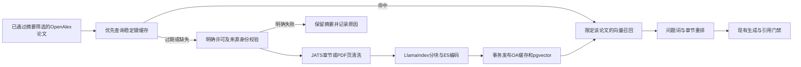

# OpenAlex第三阶段：全文RAG技术验收（2026-10-29）

> 后续用户已授权并完成业务库迁移、服务重建、真实API全链路与飞书用户实收补验，详见[部署补验](deployment/acceptance.md)。下文“未迁移/未重建/未实收”保留首次技术交付时事实；最终科研质量仍未完整通过。

本轮按用户授权进入第三阶段，只实现开放全文获取、解析、缓存、向量化、段落召回和来源绑定。技术核心与学习材料已交付；独立医学签署、完整新在线发现到飞书端到端验收未完成，不标完整科研质量通过。第二阶段的双载体重复、历史证据当前性和医学签署缺口继续保留，未进入第四阶段。

## 代码问题与实现

原FulltextService只按PMID定位PMC/BioC，OpenAlex-only论文不能接入；旧缓存按PMID建键；全文定位依赖PMCID，无法准确表示OA PDF页码。现有基础设施可复用，不需要第二套研究工作流。

| 修改或新增位置 | 当前作用 |
| --- | --- |
| `src/clinical_agent/adapters/oa_fulltext.py`（新增） | 从明确OA location取得PMC OAI/JATS或出版方PDF；许可、URL、重定向、大小、身份校验；结构化正文 |
| `src/clinical_agent/application/oa_fulltext.py`（新增） | DOI稳定键、LlamaIndex分块、E5编码、缓存续期、按论文召回与问题重排 |
| `src/clinical_agent/application/fulltext.py` | 原服务追加OA路径，保留旧PMC路径 |
| `src/clinical_agent/domain/fulltext.py` | OA身份、页码、解析表示hash及正文单位；旧PMID兼容 |
| `src/clinical_agent/adapters/postgres/fulltext.py` | 复用存储实现，OA独立表、事务替换、写入锁、TTL |
| `alembic/versions/oa3001_0009_fulltext.py`（新增） | 新增OA缓存与768维向量表，不迁移旧PMID数据 |
| `command_runtime.py`、`api_runtime.py` | 装配OA来源与存储、依赖检查、HTTP环境代理关闭 |
| `domain/retrieval.py`、`domain/models.py`、`domain/citations.py`、`src/feishu/sender.py` | 文档身份绑定、定位、真实全文引用标识；只引用摘要时不附带未使用的全文 |
| `tests/unit/test_oa_fulltext.py`（新增）、`tests/unit/test_ingestion_mapping.py` | 新契约、真实fixture、Alembic head回归 |
| `scripts/oa_fulltext_integration.py`、`scripts/oa_fulltext_answer_check.py`（新增） | 显式隔离库与真实模型回放验证，不发送消息 |

表中省略目录的runtime/domain文件均在`src/clinical_agent/`下。冻结范围、输入输出、异常、预算和依赖见[SPEC](spec.md)。

原字节hash追溯下载内容；解析表示hash追溯实际分块文本。TTL后表示不变只续期，避免OAI响应时间戳变化触发重复编码。字符位置对应清洗后的source_units，PDF额外保留原页码；不冒称原PDF字节坐标。每次最多2篇、每篇128块、共享6次HTTP尝试；分块300 tokens/重叠30，段落8选2，无新增LLM调用。全文预算35秒、获取子预算15秒并服从总deadline。

## 集中测试与实际结果

环境：Windows项目虚拟环境；pytest前设置`OMP_NUM_THREADS=2`、`OPENBLAS_NUM_THREADS=2`、`MKL_NUM_THREADS=2`，Ruff设置`RAYON_NUM_THREADS=1`。默认pytest排除external/performance/database/redis；122个未选中项不是通过。

| 实际验证 | 结果与原始记录 |
| --- | --- |
| `python -X utf8 -m pytest -q --basetemp=.pytest_oa_stage3_regression_final` | [1382 passed / 122 deselected / 1 protobuf弃用告警](regression-final.txt)，170.95秒 |
| 最后章节重排修复后的受影响8文件测试 | [209 passed](affected-section-fix.txt)，12.79秒；该修复后未再跑全量 |
| `python -X utf8 -m ruff check src tests scripts/oa_fulltext_integration.py scripts/oa_fulltext_answer_check.py` | [通过](ruff-final.txt) |
| 学习目录`demo.py` | 实际离线执行成功，真实JATS章节/位置可读；不调用模型或数据库 |
| 官方OAI实际HTTP与JATS解析 | MRI-MVI论文130828字节、24正文单位，CC BY及DOI/题名核对成功；[manifest](../../tests/fixtures/oa_fulltext/manifest.json) |
| PLOS实际HTTP与PDF解析 | 2069581字节、15页、21正文单位；[manifest](../../tests/fixtures/oa_fulltext/plos-pdf-manifest.json)。有字体告警，未证明版面/特殊符号完全保真 |
| 真实E5 + PostgreSQL/pgvector隔离库 | 29向量、最大292 tokens/块，原子回滚验证成功；[结果](integration-final/summary.json) |
| 新表降级/再升级 | OA表移除/重建、旧PMID表测试哨兵保留；[结果](migration-result.json) |
| 保存全文证据→真实LLM→现有引用门禁 | answered，2条全文定位，7.882秒；[结果](answer-final/summary.json)、[完整回答](answer-final/answer.txt) |

最后受影响测试具体文件：`test_oa_fulltext.py`、`test_fulltext_rag.py`、`test_ingestion_mapping.py`、`test_research.py`、`test_citation_report.py`、`test_feishu_sender.py`、`test_command_runtime.py`、`test_api_runtime.py`（均在`tests/unit/`），命令附`-q --basetemp=.pytest_oa_stage3_section_fix`。

数据库验证使用现有容器中的独立库`clinical_agent_test_oa_stage3_20261029_1`，源码/依赖放在API容器`/tmp/oa_stage3_20261029_1`，未替换运行虚拟环境。运行方式是设置该目录`src:deps`为PYTHONPATH、DB_NAME为上述独立库、模型目录`/app/model`，然后`python .../oa_fulltext_integration.py /tmp/oa_stage3_20261029_1 result4`。QA脚本参数同目录及`answer-check3`，读取`result4/warm.json`。源文件分别复制回`integration-final`与`answer-final`。迁移检查代码保存在[migration-check.py](migration-check.py)。

真实DB实验使用已实际下载的固定XML重放，HTTP成功由独立下载记录证明；不把两者冒称一次全链路在线执行。首次真实容器缺少llama-index，按uv.lock依赖闭包安装临时target后重跑；依赖记录见[锁定清单](llama-locked-requirements.txt)。未更改业务数据库、重启服务、发送飞书或发布部署。

## 资源与前后比较

| 维度 | 原链路 | 本轮实际观测 |
| --- | --- | --- |
| OpenAlex-only论文全文 | 无PMID无法进入旧全文路径 | DOI/OA身份可进入；真实JATS和PDF分别验证 |
| 证据范围 | OA候选通常仅摘要 | 最终案例取得Methods/Image acquisition与Methods/Patients两段，可追溯hash/章节/区间 |
| 首次缓存实验 | 无同条件原链路基准 | 14.325秒，29块，1次批量正文编码 |
| 有效缓存 | 无同条件原链路基准 | 0.112秒，零追加获取/正文编码；仅查询编码 |
| TTL过期但正文不变 | 无同条件原链路基准 | 0.120秒，追加1次fixture源读取，零追加正文编码 |
| 回答质量 | 摘要无法支持细节 | 真实模型引用CT剂量、时相和队列；承认当前段落未覆盖MRI协议 |

计时不含模型初始化；以上是单样本全文enrichment，不是全问答延迟/P95，也不是实时HTTP下载速度。未采集计费token/金额，不能声称费用下降百分比。检索候选仍由第二阶段提供，本轮不声称召回率提高。

## 完整可追溯案例与边界

论文：[Preoperative evaluation of microvascular invasion in hepatocellular carcinoma with a radiological feature-based nomogram: a bi-centre study](https://doi.org/10.1186/s12880-024-01206-7)，2024，OpenAlex W4391277958。问题询问论文的CT/MRI设备、序列与对比剂。既有候选→官方JATS→29块E5向量→两段方法→真实模型→引用核验均分别有记录；本次未重新运行在线发现。

最终回答[完整文本](answer-final/answer.txt)据方法段说明CT时相、300 mg/ml含碘对比剂、1.5 ml/kg、3–4 ml/s，并指出MRI仅作为外部测试队列，当前证据未覆盖其设备/序列。引用定位为`[6451,6954)`、`[5597,5965)`。这些关联通过工程门禁，医学语义仍待独立专家签署。

该案例揭示明确失败：原文存在更多MRI方法信息，但8选2未召回相应段，不能据“当前段落没有”推断整篇没有。表格被排除以避免列值粘连，暂不能回答表内设备参数。答案仍有重复免责声明和历史检索范围渲染；这是第四阶段待优化事项，不能把当前示例称为已满足综合综述质量。辅助脚本初次使用空检索计数，保留原`answer-check`；最终脚本已加载实际冻结来源并标明回放，未把旧来源计数伪装成新搜索。

## 失败、未验证项与停止范围

- 最初核心运行只输出8个点便中断（`core-first.txt`），不是通过；设置线程上限后重跑成功。
- 首轮全回归1377通过/1失败，因Alembic head断言未更新；修正后最终回归通过。初期Ruff失败日志保留，最终结果单列。
- DEMF-Net元数据许可CC BY-NC-ND，不满足本批白名单，未获取；真实JATS嵌套许可链接初次解析失败，随后诊断429；修正后取得成功样本。MRI出版方PDF重定向超限，没有计作成功。
- 只支持明确CC BY/CC0及有限出版域名，不能覆盖全部合法OA；没有OCR、落地页爬取、结构化表格或跨版面完整阅读顺序保证。
- 两篇/两段预算会损害复杂方法问题覆盖，尚无跨领域召回率评测；长期中文词汇重排、全文任务适配及综合写作留待后续。
- 五题新端到端全链路、飞书实收、业务库迁移、当前镜像重建、完整analysis/report分支真实验收未执行；原122个opt-in测试未统一运行。
- 第二阶段医学标签/人工签署仍未完成；AI复核发现的问题不因本轮全文能力而消失。

新增异常处理仅位于外部获取/解析边界和原可选enrichment失败记录边界；没有新增通用Repository/Factory或疾病硬编码。身份、许可、位置与事务校验用于引用真实性和数据一致性，内部错误不在adapter静默吞掉。

学习文档：[六份教程与可运行Demo](../learning/phase-03/openalex-stage3/README.md)。操作方法：[usage](usage.md)。本轮在第三阶段停止；下一阶段须由用户另行指定。
