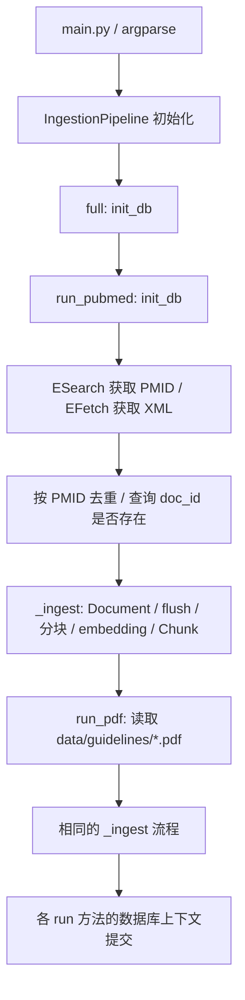
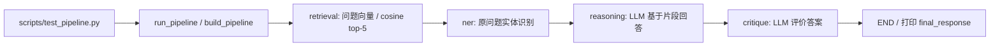

# Phase 0 / P0-02：ClinicalAgent 参考仓库分析

日期：2026-10-26（Asia/Shanghai）。本任务已完成；Phase 0 尚未完成。

## 1. 任务约定与验收方法

目标：核实参考仓库实际结构、依赖、数据模型及执行流程，提取业务设计经验，指出不宜照搬之处。范围为只读源码调研及本项目文档记录，不运行或复制参考实现，不安装依赖，不创建业务骨架。

输入：用户指定仓库及本项目已有规则、环境检查记录。输出：本分析和阶段进度记录。数据记录必须包含固定提交、源码路径、事实与推断的区别。若接口失败、响应截断或文件不可读，应记录缺口，不以文档宣传补全代码事实。

验收场景：

1. 确认默认分支并固定 SHA，避免混读移动分支。
2. 获取未截断的完整目录树，核对文件数量与实际入口。
3. 对照入口、调用方、实现及模型，追踪入库和问答两条流程。
4. 区分依赖声明、实际使用、文档声称和运行验证。
5. 检查来源追溯、去重、失败处理、资源生命周期与测试覆盖缺口。
6. 每个改进建议能关联源码事实；明确哪些结论尚未验证。

这是文档调研任务，没有应用实现，因此不生成虚假的 RED/GREEN 记录。工程功能的 SPEC 与 pytest RED → GREEN 留待后续任务执行。

## 2. 来源、版本与核查范围

- 仓库：[ismashiping/clinicalagent](https://github.com/ismashiping/clinicalagent)。GitHub 返回为公开、未归档仓库。
- 实际默认分支：`phase_02`，不是假定的 `main`。
- 固定提交：[e0439d11d0a97bdda1ba24802344b03c501632c0](https://github.com/ismashiping/clinicalagent/commit/e0439d11d0a97bdda1ba24802344b03c501632c0)。提交时间：2026-09-17 21:05:03 UTC。
- [递归目录树](https://api.github.com/repos/ismashiping/clinicalagent/git/trees/e0439d11d0a97bdda1ba24802344b03c501632c0?recursive=1)：`truncated=false`；27 个文件，其中 23 个 Python 文件。已逐个读取全部非空文件；4 个空的包初始化文件由树中 size=0 确认。
- 使用 GitHub 连接器 `get_repo`、`fetch`、`fetch_file` 读取；所有文件读取固定到上述 SHA。未克隆仓库，未导入或执行其中的 Python 代码。
- 未调查其他分支、完整提交历史及仓库外部署。以下“没有”均限定于该提交的跟踪文件。

完整树中没有 README、LICENSE、pyproject、依赖锁文件、Alembic 迁移、CI 工作流、FastAPI、飞书模块或自动评估目录。无 LICENSE 文件不能推断有代码复用许可；本项目只参考业务思路，不复制源码。

## 3. 实际目录

```text
clinicalagent/
├── .gitignore
├── doc.md
├── docker-compose.yml
├── main.py
├── requirements.txt
├── scripts/
│   ├── __init__.py
│   ├── test_pipeline.py
│   └── test_search.py
└── src/
    ├── __init__.py
    ├── config.py
    ├── pipeline.py
    ├── database/
    │   ├── __init__.py
    │   ├── connection.py
    │   └── models.py
    ├── ingestion/
    │   ├── __init__.py
    │   ├── pubmed_fetcher.py
    │   ├── pdf_parser.py
    │   ├── chunker.py
    │   └── embedder.py
    └── agents/
        ├── __init__.py
        ├── state.py
        ├── pipeline.py
        ├── retrieval_agent.py
        ├── ner_agent.py
        ├── reasoning_agent.py
        ├── critique_agent.py
        └── llm.py
```

`doc.md` 是执行流程说明；已与实际调用链交叉核对，不作为实现存在的唯一依据。

## 4. 架构与实际执行流程

参考实现是同步 Python 命令行程序，数据库连接、模型及配置多采用模块全局对象；两个主流程通过 PostgreSQL 数据共享，彼此没有调用。Redis 只在依赖、配置和 Compose 中出现，已读取的业务源码没有 Redis 调用。

### 4.1 入库

[main.py](https://github.com/ismashiping/clinicalagent/blob/e0439d11d0a97bdda1ba24802344b03c501632c0/main.py) 解析 `--mode`、`--queries`、`--max-results`，实例化 `IngestionPipeline`。构造器同时创建 PubMedFetcher、PDFParser、TextChunker、Embedder，即使仅执行 PDF 模式也会构造全部组件。



实际分支及边界：

- `pubmed` 模式自己初始化库表；`pdf` 模式没有调用 `init_db()`，新库不能据此假定可直接使用。
- `full` 模式初始化库表两次；`--max-results` 只传给单独 PubMed 模式，在 full 分支中未向下传递。
- PubMed 正文输入实际是标题加摘要，不是获取全文。`full_text` 字段名不能代表已阅读全文。
- PDF 标题取文件名，文档 ID 为 `pdf_{文件名 stem}`。抽出的文字包含 `[Page N]` 前缀，但后续分块没有生成结构化页码定位。
- `_ingest()` 先写 Document 并 flush，再分块和推理；空块时直接 return，Document 仍可能提交。嵌入与块使用 `zip`，没有验证数量一致。
- 每次 `run_pubmed` 或 `run_pdf` 的整批文献共用数据库上下文，任一异常会回滚该批；事务期间包含耗时 embedding。

调用证据：[src/pipeline.py](https://github.com/ismashiping/clinicalagent/blob/e0439d11d0a97bdda1ba24802344b03c501632c0/src/pipeline.py)、[connection.py](https://github.com/ismashiping/clinicalagent/blob/e0439d11d0a97bdda1ba24802344b03c501632c0/src/database/connection.py)。

### 4.2 检索与问答



- [LangGraph 编排](https://github.com/ismashiping/clinicalagent/blob/e0439d11d0a97bdda1ba24802344b03c501632c0/src/agents/pipeline.py) 是四节点固定线性链。没有条件分支、持久化 checkpoint、失败恢复或反馈循环；每次问答重新构建并编译图。
- [retrieval_agent](https://github.com/ismashiping/clinicalagent/blob/e0439d11d0a97bdda1ba24802344b03c501632c0/src/agents/retrieval_agent.py) 模块导入时加载 Embedder；查询按余弦距离排序取 5 条，没有关键词召回、最低分阈值或文档多样性处理。
- [NER](https://github.com/ismashiping/clinicalagent/blob/e0439d11d0a97bdda1ba24802344b03c501632c0/src/agents/ner_agent.py) 使用模块级 `en_core_web_sm` 和固定疾病/药物/症状英文子串表。发生在检索之后，只处理原问题，不用于查询扩展；它不是 PICO 结构化。
- [reasoning_agent](https://github.com/ismashiping/clinicalagent/blob/e0439d11d0a97bdda1ba24802344b03c501632c0/src/agents/reasoning_agent.py) 把全部片段及实体摘要拼接给 LLM，引用列表在 LLM 返回前就加入所有召回的 `doc_id`，并未解析答案实际引用；同一文档可重复出现。
- [critique_agent](https://github.com/ismashiping/clinicalagent/blob/e0439d11d0a97bdda1ba24802344b03c501632c0/src/agents/critique_agent.py#L63) 对每个片段仅给前 300 字符作复核，解析文本行中的分数和 YES/NO，再直接展示 RELIABLE 标签。分数和可靠标记可互相矛盾，没有独立核验、回退或拒答门禁。
- [llm.py](https://github.com/ismashiping/clinicalagent/blob/e0439d11d0a97bdda1ba24802344b03c501632c0/src/agents/llm.py) 统一调用 `init_chat_model`，设置 60 秒超时；推理和评价共享同一个全局客户端。默认模型字符串的真实可用性没有验证。
- `scripts/test_search.py` 是独立 top-3 检索打印入口，不经过 LangGraph 和 LLM。

导入前置条件也属于执行流程：加载 Settings 要求数据库 URL；导入问答图会加载 embedding、spaCy 模型和 LLM 客户端，可能在真正执行入口前失败或产生下载行为。

## 5. 数据模型及追溯差距

来源：[models.py](https://github.com/ismashiping/clinicalagent/blob/e0439d11d0a97bdda1ba24802344b03c501632c0/src/database/models.py)、[PubMed DTO](https://github.com/ismashiping/clinicalagent/blob/e0439d11d0a97bdda1ba24802344b03c501632c0/src/ingestion/pubmed_fetcher.py)、[PDF DTO](https://github.com/ismashiping/clinicalagent/blob/e0439d11d0a97bdda1ba24802344b03c501632c0/src/ingestion/pdf_parser.py)、[TextChunk DTO](https://github.com/ismashiping/clinicalagent/blob/e0439d11d0a97bdda1ba24802344b03c501632c0/src/ingestion/chunker.py)。

| 模型 | 实际字段及约束 | 对本项目的启示 |
| --- | --- | --- |
| Document ORM | 整数 id；唯一非空 doc_id；source；title、authors JSON、abstract、publication_date 字符串、journal、doi、full_text、meta JSON、created_at | 文档与片段分离值得保留；应显式保存来源 URL、PMID、内容类型、入库时间与版本，不用 JSON 承担所有契约 |
| Chunk ORM | 整数 id；document_id 整数、doc_id、chunk_index、content、Vector(768)、token_count、meta、created_at | document_id 只有“FK”注释，无 ForeignKey 约束；无文档+序号唯一约束、结构化 location、模型 revision 或分块版本 |
| PubMedArticle DTO | pmid、title、abstract、authors、publication_date、journal、可空 doi、keywords | 使用 Pydantic 作为入库 DTO 可借鉴，但缺来源 URL、日期精度和内容获取范围 |
| ParsedDocument DTO | doc_id、title、content、page_count、source、metadata | 页码应贯穿分块与检索结果；本地绝对路径不是可共享的文献链接 |
| TextChunk DTO | doc_id、chunk_index、content、token_count、metadata | 没有独立 chunk_id 和类型化定位 |
| AgentState TypedDict | question、retrieved_chunks 字典列表、entities、answer、citations 字符串列表、critique、confidence_score、is_reliable、final_response | 有共享状态边界，但 TypedDict 不提供运行时校验，嵌套字典仍无契约 |

关键缺口：检索仅返回 content、doc_id、score、source、journal，没有 chunk.id、页码、标题、作者、DOI、完整来源链接等。即使数据库含部分元数据，也未贯穿到报告。这不足以支撑本项目要求的“实质性结论 → 具体片段 → 文献”核验链。

## 6. 依赖与基础设施事实

[requirements.txt](https://github.com/ismashiping/clinicalagent/blob/e0439d11d0a97bdda1ba24802344b03c501632c0/requirements.txt) 的直接依赖声明如下；这是参考仓库声明，不是本项目已选定版本，也不代表解析成功。

| 职责 | 声明版本 |
| --- | --- |
| 配置与 DTO | python-dotenv 1.0.1；pydantic 2.13.5；pydantic-settings 2.2.0 |
| 数据库 | sqlalchemy 2.0.28；psycopg2-binary 2.9.9；pgvector 0.3.0 |
| Embedding | sentence-transformers 2.7.0；torch 2.2.0；transformers 4.38.0 |
| 数据处理 | requests 2.31.0；pymupdf 1.24.0；numpy 1.26.4；pandas 2.2.0 |
| 分词与缓存 | tiktoken 0.14.0；redis 5.0.1 |
| 日志与进度 | loguru 0.7.2；tqdm 4.66.2 |
| Agent | langgraph 1.2.11；langchain 1.4.0；langchain-openai 1.6.2；spacy 3.7.4 |

没有声明 Python 支持范围；没有锁定传递依赖、哈希或模型 revision；spaCy 语言模型也不是上述依赖文件中的安装项。业务源码未使用 pandas 或 Redis。不能根据本机已安装包或上表推断参考版本互相兼容，需后续官方文档、PyPI 和干净环境解析验证。

[Compose](https://github.com/ismashiping/clinicalagent/blob/e0439d11d0a97bdda1ba24802344b03c501632c0/docker-compose.yml) 只有 `pgvector/pgvector:pg16` 和 `redis:7-alpine` 两个基础服务，含健康检查和 PostgreSQL 持久卷。没有应用、飞书服务或 Dockerfile；镜像未固定 digest。示例数据库凭据写在文件中，端口直接发布；本项目需改用显式环境配置，避免将示例配置视为部署方案。

## 7. 可借鉴与不宜照搬的决策

| 源码事实 | 判断与本项目建议 |
| --- | --- |
| Parser、Chunker、Embedder、持久化和问答拆分 | 保留职责分离和统一入库 DTO；通过可注入接口替换外部依赖。暂不为未来阶段创建实现模块 |
| ESearch 找 PMID，EFetch 获取 XML | 保留官方来源及 PMID；离线导入与实时检索要在本项目阶段边界上区分 |
| 文档与片段分表、pgvector 查询 | 可借鉴业务实体；用 SQLAlchemy 2.x 明确约束、Alembic 迁移，不复制建表逻辑 |
| 全局 Settings、Engine、Embedder、spaCy、LLM | 改为显式配置和应用生命周期装配，导入模块不下载模型、不强制连接服务，便于隔离测试 |
| chunker 使用 cl100k_base 计数，embedding 为 PubMedBERT；超长单句仍整句保留 | 不能认为两个 tokenizer 长度等价；需用实际 embedding tokenizer 校验上限、记录分块版本，并保留位置。中文及超长句需专门测试 |
| Vector(768) 固定，配置允许更换模型/维度 | 必须校验实际输出维度和模型身份，防止库表与配置不一致；模型效果需评估，源码中的性能宣传不作为结论 |
| PubMed Session.get 无 timeout、未配置重试；fetch 批次结束 sleep；search 未分页 | 后续采用有超时、有限重试和统一限流的可替换客户端；类注释声称支持分页，但代码只看到一次 ESearch 和分批 EFetch |
| XML 摘要用节点 .text，标题用 findtext；日期只取 Year/Month | 内嵌标签文字、团体作者、MedlineDate 等情况可能丢失；用 XML 样例测试完整文本、日期精度和异常记录 |
| PDF 显式 close 在正常分支，异常分支捕获后返回 None | 用上下文管理释放句柄；区分扫描件、加密、损坏与空文本，不能统称解析成功或静默消失 |
| doc_id 查询后插入，PDF ID 来自文件名 | 无并发幂等保证；同名内容变更会被跳过，跨来源同篇文献也未归并。基础幂等在 Phase 1 明确，增量版本管理留 Phase 8 |
| 数据库上下文有 commit/rollback/close | 资源收尾值得保留；应缩短事务，以单文档为原子边界，并验证嵌入数量，避免长事务与半成品文档 |
| reasoning prompt 称 clinical decision support | 本项目应定位医学科研辅助；生成策略、错误提示和报告边界须与目标一致 |
| prompt 限制幻觉，critique 给可靠性分数 | 提示词和模型自评无法代替引用核验；不得将自评分作为医学证据质量或概率校准值 |
| 问题文本进入日志；日志为普通文本 | 设计统一结构化日志、关联 ID 和最小内容记录；避免默认记录完整问题或凭据 |

引用设计应由业务规则保证：模型只能使用检索结果中的证据标识，渲染端从可信元数据构造 PMID、DOI 和标题；回答须区分摘要与全文、检索证据与推断、证据不足与无效结论。这里是后续 SPEC 的设计输入，尚未实现这些能力。

## 8. 测试核查与后续测试输入

[test_pipeline.py](https://github.com/ismashiping/clinicalagent/blob/e0439d11d0a97bdda1ba24802344b03c501632c0/scripts/test_pipeline.py) 的 `test(question)` 调用真实问答并打印；[test_search.py](https://github.com/ismashiping/clinicalagent/blob/e0439d11d0a97bdda1ba24802344b03c501632c0/scripts/test_search.py) 也只打印检索结果。两者无断言、fixture 或外部服务替身，不构成自动化回归证据。没有运行它们，也没有尝试在本项目收集这些脚本为 pytest 测试。

后续 SPEC/TDD 应覆盖的场景（本次不编写这些业务测试）：

- 无凭据/网络/模型时仍可导入纯业务模块；外部端口可用 Fake 注入。
- PMID 重复、同名 PDF 内容变化、并发重复入库、嵌入数量或维度错误、事务回滚。
- 空白/扫描/损坏 PDF、跨页片段、超长句、中英文、模型 tokenizer 上限。
- PubMed XML 内嵌标签、无摘要、团体作者、非标准日期、429、5xx、超时、分页和限流。
- 空召回/低相关召回、答案引用未知 ID、重复来源、摘要被当作全文、结论缺证据。
- LLM 异常或格式错误、无依据的可靠标记、引用与论断不匹配、冲突证据保留。
- 使用真实 PostgreSQL + pgvector 的约束与事务集成测试；不能用 Mock 通过替代。

这些用例需按用户 Phase 划分：例如 PubMed 在线接口在 Phase 4，混合检索在 Phase 5，完整引用核验在 Phase 7，不因参考仓库包含相关代码就提前实现。

## 9. 验收结果与未验证内容

- 已确认仓库可访问、默认分支、提交和完整目录；已阅读全部非空文件。
- 已交叉核对入库、检索问答、纯检索三条入口和数据模型。
- 已区分实现、注释声称与风险推断，并给出固定提交源码链接。
- 本次仅新增调研和进度文档，无 Python 实现、依赖变更、服务调用或应用测试。
- 未验证：参考依赖能否在干净环境安装；模型端点与权重可用性；实际检索效果；数据库约束运行行为；LLM 回答质量、吞吐、内存、并发与部署结果。静态发现不能冒充运行复现。

P0-02 DoD 已满足。下一任务 P0-03：核查官方文档、PyPI 版本与 Python 兼容性，形成 `docs/tech-stack.md`，决定项目解释器和各阶段引入的组件；尚未开始依赖安装、锁定或 Phase 1。
